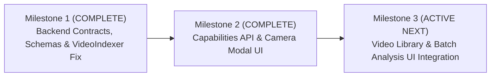

# Architectural Plan: Dynamic Detector & Pipeline Configuration for Dashboard & VMS

## 1. Executive Summary & Problem Diagnosis

When executing the CLI entrypoint:
```bash
python main.py --detector yolov8 --classes person --conf 0.40 --source real
```
the application uses high-accuracy YOLOv8 inference, filters out non-person classes, sets a custom confidence threshold ($0.40$), and automatically detects the first working physical webcam (`source: real`).

In the Web Dashboard (`scripts/run_dashboard.py`), users face four architectural gaps:
1. **Missing UI Controls in Modal**: The "Add / Configure Camera" modal (`dashboard/static/index.html`) lacks inputs for detector architecture, confidence thresholds, target class filters, and quick physical camera selection. While `dashboard/static/camera_manager.js` had code expecting `#cam-detector-select` and `#cam-tracker-select`, those DOM elements were never included in the template and silently fell back to `"mock"`.
2. **Schema & Orchestrator Loss**: Pydantic schemas (`dashboard/schemas.py`) and the `CameraPool` orchestrator (`dashboard/camera_pool.py`) drop `confidence` and `classes` parameters, preventing persistence in `configs/cameras.json`.
3. **Pipeline Factory Dropping Class Filters**: `StreamPipelineFactory._init_detector()` in `dashboard/services/pipeline_factory.py` never passes `classes` to `DetectorFactory.create()`.
4. **Fatal Crash in Batch Video Analysis**: In `dashboard/routers/videos.py`, `/api/videos/{filename}/analyze` attempts to import non-existent `BatchVideoIndexer` instead of `VideoIndexer`, throwing an unhandled `ImportError` (HTTP 500). Furthermore, `/api/videos/{filename}/add_as_camera` hardcodes `detector="mock"`.

---

## 2. 3-Tier Architectural Propositions

```mermaid
flowchart TD
    subgraph Tier1["Tier 1: Pragmatic Baseline"]
        T1A["Hardcode HTML select in modal"] --> T1B["Append fields to CameraAddRequest"]
        T1B --> T1C["Patch videos.py import"]
    end

    subgraph Tier2["Tier 2: Frontier SOTA (Recommended)"]
        T2A["Capabilities Discovery API\n(/api/system/capabilities)"] --> T2B["Contract-Driven Schema & Cascade\n(schemas.py + camera_pool.py + pipeline_factory.py)"]
        T2B --> T2C["Interactive Tag-Pill UI & Live Sliders\n(Presets: real, USB, RTSP | Badges: person, car)"]
        T2C --> T2D["Unified Video Analysis & Feed Promotion\n(Fixed VideoIndexer + parameter forwarding)"]
    end

    subgraph Tier3["Tier 3: Novel Moonshot"]
        T3A["Worker Atomic Lock Exchange"] --> T3B["Zero-Downtime Hot Swapping\n(Swap detector on active stream without restarting pipeline)"]
    end
```



### Tier 1: Pragmatic Baseline (Patch & Glue)
* **Design**: Add static `<select>` elements directly in `dashboard/static/index.html`, add optional `confidence` and `classes` to `CameraAddRequest`, and rename `BatchVideoIndexer` to `VideoIndexer` in `dashboard/routers/videos.py`.
* **Pros**: Minimal diff.
* **Cons**: Frontend options are hardcoded and will drift whenever new detectors (e.g. YOLO11, YuNet, EdgeTPU) or trackers are registered in Python; class selection is limited to raw text input without auto-completion or quick-pills; video feeds still require full stream restart.

### Tier 2: Frontier SOTA (Recommended for Production)
* **Design**:
  1. **Dynamic Capabilities API (`/api/system/capabilities`)**: Expose registered detectors (`DetectorFactory.available()`), trackers, Re-ID extractors, COCO classes, and auto-discovered physical hardware devices.
  2. **End-to-End Contract Propagation**: Propagate `detector`, `confidence`, `classes`, and `tracker` through `CameraAddRequest` / `CameraUpdateRequest` -> `CameraPool` -> `StreamPipelineFactory` -> `DetectorFactory.create()`.
  3. **High-Usability Responsive UI**:
     - Modern detector selector (`yolov8`, `yolo11`, `haar`, `mock`) with badged indicators.
     - Live confidence range slider ($0.05 - 1.00$) paired with an exact numeric input.
     - Tag-pill class selector pre-populated with standard COCO classes with one-click presets (`person`, `vehicles`, `all`).
     - One-click source presets: "Real Physical Camera (`real`)" auto-populates the source input with verified device selection.
  4. **Robust Video Analysis Integration**: Fix `VideoIndexer` integration in `dashboard/routers/videos.py`, allow parameterizing detector, confidence, and classes when running batch analytics or adding video files as live cameras.
* **Pros**: Reusable, DRY, zero drift between Python registry and UI, clean error boundaries, complete parity with `main.py` CLI.
* **Trade-off**: Requires updating 3 backend modules and 2 frontend components.

### Tier 3: Novel Moonshot (Zero-Downtime Hot-Swapping)
* **Design**: Implement in-place atomic detector hot-swapping on `StreamWorker` using a thread-safe model reference swap without tearing down the camera capture handle or MJPEG feed subscribers.
* **Trade-off**: Additional concurrency complexity. Recommended as a future enhancement once Tier 2 contracts are in place.

---

## 3. Quantitative Modularity & SRP Budgets

All file modifications comply with the repository modularity limits:

| Target File | Current Lines | Planned Mod / Lines | Soft Warning (350 L) | Hard Ceiling (500 L) | Compliance Strategy |
| :--- | :--- | :--- | :--- | :--- | :--- |
| `dashboard/schemas.py` | 183 L | +18 L $\rightarrow$ ~201 L | Clean (< 350 L) | Safe (< 500 L) | Add typed Pydantic fields with validation |
| `dashboard/services/pipeline_factory.py` | 270 L | +12 L $\rightarrow$ ~282 L | Clean (< 350 L) | Safe (< 500 L) | Pass `classes` and `conf` to `DetectorFactory` |
| `dashboard/routers/system.py` | 154 L | +26 L $\rightarrow$ ~180 L | Clean (< 350 L) | Safe (< 500 L) | Mount `/api/system/capabilities` |
| `dashboard/routers/videos.py` | 241 L | +24 L $\rightarrow$ ~265 L | Clean (< 350 L) | Safe (< 500 L) | Fix `VideoIndexer` and parameterize endpoints |
| `dashboard/camera_pool.py` | 448 L | +15 L $\rightarrow$ ~463 L | Approaching limit | Safe (< 500 L) | Forward parameters cleanly without expanding class footprint |
| `dashboard/static/camera_manager.js` | 354 L | +35 L $\rightarrow$ ~389 L | Soft Warning | Safe (< 500 L) | Extract capabilities loading into `camera_discovery.js` helper |
| `dashboard/static/index.html` | 1,354 L | +45 L $\rightarrow$ ~1,399 L | Static template | N/A (HTML template) | Clean structural group for AI detection settings |

---

## 4. Vertical Milestones Roadmap

Following the **1-Phase-Per-Turn Execution Gate**, the implementation is structured into 3 atomic milestones:



### Milestone 1: Backend Contracts, Schemas & VideoIndexer Fix (COMPLETE)
- [x] **1.1 Schemas**: Update `CameraAddRequest` and `CameraUpdateRequest` in `dashboard/schemas.py` to accept:
  - `detector: Optional[str] = "yolov8"` (default to `yolov8` with fallback)
  - `confidence: Optional[float] = 0.40`
  - `classes: Optional[List[str]] = None`
- [x] **1.2 CameraPool**: Update `add_camera`, `update_camera`, and `_create_and_register_stream` in `dashboard/camera_pool.py` to persist `confidence` and `classes` in `configs/cameras.json` and propagate them into `custom_cfg["detector"]`.
- [x] **1.3 Pipeline Factory**: Update `_init_detector` in `dashboard/services/pipeline_factory.py` to pass `conf_threshold` and `classes` to `DetectorFactory.create()`.
- [x] **1.4 Video Analysis Bug Fix**:
  - Replace broken `from intelligent_tracker.batch import BatchVideoIndexer` with `from intelligent_tracker.batch import VideoIndexer` in `dashboard/routers/videos.py`.
  - Fix `/api/videos/{filename}/analyze` to instantiate `VideoIndexer` and call `process_video(path)`.
  - Update `/api/videos/{filename}/add_as_camera` to accept `detector`, `confidence`, and `classes` instead of hardcoding `mock`.
- [x] **1.5 Regression & Unit Testing**: Add unit test in `tests/test_camera_detector_config.py` verifying full pipeline wiring and video indexer execution.

### Milestone 2: Capabilities API & Camera Modal UI (COMPLETE)
- [x] **2.1 Capabilities Endpoint**: Implement `GET /api/system/capabilities` in `dashboard/routers/system.py` returning available detectors, trackers, Re-ID models, COCO classes, and source presets.
- [x] **2.2 Modal Form Extension**: In `dashboard/static/index.html` and `dashboard/static/css/camera_ai_config.css`, add the "AI Detector & Tracking Intelligence" fieldset to `#camera-config-form`:
  - Detector dropdown (`#cam-detector-select`)
  - Confidence slider + numeric input (`#cam-conf-input`) with bidirectional sync
  - Target classes input with quick tag buttons (`person`, `vehicles`, `security`, `all`) (`#cam-classes-input`)
  - Tracker dropdown (`#cam-tracker-select`)
  - Quick-preset button for "Real Physical Webcam (`real`)"
- [x] **2.3 Camera Manager Wiring**: Created `dashboard/static/js/camera_ai_config.js` and updated `dashboard/static/camera_manager.js` to serialize and populate the new detection configuration fields during camera creation, editing, and listing.
- [x] **2.4 SortTracker Interop & Full Unit Suite**: Normalized keyword arguments between `CentroidTracker` and `SortTracker` (`max_age` / `max_disappeared`) in `dashboard/services/pipeline_factory.py` and `SortTracker.__init__`. Verified 8/8 tests in `test_camera_detector_config.py` and 317/317 tests in full test suite.

### Milestone 3: Video Library & Batch Analysis UI Integration (Deferred to Turn 3)
- [x] **3.1 Video Batch UI**: Update `dashboard/static/index.html` and `dashboard/static/js/video_batch.js` to expose detector, confidence, and class selection controls when running offline batch analytics on recorded videos.
- [x] **3.2 Feed Promotion Modal**: Allow users to select detector model and target classes when clicking "Add as Active Camera Feed" from an uploaded video.
- [x] **3.3 End-to-End Verification**: Verify full workflow via automated test suite and live browser inspection.

---

## 5. Scenario Combinations Matrix

| Scenario ID | Video Source | Detector | Confidence | Target Classes | Expected Behavior | Verification Target |
| :--- | :--- | :--- | :--- | :--- | :--- | :--- |
| **SC-01** | `real` / `auto` | `yolov8` | `0.40` | `["person"]` | Connects first physical camera; detects only persons with conf $\ge 0.40$ | `tests/test_camera_detector_config.py` |
| **SC-02** | `0` (USB) | `mock` | `0.25` | `None` | Connects device index 0; emits synthetic mock tracks (backward compatible) | `tests/test_camera_detector_config.py` |
| **SC-03** | `video_file.mp4` | `yolov8` | `0.50` | `["person", "car"]` | Loops video file with YOLOv8 filtering persons and vehicles | `tests/test_camera_detector_config.py` |
| **SC-04** | `video_file.mp4` | Batch Analysis | `0.30` | `["person"]` | Runs `VideoIndexer.process_video()`, writes to `TrackerDB`, returns report | `tests/test_batch_api.py` |
| **SC-05** | `rtsp://...` | `yolo11` | `0.45` | `["person"]` | Configures YOLO11 stream with person filtering | `tests/test_camera_detector_config.py` |

---

## 6. Verification Commands (OS-Agnostic)

```bash
# Run unit tests in headless Agg mode
$env:MPLBACKEND="Agg"; .\.venv\Scripts\python.exe -m unittest discover tests

# Fast AST validation on modified files
python -c "import ast; [compile(open(f, encoding='utf-8').read(), f, 'exec') for f in ['dashboard/schemas.py', 'dashboard/camera_pool.py', 'dashboard/services/pipeline_factory.py', 'dashboard/routers/videos.py']]"
```
