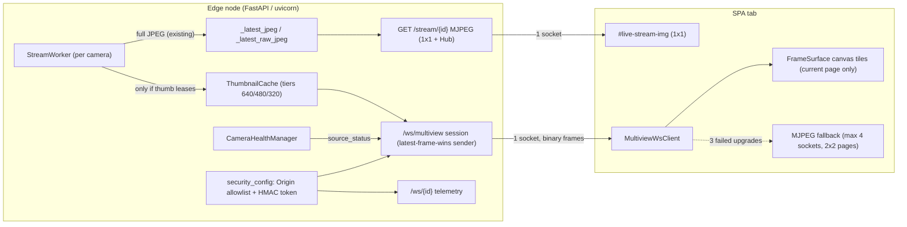

# Multi-View WebSocket Streaming & Grid Scalability Plan (Child Plan A)

> Parent: `.TODO/realtime_multiview_master_roadmap.md` (Step 1). Decisions Q1–Q9 are recorded in the parent Decision Log.
> Goal: any number of cameras (target: 100) in 1x1 / 2x2 / 3x3 / 4x4 views without exhausting the browser's 6-socket HTTP/1.1 pool, starving Video Studio, or waking inference — while staying compatible with `documentation/enterprise_hub_integration.rst`.

## 1. Empirical Baseline (2026-11-16)

| # | Symptom | Evidence | Root Cause | Location |
|---|---|---|---|---|
| 1 | `1x1 → 2x2 → 1x1` leaves 1x1 black; Video Studio and `fetch()` stall | Headless CDP probe: `after_2x2` = 6 live grid ``; `after_1x1` = `liveImg.complete:false, 0x0`, `fetch('/api/system/processing-mode')` → `FETCH_TIMEOUT_3S` | `renderGrid()` clears `innerHTML` without resetting tile `img.src` to standby, so the multipart sockets keep draining | `dashboard/static/js/camera_grid.js#L108-L115` |
| 2 | Grid opens one MJPEG per enabled camera (6 today, 100 at scale) | `renderGrid()` maps all `activeCameras`; CSS `overflow:hidden` hides extras while streams stay alive | No pagination and no socket budget | `dashboard/static/js/camera_grid.js#L102-L126`, `dashboard/static/css/vms_grid.css#L71-L90` |
| 3 | `VideoSource '2': … reconnect exhausted` missing from `.diagnostics/traces/` | Terminal shows error; `trace_catalog.json` has no entry | Bridge only captures unhandled exceptions, not `logging.ERROR` | `dashboard/services/diagnostic_bridge.py#L42-L89` |
| 4 | Any site can open `/ws/{camera_id}` | `await websocket.accept()` with no `Origin` check; CORS `*` + credentials | Missing handshake validation | `dashboard/routers/streaming.py#L136`, `dashboard/app.py#L204-L210` |
| 5 | Plain HTTP/1.1 only, no proxy-header trust | `uvicorn.run(...)` without TLS/`proxy_headers` | HTTP/2 impossible in browsers without TLS; Hub reverse proxy loses client IP/scheme | `dashboard/server.py#L116` |

## 2. Target Architecture

### 2.1 Socket Budget (per SPA tab, any camera count)

| View | WebSocket | MJPEG | Free for `fetch()`/MP4 |
|---|---|---|---|
| 1x1 | 0–1 (idle, 0 subscriptions) | 1 | ≥ 4 |
| 2x2 / 3x3 / 4x4 (WS mode) | 1 | 0 | ≥ 5 |
| Grid (fallback mode) | 0 | ≤ 4 | ≥ 2 |
| Video Studio / other tabs | 0–1 (unsubscribed, closes after 30 s idle) | 0 | ≥ 5 |

### 2.2 `/ws/multiview` Protocol v1

**Binary server→client frame** (big-endian):

| Offset | Size | Field |
|---|---|---|
| 0 | 1 | `version` = `0x01` |
| 1 | 1 | `kind` = `0x01` (JPEG frame); other values reserved |
| 2 | 2 | `cam_id_len` (uint16) |
| 4 | 4 | `seq` (uint32, monotonic per camera, wraps) |
| 8 | 8 | `capture_ts_ms` (uint64) |
| 16 | `cam_id_len` | `camera_id` (UTF-8) |
| 16+len | rest | JPEG bytes |

**JSON text control frames.** Client→server: `{"v":1,"action":"subscribe","cameras":[...],"layout":"3x3","profile":"thumb","max_fps":10,"max_width":480}` (this replaces the full set; it is not additive) · `unsubscribe_all` · `pause` · `resume` · `ping`.
Server→client: `hello` (`protocol`, `limits`, `layouts`) · `subscribed` (`accepted`, `rejected` with reason, clamped `fps`/`width`) · `source_status` (`camera_id`, `status` ∈ `online|hibernating|reconnecting|error|offline|disabled`, `reason`) · `pong` · `error` (`code`, `message`).
`profile:"full"` is reserved in v1 (the server answers `rejected: profile_not_enabled`) for the future 1x1 migration.

### 2.3 Server Limits (env-configurable; defaults)

| Setting | Default | Purpose |
|---|---|---|
| `MULTIVIEW_LAYOUT_CAPS` | `2x2:15:640,3x3:10:480,4x4:6:320` | Per-layout FPS / max width ceilings (Q4) |
| `MULTIVIEW_MAX_SUBSCRIPTIONS` | `16` | Cameras per session (4x4) |
| `MULTIVIEW_MAX_SESSIONS` | `16` | Concurrent sessions per node (more are rejected with close code `1013`) |
| `MULTIVIEW_SEND_TIMEOUT_S` | `0.5` | Per-frame send deadline; on timeout the frame is skipped and the session flagged slow |
| `MULTIVIEW_THUMB_QUALITY` | `70` | Thumbnail JPEG quality |
| `ALLOWED_ORIGINS` | `""` (same-origin only) | Comma-separated extra origins (e.g. the Hub) |
| `MULTIVIEW_TOKEN_SECRET` | `""` (disabled) | Turns on HMAC-signed `?token=` (`exp` ≤ 300 s) for proxied/cross-origin use |
| `FORWARDED_ALLOW_IPS` | `""` (uvicorn default) | Trusted reverse-proxy IPs for `X-Forwarded-*` |

## 3. Invariants & Edge Cases (each one has a test)

| # | Edge Case | Required Behavior | Verified By |
|---|---|---|---|
| E1 | Rapid `1x1↔2x2↔3x3↔4x4` / page clicks | Every subscribe is a full replacement; leases for dropped cameras are released immediately (`remove_subscriber`); grid teardown always resets tile sources (no zombie MJPEG) | `test_multiview_session.py`, Node VM grid tests, CDP repro |
| E2 | Slow client / backgrounded tab | No per-session frame queue: the sender reads the latest cached thumbnail; sends past `SEND_TIMEOUT` are skipped; `document.hidden` → `pause` (leases released) | `test_multiview_session.py::test_slow_send_skips` |
| E3 | Out-of-order `createImageBitmap` | `FrameSurface` drops any decode whose `seq` ≤ last drawn (wrap-aware); `bitmap.close()` in `finally` | Node VM `test_frame_surface_*` |
| E4 | Grid wakes cameras but never inference | `should_run_vision_step()` is the same with and without thumbnail leases in every mode | `test_processing_mode_invariants.py` |
| E5 | Off-page cameras | Released leases → re-hibernate after `lease_ttl` (3.0 s) in `focus_only`/`capture_only`; `full_realtime` pooled and `armed` cameras never hibernate; recording always overrides | `test_processing_mode_invariants.py` |
| E6 | `paused` mode vs `armed` | `paused` is an explicit operator override: armed cameras also hibernate (unless recording); the UI shows "N armed cameras paused" in the paused overlay | Unit test + UI test |
| E7 | Camera drop / reconnect storm (`VideoSource '2'`) | `source_status` sent only when the status changes (no repeat sends); the tile shows a status poster; `DiagnosticLogHandler` records ≤ 1 trace per key per 60 s | `test_diagnostic_log_handler.py`, session test |
| E8 | Unknown / disabled / removed camera in subscribe | Returned in `rejected` with a reason; other cameras unaffected; camera deleted mid-session → `source_status: offline` and its lease dropped | Session test |
| E9 | Thumbnail encode cost | Encode only when the camera has ≥ 1 thumb lease for that tier; at most 3 tiers; source = annotated frame if the worker already rendered one this tick, else raw (never extra overlay renders) | `test_thumbnail_cache.py` |
| E10 | Proxy strips `Upgrade` / 403 / 426 / 502 | Client fallback after 3 consecutive failures → MJPEG mode forced to 2x2 pages (≤ 4 sockets), "Degraded transport" badge, background WS retry (1 s → 60 s), automatic restore | Node VM `test_multiview_client_fallback_*` |
| E11 | Cross-site WebSocket hijacking | Handshake rejected (close `1008`) when the `Origin` is not same-origin and not in `ALLOWED_ORIGINS`; token required when `MULTIVIEW_TOKEN_SECRET` is set; applies to `/ws/{id}` too | `test_security_config.py`, router tests |
| E12 | Server shutdown / reload | Sessions observe the shutdown event, release all leases, and close with `1001`; no orphan sender tasks | Session test with shutdown event |
| E13 | Session cap exceeded | New session closed with `1013`; the client treats it as retryable (no immediate fallback) | Router test |
| E14 | Page index out of range after a camera is removed or the layout changes | Pagination clamps to the last valid page; state persisted in `localStorage` (`it_grid_layout`, `it_grid_page`) | Node VM pagination tests |
| E15 | Multiple tabs / Hub viewers | Each tab = 1 session; thumbnails are shared per camera/tier, so N viewers cost N sends and 0 extra encodes | Thumbnail cache test |

## 4. Modularity Placement (Split-Before-You-Grow)

Audited 2026-11-16: `StreamSubscriberRegistry` = 12 methods (at ceiling), `StreamSubscriberMixin` ≥ 12, `ProcessingModeService` = 11, `camera_manager.js` = 364 L (warning), `stream_worker.py` = 284 L, `app.py` = 298 L, `streaming.py` = 167 L.
- **No new methods** on `StreamSubscriberRegistry`, `StreamSubscriberMixin` or `ProcessingModeService`; extend `should_hibernate_camera(..., is_armed=False)` via a keyword parameter only.
- New backend package `dashboard/services/multiview/` (`protocol.py`, `thumbnail_cache.py`, `session.py`, `limits.py`) + thin router `dashboard/routers/multiview.py`.
- New `dashboard/services/security_config.py`, `dashboard/services/diagnostic_log_handler.py`.
- New frontend modules `dashboard/static/js/multiview/{protocol,frame_surface,multiview_client}.js`, `dashboard/static/js/grid_pagination.js`, styles in `dashboard/static/css/grid_pagination.css`. No additions to `camera_manager.js` or `app.js`.

## 5. Milestones

### Milestone 1: Grid Stabilization, Pagination, MJPEG Socket Budget & Diagnostics Bridge
Ships the immediate fix for the black-screen bug. The MJPEG budget logic built here becomes the Milestone 4 fallback mode, so none of it is throwaway.
- [x] **dashboard/static/js/camera_grid.js**: Call `window.LivePlayer?.detachGridStreams?.()` before every `innerHTML` teardown (1x1 switch and tile rebuild); render only the current page (via `GridPagination`); add `4x4` layout; MJPEG budget = 4 live tiles per page, the rest show a standby poster with a "View" action (until Milestone 4 replaces them with canvas tiles).
- [x] **dashboard/static/js/grid_pagination.js**: Pure page-state module (`pageSize` per layout 4/9/16, clamp on camera list change, Prev/Next, persisted to `localStorage` keys `it_grid_layout`/`it_grid_page`).
- [x] **dashboard/static/partials/tabs/live.html** + **dashboard/static/css/grid_pagination.css** + **dashboard/static/css/vms_grid.css**: Pagination controls (Prev / "Page x of y" / Next, ≥ 32 px targets, ≥ 8 px gaps, no `!important`), `.grid-4x4`, `4x4` switch button; link the new CSS/JS in `dashboard/static/index.html`.
- [x] **dashboard/services/diagnostic_log_handler.py**: `DiagnosticLogHandler(logging.Handler)`: ERROR+ from `intelligent_tracker.*`/`dashboard.*`, dedup key `(logger, message[:80])`, ≤ 1 trace per key per 60 s, never raises; installed in app lifespan next to `init_diagnostic_tracer`, removed on shutdown.
- [x] **tests/test_grid_pagination.py**, **tests/test_camera_grid_teardown.py** (Node VM, ≤ 40 L per method), **tests/test_diagnostic_log_handler.py** (temp workspace root, no live `.diagnostics/` writes).
- [x] **Definition of Done**: CDP repro `1x1→2x2→1x1` restores 1x1 at 640x360 and `fetch` < 2 s; with 6 cameras, 3x3 holds ≤ 4 MJPEG sockets; full suite green; `diagnose.py audit` passes on all touched files.

### Milestone 2: WebSocket Security, Protocol Contract & `armed` Policy *(Deferred)*
- [x] **dashboard/services/security_config.py**: `parse_allowed_origins()`, `is_origin_allowed(origin, host_header, allowlist)`, `sign_token()/verify_token()` (HMAC-SHA256, `exp`), all from env with empty-string defaults.
- [x] **dashboard/routers/streaming.py**: Origin/token check before `accept()` on `/ws/{camera_id}` (close `1008`).
- [x] **dashboard/app.py** + **dashboard/server.py**: CORS `allow_origins` from the allowlist (same-origin by default); `proxy_headers=True`, `forwarded_allow_ips` from `FORWARDED_ALLOW_IPS`.
- [x] **dashboard/services/multiview/protocol.py** + **limits.py**: Pure pack/unpack of the v1 header, control-message validation, layout caps parsing/clamping.
- [x] **dashboard/services/camera_config_store.py** + **dashboard/services/processing_mode_service.py** + callers (`stream_worker.py#L112`, `stream_pool_coordinator.py#L234`, `processing_mode_service.py#L121,L138`): `armed: bool = False` in the camera schema; `should_hibernate_camera(..., is_armed=False)`: armed never hibernates except in `paused` (E6).
- [x] **tests/test_security_config.py**, **tests/test_multiview_protocol.py**, **tests/test_processing_mode_invariants.py** (E4/E5/E6 across all 4 modes; every branch).

### Milestone 3: Backend `/ws/multiview` Engine (Thumbnail Cache + Sessions) *(Deferred)*
- [ ] **dashboard/services/multiview/thumbnail_cache.py**: Per-camera `ThumbnailCache` with tier leases (640/480/320), FPS gate, `(seq, ts_ms, bytes)` slots; worker hook in `stream_worker.py` (≤ 6 added lines) after the existing encode step; annotated-if-available source (E9).
- [ ] **dashboard/services/multiview/session.py**: `MultiviewSession`: replace-set subscriptions, `mgr.add_subscriber`/`heartbeat`/`remove_subscriber` leases, frame-waiter wakeups, latest-frame-wins sender with `SEND_TIMEOUT`, `source_status` change detection, pause/resume, shutdown-event teardown (E1, E2, E7, E8, E12).
- [ ] **dashboard/routers/multiview.py**: Thin handler (≤ 25 L): security check → session cap → `session.run()`; mounted in `dashboard/app.py`.
- [ ] **tests/test_thumbnail_cache.py**, **tests/test_multiview_session.py**, **tests/test_multiview_router.py** (synthetic frames / mock detector only; `TestClient` WebSocket; temp `cameras.json` with `enabled=False` seeds).

### Milestone 4: Frontend Client, Canvas Tiles, Fallback, Docs & E2E *(Deferred)*
- [ ] **dashboard/static/js/multiview/protocol.js** + **frame_surface.js** + **multiview_client.js**: Header parsing; `FrameSurface` (seq gating, `bitmap.close()` in `finally`, DPR-aware `ResizeObserver`, status posters); `MultiviewWsClient` (lazy connect, replace-set subscribe, `unsubscribe_all` outside the grid, 30 s idle close, `pagehide` close, visibility pause/resume, exponential backoff, 3-failure fallback + auto-restore, `1013` treated as retryable).
- [ ] **dashboard/static/js/camera_grid.js** + **live_player.js**: WS mode renders `<canvas>` tiles via `FrameSurface`; fallback mode reuses the Milestone 1 MJPEG budget (forced 2x2 pages); "Degraded transport" badge; tab sync calls `unsubscribe_all`.
- [ ] **documentation/enterprise_hub_integration.rst** + **documentation/multiview_streaming.rst**: `/ws/multiview` v1 contract, Origin/token config, reverse-proxy recipe (Caddy/Nginx TLS → HTTP/2 + WebSocket `Upgrade` forwarding), socket budget table; `sphinx -W` clean.
- [ ] **tests/test_frame_surface.py**, **tests/test_multiview_client.py** (Node VM, ≤ 40 L per method) + CDP E2E: `1x1↔2x2↔3x3↔4x4↔Video Studio`, pagination, forced WS failure → fallback → restore.
- [ ] **CHANGELOG.md** via `diagnose.py changelog add`; **AGENTS.md** §7/§12: add the multiview invariants (socket budget, viewing ≠ analytics).

## 6. Scenario Combinations Matrix

| Scenario | Command | Expected |
|---|---|---|
| Full suite (headless) | `MPLBACKEND=Agg python -m unittest discover tests` | 100% green |
| Milestone 1 targeted | `python -m unittest tests.test_grid_pagination tests.test_camera_grid_teardown tests.test_diagnostic_log_handler` | Green |
| Modularity audit | `python "<config_dir>/skills/system-diagnostics/scripts/diagnose.py" audit --path <touched files>` | PASS, < 350 L, ≤ 40 L/function |
| Grid repro (CDP) | `python "<config_dir>/skills/app-debugger/scripts/run_diagnose.py" ui --headless --eval-file <scratch>/repro_grid.js` | 1x1 restored 640x360; `fetch` < 2 s |
| Origin rejection (Milestone 2+) | WebSocket connect to `/ws/<camera_id>` with `Origin: https://evil.example` | Closed `1008` |
| Fallback (Milestone 4) | Set `MULTIVIEW_MAX_SESSIONS=0` (forces `1013`) or block the upgrade in a proxy | Badge shown, ≤ 4 MJPEG sockets, auto-restore when unblocked |
| Docs | `python -m sphinx -W --keep-going documentation/ documentation/_build/html/` | 0 warnings |

## 7. Out of Scope (tracked elsewhere)

- Inference priorities, motion gating, GPU budget, alarm SLA → `.TODO/resource_aware_analytics_scheduler.md`.
- Moving 1x1 onto `/ws/multiview` (`profile:"full"`) and WebRTC/H.264 → future opt-in milestone; protocol v1 already reserves it.
