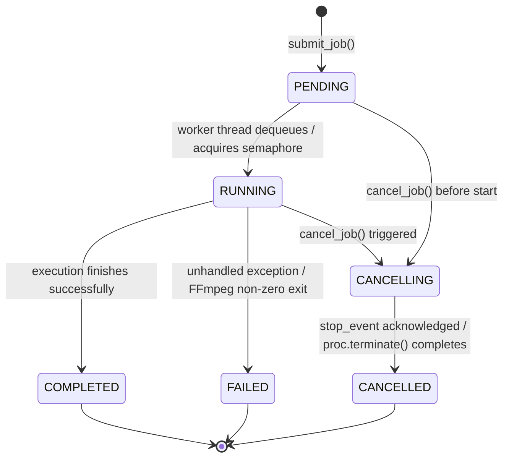

# Implementation Plan: Video Processing Concurrency, Progress Engine & Interactive Cancellation

## Executive Summary
This plan addresses concurrency collisions, lack of progress visibility, and cross-video state leaks when running **⚡ Batch Video Analytics** and **⚡ Convert to H.264** transcoding in the Intelligent Tracker Video Studio.

By introducing an asynchronous **`VideoJobManager`** backend service, non-blocking polling and cancellation endpoints, and a dedicated **`VideoJobClient`** frontend coordinator, the system guarantees:
1. **Per-Video State Awareness**: Switching videos dynamically updates controls and progress indicators without cross-contamination.
2. **Interactive Cancellation Prompts**: Clicking an action while a job is running opens a modal displaying current progress with options to cancel or keep running.
3. **Real-Time Progress & Progress Bars**: Live percentage, frame count, elapsed time, and direct cancel buttons for both transcoding and analytics.
4. **Resilient Error Alerting**: Immediate, actionable error diagnostics when FFmpeg or AI detection fails.
5. **System Concurrency Guard**: Max 1 heavy task per video file, max 2 concurrent heavy jobs system-wide to prevent CPU/GPU starvation.

---

## 1. Architectural Surface Invariants & Quantitative Modularity Budgets

### Quantitative Modularity Ceilings
All modified and newly created files will strictly adhere to the project's modularity guidelines ($\le 350$ lines soft warning, $\le 500$ lines hard ceiling, $\le 10–12$ methods per class, $\le 40$ lines per method):

| Target File | Current Lines | Planned Net Change | Projected Lines | Status | Action |
| :--- | :--- | :--- | :--- | :--- | :--- |
| `intelligent_tracker/batch.py` | 343 | +35 | ~378 | Healthy ($\le 500$) | Add `progress_callback` & `stop_event` parameters to `process_video` |
| `dashboard/services/video_transcoder.py` | 112 | +60 | ~172 | Healthy ($\le 300$) | Add progress parsing & async subprocess cancellation |
| `dashboard/services/video_jobs_service.py` *(New)* | 0 | +220 | ~220 | Healthy ($\le 300$) | Cohesive job ledger & worker thread manager ($\le 10$ methods) |
| `dashboard/routers/videos.py` | 306 | +40 | ~346 | Healthy ($\le 350$) | Connect job manager endpoints, return 202 Accepted & 409 Conflict |
| `dashboard/static/js/video_jobs.js` *(New)* | 0 | +240 | ~240 | Healthy ($\le 300$) | Modular client-side job tracker & modal UX |
| `dashboard/static/js/video_batch.js` | 263 | +25 | ~288 | Healthy ($\le 350$) | Wire into `VideoJobClient` |
| `dashboard/static/js/video_library.js` | 201 | +25 | ~226 | Healthy ($\le 350$) | Wire transcode into `VideoJobClient` |
| `dashboard/static/video_scrubber.js` | 366 | +20 | ~386 | Soft Warning ($\le 500$) | Synchronize UI state on video switch |
| `tests/test_video_jobs.py` *(New)* | 0 | +280 | ~280 | Healthy ($\le 350$) | Exhaustive unit & integration tests |

---

## 2. State Machine & Thread Safety Specification

### Job Lifecycle State Machine



### Thread Safety, Process Lifecycle & Locking Invariants
1. **Zero Lock Holding Across Blocking Operations**:
   - `VideoJobManager` maintains an internal `threading.Lock()` strictly for mutating the job ledger and queue data structures.
   - Subprocess execution (`proc.wait()`), worker joining (`thread.join()`), and file I/O operations MUST execute outside the lock.
2. **Interruptible Worker Sleeps**:
   - In accordance with AGENTS.md Rule 8, no worker loop may use `time.sleep()`. All backoffs or waits must use `stop_event.wait(timeout=...)` to guarantee sub-10ms shutdown.
3. **Windows & POSIX Subprocess Lifecycle**:
   - In `transcode_to_h264_async`, FFmpeg is spawned via `subprocess.Popen` with `stdout=subprocess.PIPE, stderr=subprocess.PIPE`.
   - On Windows, `creationflags=subprocess.CREATE_NEW_PROCESS_GROUP` ensures clean process signaling without killing the main Python runtime.
   - Cancellation issues `proc.terminate()`, waits up to 2.0s with `stop_event.wait(0.1)`, and issues `proc.kill()` if the process fails to exit.
4. **Memory Retention & In-Memory TTL**:
   - Completed/Cancelled/Failed jobs are retained in-memory for a maximum of 1 hour or 100 entries, pruned automatically on new job submissions.

---

## 3. Symptom-to-Root-Cause Matrix

| # | Symptom Reported by User | Root Cause in Codebase | Target Resolution | Verification Method |
|---|---|---|---|---|
| **S1** | User can click both "Batch Video Analytics" and "Convert to H.264" simultaneously. | Synchronous endpoints in `dashboard/routers/videos.py` executed without mutex or task ledger. | `VideoJobManager` enforces mutual exclusion per video; returns 409 Conflict with active job metadata. | Start transcode, attempt analytics click -> Assert 409 Conflict returned and confirmation modal appears. |
| **S2** | Zero progress visibility for both transcoding and analytics. | `VideoIndexer.process_video` and `VideoTranscodeService.transcode_to_h264` lacked progress callbacks and exposed no polling state. | Added `progress_callback` to `VideoIndexer` (every 10 frames) and FFmpeg stdout `-progress` parser; polled every 1000ms. | Trigger job -> Assert DOM progress bar updates smoothly from 0% to 100%. |
| **S3** | Changing videos keeps buttons stuck on "Processing..." or allows blind re-clicks. | `dashboard/static/video_scrubber.js#loadVideoIntoPlayer` resets button states globally without querying active video tasks. | `loadVideoIntoPlayer` checks `VideoJobClient.getActiveJob(filename)`; displays background task pill if another video is processing. | Switch from running Video A to idle Video B -> Assert Video B buttons reset; return to Video A -> Assert progress restored. |
| **S4** | No error alert when conversion or batch analytics fails. | Failure handlers only print to console or set basic text with no dismissible alert or details. | Standardized `ErrorAlert` component displaying detailed exception message with Retry button. | Mock worker failure -> Assert structured error banner rendered. |
| **S5** | Inability to cancel long-running processes or prompt user on re-click. | No `stop_event` or FFmpeg process handle termination; no interactive cancellation modal. | Subprocess `.terminate()` + `stop_event.set()` exposed via `POST /api/videos/jobs/{job_id}/cancel`. | Click cancel -> Assert worker exits within 500ms and UI updates to "Cancelled". |

---

## 4. Component Interfaces & API Contracts

### Backend Services

#### `intelligent_tracker/batch.py`
```python
def process_video(
    self,
    video_path: str,
    source_label: Optional[str] = None,
    max_frames: int = 0,
    verbose: bool = True,
    progress_callback: Optional[Callable[[Dict[str, Any]], None]] = None,
    stop_event: Optional[threading.Event] = None,
) -> Dict[str, Any]:
    ...
```
- Calls `progress_callback({
    "read_frames": read_frames,
    "total_frames": total_frames,
    "processed_frames": processed_frames,
    "percent": round(pct, 1),
    "fps": round(fps_eff, 1),
    "sightings": matched_identifications,
    "elapsed": round(elapsed, 1),
  })` every 10 frames or at least every 0.25s.
- Checks `if stop_event is not None and stop_event.is_set(): summary["cancelled"] = True; break`.

#### `dashboard/services/video_transcoder.py`
```python
@staticmethod
def transcode_to_h264_async(
    input_path: str,
    output_path: str,
    target_resolution: Optional[str] = "1080p",
    progress_callback: Optional[Callable[[Dict[str, Any]], None]] = None,
    stop_event: Optional[threading.Event] = None,
    proc_holder: Optional[Dict[str, Any]] = None,
) -> bool:
    ...
```
- Launches FFmpeg with `-progress pipe:1 -nostats`.
- Parses stdout for `out_time_ms`, `frame`, `fps`, and computes percentage against input video duration.
- Reacts to `stop_event.is_set()` by terminating `proc`.

#### `dashboard/services/video_jobs_service.py`
```python
class JobStatus(str, Enum):
    PENDING = "pending"
    RUNNING = "running"
    COMPLETED = "completed"
    CANCELLED = "cancelled"
    FAILED = "failed"

@dataclass
class VideoJob:
    job_id: str
    job_type: str  # "transcode" | "analytics"
    filename: str
    status: JobStatus
    progress: float  # 0.0 to 100.0
    stage: str
    metrics: Dict[str, Any]
    error: Optional[str] = None
    result: Optional[Dict[str, Any]] = None
    created_at: float = field(default_factory=time.time)
    started_at: Optional[float] = None
    completed_at: Optional[float] = None

class VideoJobManager:
    def submit_job(self, job_type: str, filename: str, **kwargs) -> VideoJob: ...
    def get_job(self, job_id: str) -> Optional[VideoJob]: ...
    def get_active_job_for_file(self, filename: str) -> Optional[VideoJob]: ...
    def list_jobs(self, filename: Optional[str] = None, active_only: bool = False) -> List[VideoJob]: ...
    def cancel_job(self, job_id: str) -> bool: ...
    def shutdown(self) -> None: ...
```

### REST Endpoints (`dashboard/routers/videos.py`)
- `POST /api/videos/{filename}/transcode`: Submits transcode job. Returns 202 Accepted `{ "status": "accepted", "job_id": "...", "job": {...} }`. If a job is active for this filename, returns 409 Conflict `{ "error": "conflict", "message": "...", "active_job": {...} }`.
- `POST /api/videos/{filename}/analyze`: Submits analytics job. Returns 202 Accepted. If conflicting, returns 409 Conflict with active job.
- `GET /api/videos/jobs/{job_id}`: Returns `VideoJob` details.
- `GET /api/videos/jobs?filename={filename}&active_only=true`: Lists jobs.
- `POST /api/videos/jobs/{job_id}/cancel`: Cancels running/pending job. Returns 200 OK `{ "status": "cancelling", "job_id": "..." }`.

---

## 5. Detailed Implementation Roadmap

### Phase 1: Core Worker Cancellation & Progress Hooks
- [x] **`intelligent_tracker/batch.py`**: Add `progress_callback` & `stop_event` parameters to `VideoIndexer.process_video`, handle cancellation breaks cleanly with `cancelled: True` in summary, and invoke `progress_callback` every 10 frames or 0.25s with read frames, total frames, percent, fps, and sightings.
- [x] **`dashboard/services/video_transcoder.py`**: Add `transcode_to_h264_async` supporting FFmpeg subprocess spawning with `-progress pipe:1`, background stdout parser for `out_time_ms`/`frame`, periodic invocation of `progress_callback({"percent": pct, "elapsed": elapsed, "fps": fps})`, and process `.terminate()` upon `stop_event.is_set()`.
- [x] **`tests/test_video_jobs.py`**: Add unit tests for `VideoIndexer` cancellation/progress callback and `transcode_to_h264_async` in `tests/test_video_jobs.py`.

### Phase 2: Asynchronous `VideoJobManager` Service & REST Endpoints
- [x] **`dashboard/services/video_jobs_service.py`**: Implement `VideoJob` dataclass/model and `VideoJobManager` singleton with concurrency throttle (`active_semaphore = threading.BoundedSemaphore(2)`), per-video mutual exclusion, background thread execution, cancellation hooks, and job status querying.
- [x] **`dashboard/routers/videos.py`**: Refactor `/transcode` and `/analyze` endpoints to return 202 Accepted with `job_id`; add `GET /api/videos/jobs/{job_id}`, `GET /api/videos/jobs`, and `POST /api/videos/jobs/{job_id}/cancel`. Return 409 Conflict on simultaneous jobs for the same file.
- [x] **`tests/test_video_jobs.py`**: Extend `tests/test_video_jobs.py` to cover REST endpoints, concurrency cap enforcement, 409 conflict detection, and status polling.

### Phase 3: Frontend Client, Progress UI & Interactive Cancellation Modal
- [x] **`dashboard/static/js/video_jobs.js`**: Implement `VideoJobClient` coordinator (polling, state management per video, confirmation modals, inline progress bar rendering, error alert banners).
- [x] **`dashboard/static/index.html`**: Include `<script src="/static/js/video_jobs.js"></script>` before dependent video scripts.
- [x] **`dashboard/static/js/video_batch.js`**: Wire "⚡ Run Batch Analytics" through `VideoJobClient` with active job checking, cancellation confirmation prompt, inline progress, and error display.
- [x] **`dashboard/static/js/video_library.js`**: Wire "⚡ Convert to H.264" through `VideoJobClient` with active job checking and inline banner progress.
- [x] **`dashboard/static/video_scrubber.js`**: In `loadVideoIntoPlayer`, sync UI state for selected video, display background task pill when another video is running, and prevent cross-video state leaks.
- [x] **`tests/test_video_jobs.py`**: Verify complete test suite pass, clean Sphinx docs build, and assert UI script syntax and integration contracts.

---

## 6. Scenario Combinations Matrix (Executable Verification)

| Case ID | Scenario Description | Initial State | Trigger Action | Expected Outcome | Verification Command |
|---|---|---|---|---|---|
| **SC-01** | Start Transcode & Track Progress | Video file uncompressed (HEVC) | Click "⚡ Convert" | Returns `job_id`, progress bar advances 0% -> 100%, button says "Converting...", output file created | `.\.venv\Scripts\python.exe -m unittest tests/test_video_jobs.py` |
| **SC-02** | Start Batch Analytics & Track Progress | Synthetic MP4 file loaded | Click "⚡ Run Batch Analytics" | Returns `job_id`, progress bar counts frames/sightings, finishes with complete Occurrence Report Card | `.\.venv\Scripts\python.exe -m unittest tests/test_video_jobs.py` |
| **SC-03** | Conflict Resolution Prompt | Video A is transcoding (30%) | Click "⚡ Run Batch Analytics" on Video A | Confirmation modal pops up: *"Transcode in progress (30%). Cancel and start analytics?"* | Browser / Unit test asserting 409 Conflict with active job metadata |
| **SC-04** | User Confirms Cancellation | Video A is analyzing (50%) | In confirm modal, click "Cancel & Proceed" | Running worker terminates within 500ms; new job starts cleanly | Unit test checking cancellation and state transition |
| **SC-05** | User Retains Current Job | Video A is analyzing (50%) | In confirm modal, click "Keep Running" | Modal closes; analytics continues without interruption | Browser DOM check |
| **SC-06** | Video Switch UI Isolation | Video A is analyzing | Select Video B in recordings list | Video B buttons show normal idle state; global banner displays "Video A analyzing (50%)" | Unit test & DOM state test |
| **SC-07** | Return to Processing Video | Video A is analyzing; user is on Video B | Select Video A in recordings list | Video A immediately displays its active progress bar and "Processing..." button state | Unit test & DOM state test |
| **SC-08** | Worker Failure Alert | Video file corrupted / invalid | Trigger transcode on invalid file | Job transitions to `FAILED`; UI renders error alert with failure reason and Retry button | Unit test asserting failure response & error message |
| **SC-09** | Concurrency Cap Enforcement | 2 heavy jobs already running | Attempt 3rd job on Video C | Job enters `PENDING` queue or rejects gracefully with concurrency throttle notice | Unit test asserting concurrency cap of 2 |
| **SC-10** | Video Deletion with Active Job | Video A is running job | Delete Video A | Active job cancelled automatically before file deletion | Unit test asserting job cancellation upon file deletion |

---

## 7. Non-Destructive Plan & Verification Commands

All changes are strictly additive:
- Existing synchronous query endpoints will maintain backward compatibility or return job descriptors.
- Full regression test command:
  ```powershell
  $env:MPLBACKEND="Agg"; .\.venv\Scripts\python.exe -m unittest discover tests
  ```
- Dedicated new unit test suite:
  ```powershell
  $env:MPLBACKEND="Agg"; .\.venv\Scripts\python.exe -m unittest tests/test_video_jobs.py
  ```
