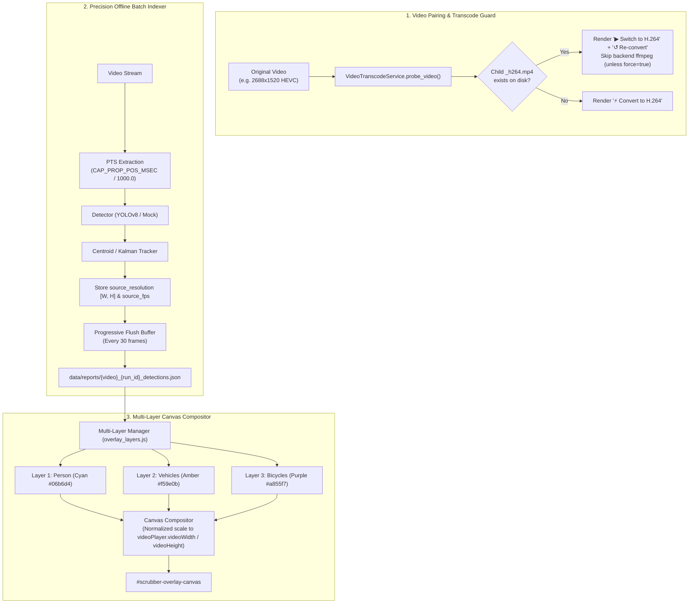

# Video Studio SOTA Analytics, Multi-Layer Overlay & Codec Pairing Architecture Plan (V2)

## 1. Executive Summary & Problem Breakdown

This architecture plan elevates the Video Studio subsystem to state-of-the-art (SOTA) operational quality, addressing the 5 core user-reported defects and usability gaps when pairing original videos with their web-compatible H.264 counterparts:

1. **Superfluous H.264 Transcoding & Pairing Disconnect**:
   - When an incompatible video (e.g. HEVC `20260912132121211_92c53f9523ac476689854669f9750d9e_G94106186.mp4`) already has an existing converted file (`..._h264.mp4`) on disk, the UI still displays an active "⚡ Convert" button.
   - Clicking it triggers a redundant, CPU-intensive ffmpeg re-encode job that overwrites the existing file.
   - **Resolution**: Implement automatic pairing between parent recordings and converted children. Replace redundant convert triggers with a direct "▶ Switch to H.264" action and a non-destructive "↺ Re-convert" action. In `/api/videos/{filename}/transcode`, guard against re-encoding if the output file already exists unless `force=true`.

2. **Cross-Resolution Bounding Box Discrepancy & Speed/PTS Drift**:
   - The original recording (2688x1520 @ 30.027 FPS) and the transcoded version (1920x1086 @ 30.0 FPS) have different spatial dimensions and frame timings.
   - Batch analytics on the original saved absolute pixel bounding boxes (`[1421, 175, 63, 132]`). When loaded onto the transcoded player, the canvas divided by `1920` instead of `2688`, multiplying coordinates by $1.4\times$ and visually shifting boxes across the screen.
   - **Resolution**: Include `source_resolution: [width, height]` and `source_fps` in every detection record and normalize rendering logic in `scrubber_overlay.js`. In `intelligent_tracker/batch.py`, compute frame timestamps from hardware container PTS (`cap.get(cv2.CAP_PROP_POS_MSEC) / 1000.0`) to eliminate frame-rate drift.

3. **Stale Client Cache Overwrite (Tag Desynchronization)**:
   - When running batch analytics on the converted video for "car", the resulting report incorrectly displayed the old "person" tags from the original run.
   - **Root Cause**: `video_batch.js` caches reports in a client-side in-memory `reportsByFilename = new Map()`. On `job-finished`, `restoreReportForFile` returned the stale cached run without re-fetching newly persisted records from the backend.
   - **Resolution**: Invalidate `reportsByFilename.delete(filename)` and `reportsByFilename.delete(baseRecordingName)` upon `job-finished`, guaranteeing fresh retrieval of the newly completed run.

4. **Missing Live Overlay During Processing & Reload Requirement**:
   - Users could not view stacked runs until manually reloading the page, and could not see real-time detection overlays while the background batch job was actively indexing.
   - **Resolution**: Stream progressive detection chunks (`frame_detections`) during indexing so users can scrub and play analyzed portions in real time, and auto-refresh UI components with zero page reloads.

5. **Multi-Overlay Visualization & Layer Concurrency**:
   - Previously, only one run could be selected via the dropdown at a time. Users running separate passes for "person" and "vehicles" could not view them together.
   - **Resolution**: Implement a Multi-Layer Toggle Manager (`dashboard/static/js/overlay_layers.js`) with auto-assigned color palettes (e.g. Cyan for Person, Amber for Vehicles, Purple for Heavy Transit). The overlay canvas blends and renders all checked layers concurrently.

---

## 2. V1 vs. V2 Architecture Delta & Improvements

| Architectural Dimension | V1 Architecture (`video_studio_sota_overlay_persistence_plan.md`) | V2 SOTA Architecture (This Plan) |
| :--- | :--- | :--- |
| **Parent-Child Video Pairing** | Disconnected: Original and `_h264` are separate library items with redundant convert buttons. | **Unified Pairing**: Library and notice banner detect `_h264` child, providing `▶ Switch to H.264` and optional `↺ Re-convert`. |
| **Backend Transcode Guard** | Unconditional overwrite; ffmpeg always runs. | **Idempotent `/transcode`**: Returns existing file metadata immediately unless `force=true`. |
| **Spatial Coordinate Space** | Absolute pixel coordinates tied to the analyzed file resolution; fails across 4K/1080p transcodes. | **Resolution-Independent Coordinates**: Detections store `source_resolution: [w, h]`; canvas scales dynamically to any active video viewport. |
| **Temporal Alignment** | Frame calculation `(read_frames - 1) / fps`; drifts on VFR/B-frame videos. | **Hardware Container PTS**: Real-time PTS (`cv2.CAP_PROP_POS_MSEC / 1000.0`) ensures zero sync drift between codecs. |
| **Client Report Cache** | Volatile `reportsByFilename` Map served stale reports; required full browser reload. | **Reactive Invalidation**: Auto-purged upon `job-finished` and cross-linked between parent and `_h264` aliases. |
| **Overlay Layer Concurrency** | Single-run exclusive select via `<select id="batch-report-run-select">`. | **Concurrent Multi-Layer Manager**: Independent toggle chips `[👁️ Run #1] [👁️ Run #2]` with distinct palette color rendering. |
| **Live Processing Overlay** | Completely hidden until full job finishes; container set to `display: none`. | **Progressive Chunk Buffer**: Flushes partial detection stream every 30 frames; allows live scrubbing during background runs. |
| **Code Modularity** | `video_batch.js` grew to 473 lines (approaching 500 ceiling). | **Surgical SRP Decomposition**: Extracts `overlay_layers.js` (~120 lines), keeping `video_batch.js` safely within budget. |

---

## 3. Symptom-to-Root-Cause Matrix

| ID | User Symptom | Root Cause | Target Code Reference | Live Verification Check |
| :--- | :--- | :--- | :--- | :--- |
| **SYM-01** | Clicking "Convert to H.264" runs even if converted file exists | UI lacks check for `_h264.mp4` presence; backend does not check `os.path.exists(output_path)` | `dashboard/static/js/video_library.js#L252` `dashboard/routers/video_jobs.py#L45` | Verify button renders as `▶ Switch to H.264` when `_h264` exists; `/transcode` returns 200 without ffmpeg execution. |
| **SYM-02** | Bounding boxes shifted or stretched when viewing original runs on converted video | Bounding boxes saved in original pixel space (2688x1520) without storing source resolution; player dimensions (1920x1086) divide coordinates incorrectly | `intelligent_tracker/batch.py#L190` `dashboard/static/js/scrubber_overlay.js#L160` | Verify box coordinates overlay exactly on objects on both 2688x1520 original and 1920x1086 converted player. |
| **SYM-03** | Speed/timing ratio drifts between original and converted overlays | `(read_frames - 1) / fps` assumes constant CFR; transcode normalized 30.027 FPS to 30.0 FPS | `intelligent_tracker/batch.py#L163` | Verify timestamp sync matches container PTS via `cv2.CAP_PROP_POS_MSEC`. |
| **SYM-04** | Running analytics for "car" generated result but showed "person" tag | Client `reportsByFilename` cache returned stale Map value instead of fetching new report from backend | `dashboard/static/js/video_batch.js#L393` | Verify report cards immediately display `🏷️ car` without browser reload. |
| **SYM-05** | Historical runs only visible after manual page reload | `restoreReportForFile` bypasses network fetch when filename key is in local Map | `dashboard/static/js/video_batch.js#L361` | Verify history dropdown updates with newly added run immediately upon `job-finished`. |
| **SYM-06** | Only one overlay can be viewed at a time | `ScrubberOverlay` holds a single `currentDetections` array and renders single color palette | `dashboard/static/js/scrubber_overlay.js#L21` | Verify checking multiple run chips displays bounding boxes concurrently with distinct colors (cyan, amber, purple). |

---

## 4. Architectural Invariant Contracts

### Invariant Contracts
1. **Idempotent Transcode Invariant**:
   - `POST /api/videos/{filename}/transcode?force=false` MUST check `os.path.exists(output_path)`. If present and valid, return HTTP 200 with existing metadata and `already_exists: true` within $< 20\text{ms}$ without spawning ffmpeg.
2. **Resolution-Agnostic Coordinate Invariant**:
   - Detection streams MUST provide `source_resolution: [width, height]`.
   - The canvas overlay renderer MUST scale bounding boxes using:
     $$\text{scaleX} = \frac{\text{vRect.width}}{\text{record.source\_resolution}[0]}, \quad \text{scaleY} = \frac{\text{vRect.height}}{\text{record.source\_resolution}[1]}$$
   - This guarantees identical visual alignment regardless of whether the original 4K/2K file or 1080p transcoded file is currently playing.
3. **Reactive Cache Invalidation Invariant**:
   - In `video-job-event` (`job-finished`), any cached report references for `job.filename` and its alternate base/child alias MUST be deleted from `reportsByFilename` prior to invoking `restoreReportForFile`.
4. **Layer Composition Invariant**:
   - `ScrubberOverlay` MUST support an active layers map `activeLayers: Map<runId, { detections, color, label }>`. Every frame tick composite-renders all active layers without wiping sibling layers.

---

## 5. Quantitative Modularity & SRP Budgets

To honor the **Monolith Freeze** and **Split-Before-You-Grow** principles (AGENTS.md & security_and_standards.md), new layer management is placed into a dedicated module rather than expanding `video_batch.js` past 500 lines:

| Target File | Current Lines | Planned Net Lines | Hard Ceiling | Modularity Action |
| :--- | :--- | :--- | :--- | :--- |
| `intelligent_tracker/batch.py` | 413 lines | ~445 lines | 500 lines | Healthy. Add PTS calculation and resolution metadata. |
| `dashboard/routers/video_jobs.py` | 314 lines | ~340 lines | 350 lines | Healthy. Add `force` param and existing transcode guard. |
| `dashboard/routers/videos.py` | 206 lines | ~225 lines | 350 lines | Healthy. Return `has_converted_h264` in video listing. |
| `dashboard/services/video_report_store.py` | 172 lines | ~205 lines | 350 lines | Healthy. Add `source_resolution` and base-pairing logic. |
| `dashboard/services/video_transcoder.py` | 283 lines | ~295 lines | 350 lines | Healthy. Guard existing outputs. |
| `dashboard/static/js/video_library.js` | 282 lines | ~315 lines | 350 lines | Healthy. Add paired `▶ Switch to H.264` UI button & notice. |
| `dashboard/static/js/video_batch.js` | 473 lines | ~485 lines | **500 lines** | **Near ceiling**. Cache invalidation only; delegate layers. |
| `dashboard/static/js/overlay_layers.js` *(NEW)* | 0 lines | ~140 lines | 350 lines | **New domain submodule** for multi-layer toggle UI & palette. |
| `dashboard/static/js/scrubber_overlay.js` | 258 lines | ~320 lines | 350 lines | Healthy. Multi-layer composite loop and source-aware scaling. |
| `dashboard/static/video_scrubber.js` | 455 lines | ~465 lines | 500 lines | Within ceiling. Connect multi-layer coordinator. |
| `tests/test_video_pairing_and_layers.py` *(NEW)* | 0 lines | ~180 lines | 350 lines | Dedicated unit and integration tests. |

---

## 6. Atomic Implementation Roadmap

### Phase 1: Video Pairing, Transcode Idempotency & Resolution Invariant (Active Execution Target)
- [x] **dashboard/routers/videos.py**:
  - [x] In `list_videos()`, check if `{base_name}_h264.mp4` exists for each non-web-compatible file. Return `has_converted_h264: true` and `converted_filename: "{base}_h264.mp4"`.
- [x] **dashboard/routers/video_jobs.py**:
  - [x] In `transcode_video()`, accept `force: bool = False`. If `output_path` already exists and `force=False`, return HTTP 200 with `already_exists: true` and file metadata without starting an ffmpeg job.
- [x] **dashboard/static/js/video_library.js**:
  - [x] Update `renderVideoFileCard` and `showCodecNotice`: when `has_converted_h264` is true, render a prominent `▶ Switch to H.264` button and a secondary `↺ Re-convert` dropdown action.
  - [x] Wire `▶ Switch to H.264` to immediately invoke `window.loadVideoIntoPlayer(...)` with the converted file.
- [x] **intelligent_tracker/batch.py**:
  - [x] Record `source_resolution: [width, height]` and `source_fps: fps`.
  - [x] Replace `(read_frames - 1) / fps` with container PTS: `cap.get(cv2.CAP_PROP_POS_MSEC) / 1000.0` (falling back to frame division only if PTS returns 0.0 or negative).
  - [x] Include `source_resolution` in `summary["source_resolution"]` and each frame detection packet.
- [x] **dashboard/services/video_report_store.py**:
  - [x] Save `source_resolution` and `source_fps` in `data/reports/{video}_reports.json` and `data/reports/{video}_{run_id}_detections.json`.
  - [x] Unify list lookup so requests for `foo.mp4` or `foo_h264.mp4` return the consolidated report stack under the base recording name.
- [x] **dashboard/static/js/scrubber_overlay.js**:
  - [x] Update coordinate scaling logic: compute scale against `record.source_resolution || [videoPlayer.videoWidth, videoPlayer.videoHeight]`.
  - [x] Fixes the 1.4x bounding box stretch/shift when viewing 2688x1520 detections on a 1920x1086 video player.

### Phase 2: Reactive Cache Invalidation & Progressive Detection Streaming (Deferred to Next Turn)
- [x] **dashboard/static/js/video_batch.js**:
  - [x] In `video-job-event` on `job-finished`, explicitly execute `reportsByFilename.delete(job.filename)` and `reportsByFilename.delete(baseRecordingName)` before calling `restoreReportForFile(job.filename)`.
  - [x] Fixes the bug where "car" analytics showed "person" tags until browser reload.
- [x] **intelligent_tracker/batch.py**:
  - [x] Add progressive flush callback in `process_video` every 30 frames to stream partial frame detections to disk / memory cache.
- [x] **dashboard/routers/video_jobs.py**:
  - [x] Provide endpoint `GET /api/videos/{filename}/jobs/{job_id}/stream` returning progressive detection frames while job is running.
- [x] **dashboard/static/js/scrubber_overlay.js**:
  - [x] Allow progressive detection updates during active job execution so playing/scrubbing behind the analysis pointer renders live bounding boxes.

### Phase 3: Concurrent Multi-Layer Overlay Manager (Deferred to Next Turn)
- [x] **dashboard/static/js/overlay_layers.js**:
  - [x] Create dedicated domain submodule to manage active overlay layers.
  - [x] Render layer toggle chips `[👁️ Run #1: person (Cyan)] [👁️ Run #2: vehicles (Amber)]` inside `.scrubber-viewport` control bar.
  - [x] Assign distinct accessible color palettes (Cyan, Amber, Purple, Emerald, Rose) per layer.
- [x] **dashboard/static/js/scrubber_overlay.js**:
  - [x] Upgrade `currentDetections` to `Map<runId, LayerState>`.
  - [x] Multi-layer canvas compositor: render bounding boxes from all checked layers in their respective color palettes simultaneously.
- [x] **dashboard/static/index.html** & **dashboard/static/css/scrubber.css**:
  - [x] Add `#scrubber-overlay-layers` bar beneath the scrubber slider.

### Phase 4: Automated Testing & Verification (Deferred to Next Turn)
- [x] **tests/test_video_pairing_and_layers.py**:
  - [x] Test pairing detection in `list_videos` when `_h264` file exists.
  - [x] Test transcode guard: verify `force=False` returns existing file without invoking ffmpeg subprocess.
  - [x] Test resolution-aware coordinate scaling: verify bounding boxes normalize identically on 2688x1520 and 1920x1086 geometries.
  - [x] Test cache invalidation and multi-layer compositing.

---

## 7. Scenario Combinations Matrix

| Scenario ID | Test Condition | Expected Behavior | Verification Command |
| :--- | :--- | :--- | :--- |
| **SC-01** | `GET /api/videos` with `foo.mp4` (HEVC) and `foo_h264.mp4` on disk | `foo.mp4` entry includes `has_converted_h264: true` and `converted_filename: "foo_h264.mp4"`. | `python -m unittest tests/test_video_pairing_and_layers.py` |
| **SC-02** | `POST /api/videos/foo.mp4/transcode` when `foo_h264.mp4` already exists | Returns HTTP 200 with `already_exists: true` and does not launch ffmpeg subprocess. | `python -m unittest tests/test_video_pairing_and_layers.py` |
| **SC-03** | Load incompatible video with existing converted file into Scrubber | UI displays `▶ Switch to H.264` button; clicking loads `foo_h264.mp4` instantly. | `diagnose.py ui --live --selectors ".btn-switch-h264"` |
| **SC-04** | Run batch analytics on 2688x1520 original, view in 1920x1086 player | Bounding box coordinates scale by `videoWidth / 2688`, perfectly enclosing target objects. | `python -m unittest tests/test_video_pairing_and_layers.py` |
| **SC-05** | Batch analytics for "car" completes on video | Report card immediately displays `🏷️ car`, `Detections > 0` with 0 page reloads. | `diagnose.py ui --live --audit-layout` |
| **SC-06** | Multiple runs completed on same video (e.g. Run 1: person, Run 2: car) | Layer chips `[👁️ Run 1] [👁️ Run 2]` render; toggling both renders Cyan and Amber boxes simultaneously. | `diagnose.py ui --live --selectors "#scrubber-overlay-layers"` |
| **SC-07** | Video playback with multiple active layers | Canvas updates smoothly at 60fps, displaying all active layer boxes synchronized with video time. | CDP layout inspection |
| **SC-08** | Delete video recording | Cleanly deletes parent or child, and cancels any active jobs. | `python -m unittest tests/test_video_jobs.py` |

---

## 8. Definition of Done (DoD) per Milestone

- **Phase 1 DoD**:
  1. `foo.mp4` reports `has_converted_h264: true` in `/api/videos`.
  2. `/api/videos/{file}/transcode` returns existing file when `force=false`.
  3. `batch.py` writes `source_resolution: [w, h]` and PTS timestamps.
  4. `scrubber_overlay.js` scales against source resolution.
  5. 100% green test pass on `tests/test_video_pairing_and_layers.py` and `tests/test_video_jobs.py`.
- **Phase 2 DoD**:
  1. Cache auto-purged on `job-finished`; zero reload needed for new tags.
  2. Progressive detection streaming active during batch jobs.
- **Phase 3 DoD**:
  1. Multi-layer chips visible under player; multiple runs render concurrently in distinct color palettes.
- **Phase 4 DoD**:
  1. Full test suite passing across all platforms with 0 warnings.

