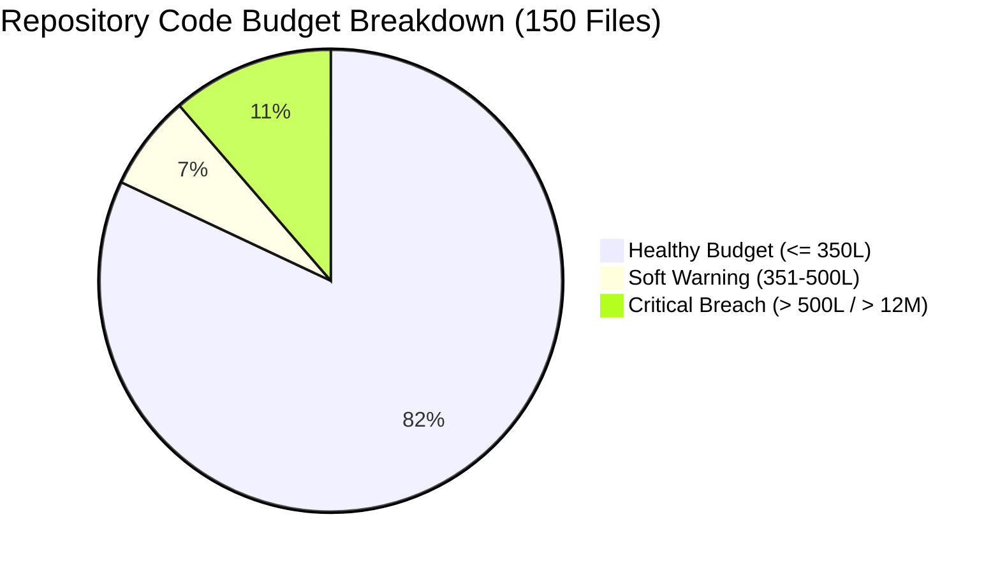
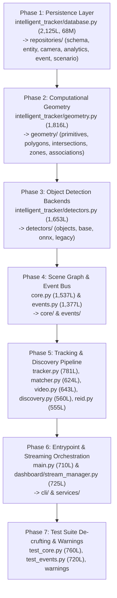

# Codebase Modularity Audit & Full Repository Refactoring Roadmap

## Executive Summary

A comprehensive structural audit across the entire **Intelligent Tracker** repository (150 files, ~37,000+ lines of code) was performed using the automated AST budget engine (`code_health_audit.py`). 

The baseline test suite is **100% passing** (283 unit and integration tests passing in ~50s via the project virtual environment runner). The previous campaign successfully modularized the `dashboard/` subsystem (decoupling 76 routes into 10 FastAPI routers, refactoring 2,902 lines of CSS into modular ITCSS stylesheets with 0 `!important`, and modularizing frontend feature controllers).

However, the core tracking library (`intelligent_tracker/`), application entrypoint (`main.py`), and test harness (`tests/`) contain **17 Critical Monoliths** (exceeding the 500-line hard ceiling or 12-method class budget) and **10 Soft Warnings** (exceeding 350 lines or 10 methods).

---

## 1. Structural Modularity Audit Findings

### A. Subsystem Line Distribution & Health
| Subsystem / Directory | Files | Total Lines | Critical (> 500L) | Warnings (351-500L) | Status |
| :--- | :--- | :--- | :--- | :--- | :--- |
| **`intelligent_tracker/`** | 32 | 18,925 | **13** | **5** | 🚨 Highest Refactor Priority |
| **`dashboard/`** | 6 | 1,844 | **1** | **1** | StreamManager (725L) & CameraPool (406L) |
| **`dashboard/routers/`** | 10 | 2,053 | 0 | 0 | ✅ OK (All within budget) |
| **`dashboard/services/`** | 7 | 895 | 0 | 0 | ✅ OK (All within budget) |
| **`dashboard/static/`** | 6 | 1,752 | 0 | 3 | Minor JS controller warnings (~350-371L) |
| **`dashboard/static/css/`** | 19 | 3,550 | 0 | 0 | ✅ OK (All within budget, 0 `!important`) |
| **`dashboard/static/js/`** | 21 | 3,658 | 0 | 0 | ✅ OK (All within budget) |
| **`tests/`** | 39 | 7,422 | **2** | 0 | `test_core.py` (760L) & `test_events.py` (720L) |
| **`tests/experimental/`** | 2 | 332 | 0 | 0 | ✅ OK (All within budget) |
| **`scripts/`** | 5 | 1,205 | 0 | 1 | `cdp_inspect.py` (436L) |
| **`documentation/`** | 1 | 180 | 0 | 0 | ✅ OK (All within budget) |
| **Root (`main.py`)** | 2 | 839 | **1** | 0 | `main.py` (710L, 511L `main()`) |

---

### B. Complete Critical Monolith Registry (Ceiling > 500 Lines / > 12 Methods)

| # | File Path | Current Lines | Primary God Class / Function | Issues & Smells | Target Architecture |
| :- | :--- | :--- | :--- | :--- | :--- |
| **1** | `intelligent_tracker/database.py` | **2,125** | `TrackerDB` (2,091L, **68 methods**) | `_init_schema` (344L), `get_entity_analytics` (78L), `enroll_entity` (77L). Violates SRP by mixing SQLite DDL, camera registry, entity embeddings, gallery rollbacks, telemetry, and spatial sightings into one class. | `intelligent_tracker/repositories/`: `schema_manager.py`, `entity_repo.py`, `camera_repo.py`, `analytics_repo.py`, `event_repo.py`, `scenario_repo.py` + Facade in `database.py` |
| **2** | `intelligent_tracker/geometry.py` | **1,816** | `BasePoly` (531L, 30 methods) `cnt_intersection` (316L) | `Completeness` (210L, 11 methods), `indexes` (110L), `ZoneROI.update` (98L). Mixes polygon primitive vectors, line clipping, Sutherland-Hodgman intersections, and ROI tracking logic. | `intelligent_tracker/geometry/`: `primitives.py`, `polygons.py`, `intersections.py`, `zones.py`, `associations.py` + Facade in `geometry.py` |
| **3** | `intelligent_tracker/detectors.py` | **1,653** | `Object` (438L, 35 methods) `Detector` (284L, 17 methods) | `OnnxDetector.detect` (99L), `process_raw_objects` (77L). Couples detected object bounding box representations with ONNX runtime inference, Haar Cascades, and legacy OpenCV DNN backends. | `intelligent_tracker/detectors/`: `objects.py`, `base.py`, `onnx_detector.py`, `legacy_detectors.py` + Facade in `detectors.py` |
| **4** | `intelligent_tracker/core.py` | **1,537** | `Group` (373L, 34 methods) `Space` (333L, 17 methods) | `TailItem` (174L, 20 methods), `CompleteGroup` (158L, 12 methods). Monolithic hierarchical spatial graphs mixed with dynamic agent collections and trajectory queues. | `intelligent_tracker/core/`: `spaces.py`, `collections.py`, `tails.py` + Facade in `core.py` |
| **5** | `intelligent_tracker/events.py` | **1,377** | `TelegramDispatcher` (228L) `EventBus` (161L, 11 methods) | `setup_event_pipeline` (108L), `AlertRuleEngine.evaluate` (83L). Pub/sub bus, event dataclasses, third-party webhook dispatchers, and rule filtering engines in a single file. | `intelligent_tracker/events/`: `bus.py`, `types.py`, `dispatchers.py`, `rules.py` + Facade in `events.py` |
| **6** | `intelligent_tracker/tracker.py` | **781** | `CentroidTracker` (230L) `CentroidTracker.update` (158L) | `SortTracker.update` (93L), `check_track_occlusions` (67L), `Track` (53L). Merges centroid Euclidean distance tracking, SORT Kalman filters, occlusion reasoning, and track lifecycle state. | `intelligent_tracker/tracking/`: `track.py`, `centroid.py`, `sort.py`, `occlusion.py` + Facade in `tracker.py` |
| **7** | `tests/test_core.py` | **760** | `GroupEfficiencyTestCase` (216L) `GroupTestCase` (220L) | Single 207-line test method `test_compare`. Overloaded test file testing disparate space parenting, group iteration, and performance benchmarking. | `tests/`: `test_core_spaces.py`, `test_core_groups.py`, `test_core_efficiency.py` |
| **8** | `dashboard/stream_manager.py` | **725** | `StreamManager` (673L, **29 methods**) | `_worker_loop` (233L), `_init_subsystems` (153L), `__init__` (85L). Orchestrates thread lifecycle, frame acquisition, computer vision pipeline, JPEG encoding, and telemetry recording. | `dashboard/services/`: `stream_worker.py`, `pipeline_factory.py`, `stream_overlay.py` + Facade in `stream_manager.py` |
| **9** | `main.py` | **710** | `main` function (**511 lines**) `parse_args` (95L) | Giant monolithic application loop handling argument parsing, camera initialization, window management, keyboard events, and highgui rendering. | `intelligent_tracker/cli/`: `arguments.py`, `pipeline_builder.py`, `runner.py` + thin 25-line bootstrap `main.py` |
| **10** | `tests/test_events.py` | **720** | `TestFullPipelineIntegration` | `test_pipeline_setup_and_analytics_integration` (74L), `test_typed_events` (61L), `test_mqtt_publishing_mock` (60L). | `tests/`: `test_events_bus.py`, `test_events_dispatchers.py`, `test_events_rules.py` |
| **11** | `intelligent_tracker/video.py` | **643** | `VideoSource` (480L, 18 methods) | `_capture_worker` (118L), `_open_capture` (86L). Threaded video ingestion, RTSP reconnection backoff, hardware acceleration, and synthetic fallback generator. | `intelligent_tracker/video/`: `source.py`, `capture_worker.py` + Facade in `video.py` |
| **12** | `intelligent_tracker/analytics.py` | **641** | `AnalyticsEngine` (404L) `OccupancyHeatmap` (209L) | `AnalyticsEngine.update` (197L), `AnalyticsEngine.draw` (82L). Combines trajectory heatmaps, zone dwell timers, and flow counters. | `intelligent_tracker/analytics/`: `engine.py`, `heatmaps.py` + Facade in `analytics.py` |
| **13** | `intelligent_tracker/matcher.py` | **624** | `GalleryMatcher` (543L) | `match_track` (236L), `__init__` (83L), `_apply_bounded_ema_update` (78L). Feature vector cosine distance matching, bounded EMA gallery updates, and multi-camera re-identification. | `intelligent_tracker/matching/`: `gallery.py`, `metrics.py` + Facade in `matcher.py` |
| **14** | `intelligent_tracker/discovery.py` | **560** | Network Probing Functions | `test_camera_connection` (106L), `probe_onvif_devices` (79L), `build_preset_rtsp_url` (65L). Multi-protocol camera discovery (ONVIF WS-Discovery, RTSP port sweep, presets). | `intelligent_tracker/discovery/`: `onvif.py`, `rtsp.py`, `scanner.py` + Facade in `discovery.py` |
| **15** | `intelligent_tracker/reid.py` | **555** | `OnnxReIDExtractor` | `_init_session` (43L), `extract_crop` (41L). Model loading, DirectML/CUDA execution provider setup, and batch image normalization. | `intelligent_tracker/reid/`: `extractor.py`, `feature_pool.py` + Facade in `reid.py` |
| **16** | `intelligent_tracker/high_objects.py` | **518** | `Scene` (269L, 25 methods) `World` (163L, 11 methods) | High-level simulation object graphs with compound coordinate spaces. | `intelligent_tracker/simulation/`: `scene.py`, `world.py` + Facade in `high_objects.py` |
| **17** | `intelligent_tracker/periferials.py` | **510** | `VideoStream` (176L, 15 methods) `SyncCameras` (117L, 14 methods) | Multi-camera synchronization and legacy OpenCV frame readers. | `intelligent_tracker/peripherals/`: `stream.py`, `sync.py` + Facade in `periferials.py` |

---

### C. Soft Warning Registry (351–500 Lines)

| File Path | Current Lines | Element | Details |
| :--- | :--- | :--- | :--- |
| `intelligent_tracker/active_learning.py` | 457 | `ActiveLearningManager` (429L, 13M) | `consider_candidate` (88L), `maybe_queue_candidate` (68L) |
| `intelligent_tracker/interactive.py` | 453 | `run_interactive_app` (151L) | `InteractiveController` (236L), GUI mouse event handler |
| `intelligent_tracker/scenarios.py` | 438 | `ScenarioManager` (400L, 12M) | `load_from_yaml` (90L), scenario configuration parser |
| `scripts/cdp_inspect.py` | 436 | `main_async` (111L) | Chrome DevTools Protocol verification script |
| `intelligent_tracker/journey.py` | 432 | `TrajectoryJourneySearcher` (220L) | `search_journey` (145L), `export_journey_video` (104L) |
| `intelligent_tracker/rsac.py` | 412 | `RSACManager` (210L, 14M) | `RSACZoneRule.evaluate_access` (79L) |
| `dashboard/camera_pool.py` | 406 | `CameraPool` (382L, 18M) | Multi-camera lifecycle pool |
| `dashboard/static/camera_manager.js` | 371 | JS UI Handlers | `bindEvents` (52L), `saveCamera` (52L) |
| `dashboard/static/app.js` | 370 | Coordinator | Page hash router and global state coordination |
| `dashboard/static/video_scrubber.js` | 353 | Video Scrubber | `bindEvents` (60L), `loadVideoIntoPlayer` (48L) |

---

## 2. Architectural Decomposition Strategy ("Split-Before-You-Grow")

To ensure strict zero regressions, no breaking changes, and compliance with the 10 Core Engineering Principles, all refactoring must adhere to:
1. **The Re-Export Facade Invariant**: The original file (`database.py`, `geometry.py`, `detectors.py`, `tracker.py`, etc.) is retained as a thin facade re-exporting 100% of the public classes, functions, and module constants. Existing imports across the project and external callers will not break.
2. **SRP Domain Modules**: Monoliths are decomposed into cohesive domain packages (`intelligent_tracker/repositories/`, `intelligent_tracker/geometry/`, `intelligent_tracker/detectors/`, `intelligent_tracker/tracking/`, `intelligent_tracker/cli/`).
3. **Preservation of Computer Vision Math & Comments**: All mathematical formulas, OpenCV matrix transformations, IoU computations, Kalman filter state equations, and bounding box algebra are preserved verbatim with documentation intact.
4. **Modularity Budgets**:
   - Submodules $\le$ 350 lines (hard ceiling 500 lines)
   - Classes $\le$ 10–12 methods (hard ceiling 300 lines)
   - Functions $\le$ 40 lines
5. **Turn Boundary Discipline**: Never execute more than 1–2 monolith decompositions per turn to maintain token efficiency and prevent reasoning degradation.

---

## 3. Multi-Phase Refactoring Campaign Roadmap

### Detailed Phase Specifications

#### 🔹 Phase 1: Persistence & Database Domain Decomposition
- **Target**: `intelligent_tracker/database.py` (2,125 lines, 68 methods).
- **Target Package**: `intelligent_tracker/repositories/`
  1. `schema_manager.py` (~300L): Database schema initialization (`_init_schema`), SQLite pragmas, migrations, indexes.
  2. `entity_repo.py` (~320L): Entity enrollment (`enroll_entity`), gallery management, embedding vectors, descriptor rollback.
  3. `camera_repo.py` (~220L): Camera registrations, RTSP URLs, resolution settings, status updates.
  4. `analytics_repo.py` (~300L): Sightings, occurrence logging, heatmaps, counts, dwell times, journey hops.
  5. `event_repo.py` (~250L): Event audit trails, alerts, notifications, RSAC incident logging.
  6. `scenario_repo.py` (~200L): Scenarios, access control rules, schedules.
- **Facade**: `intelligent_tracker/database.py` becomes a lean composition facade delegating to focused repositories while keeping `TrackerDB` completely intact for callers.
- **Verification**: `python -m unittest discover tests` (specifically `test_database.py`, `test_backup.py`, `test_scenarios.py`).

#### 🔹 Phase 2: Computational Geometry & Polygon Math Decomposition
- **Target**: `intelligent_tracker/geometry.py` (1,816 lines).
- **Target Package**: `intelligent_tracker/geometry/`
  1. `primitives.py` (~250L): `Point`, `Line`, `Segment`, `Rect`, `Circle`, `BasePoly`.
  2. `polygons.py` (~280L): `Poly`, convex hull, polygon indexing (`BasePoly.indexes`), bounding boxes.
  3. `intersections.py` (~340L): `cnt_intersection`, Sutherland-Hodgman clipping, ray casting, segment crossing detection.
  4. `zones.py` (~300L): `ZoneROI`, `TripwireROI`, directional line crossing, zone occupancy detection.
  5. `associations.py` (~200L): `Completeness`, centroid spatial overlap scoring.
- **Facade**: `intelligent_tracker/geometry.py` re-exports all primitives and algorithms with mathematical docstrings preserved.
- **Verification**: `test_analytics.py`, `test_geometry` tests.

#### 🔹 Phase 3: Detectors & Object Representation Decomposition
- **Target**: `intelligent_tracker/detectors.py` (1,653 lines).
- **Target Package**: `intelligent_tracker/detectors/`
  1. `objects.py` (~320L): `Object` representation, bounding box math, normalized coordinate conversions, confidence scoring, visual formatting.
  2. `base.py` (~220L): `Detector` base class, Non-Maximum Suppression (NMS), raw object pre/post-processing.
  3. `onnx_detector.py` (~280L): `OnnxDetector`, DirectML/CUDA/CPU provider configuration, input tensor reshaping.
  4. `legacy_detectors.py` (~250L): OpenCV DNN backend, Haar Cascade, Background Subtractor.
- **Facade**: `intelligent_tracker/detectors.py` re-exports all detector implementations.
- **Verification**: `test_detectors.py`.

#### 🔹 Phase 4: Core Scene Graph & Event Bus Infrastructure
- **Targets**: `intelligent_tracker/core.py` (1,537 lines) & `intelligent_tracker/events.py` (1,377 lines).
- **Core Package**: `intelligent_tracker/core/`
  1. `spaces.py` (~300L): Hierarchical `Space` tree, coordinate transformations, spatial parenting.
  2. `collections.py` (~280L): `Group` and `CompleteGroup` collection primitives and iterators.
  3. `tails.py` (~200L): `TailItem` and trajectory history queues.
- **Events Package**: `intelligent_tracker/events/`
  1. `bus.py` (~180L): `EventBus` pub/sub engine, subscriber error isolation.
  2. `types.py` (~220L): `BaseEvent` and concrete typed event dataclasses.
  3. `dispatchers.py` (~300L): `WebhookDispatcher`, `TelegramDispatcher`, `MqttDispatcher`.
  4. `rules.py` (~260L): `AlertRuleEngine`, condition evaluator, pipeline setup factory.
- **Verification**: `test_core.py`, `test_events.py`.

#### 🔹 Phase 5: Tracking Engines, ReID Matcher, Video & Discovery
- **Targets**: `tracker.py` (781L), `matcher.py` (624L), `video.py` (643L), `discovery.py` (560L), `reid.py` (555L).
- **Tracking Package**: `intelligent_tracker/tracking/` (`track.py`, `centroid.py`, `sort.py`, `occlusion.py`).
- **Matching Package**: `intelligent_tracker/matching/` (`gallery.py`, `metrics.py`).
- **Video & Discovery**: Extract capture worker thread and ONVIF/RTSP probe tools into focused submodules.
- **Verification**: `test_tracker.py`, `test_matcher.py`, `test_video.py`.

#### 🔹 Phase 6: Application Entrypoint & Streaming Service Orchestration
- **Targets**: `main.py` (710 lines) & `dashboard/stream_manager.py` (725 lines).
- **CLI Architecture**: `intelligent_tracker/cli/`
  1. `arguments.py` (~120L): CLI argument parsing, profile presets, scenarios.
  2. `pipeline_builder.py` (~200L): Factory wiring video source, detector, tracker, event bus, and database.
  3. `runner.py` (~250L): Application loop, display rendering, keyboard controls, FPS throttling.
  4. `main.py` becomes a thin 25-line bootstrap entrypoint.
- **StreamManager Orchestration**: `dashboard/services/`
  1. `stream_worker.py`: Frame acquisition and inference loop.
  2. `pipeline_factory.py`: Subsystem initialization and camera configuration.
  3. `stream_overlay.py`: Visual bounding box and label rendering on dashboard frames.
- **Verification**: Test suite + scenario API tests + streaming tests.

#### 🔹 Phase 7: Test Suite De-crufting & Warnings
- **Targets**: `tests/test_core.py` (760L), `tests/test_events.py` (720L), `scripts/cdp_inspect.py` (436L), frontend warning modules.
- Split oversized test suites into focused, parallel test files mirroring new domain packages.
- Polish minor JS controllers (`camera_manager.js`, `app.js`, `video_scrubber.js`) to stay strictly below 350 lines.

---

## 4. Verification Protocol (Tier 1-3)

Every refactoring phase must satisfy the **Axiom 9 Verification Matrix**:
- **Tier 1 (Static Contracts & Tests)**:
  - `python "<skill_dir>/scripts/contract_snapshot.py" run-tests --path . discover tests` (100% green).
  - `python "<skill_dir>/scripts/code_health_audit.py" --path <refactored_subsystem> --strict` (0 files > 350/500L).
  - Zero dropped imports or broken public signatures.
- **Tier 2 (Container Sync)**:
  - Docker container synchronization audit (if containerized environment).
- **Tier 3 (Live Layout & API)**:
  - Headless/Live CDP browser inspection for any dashboard UI modifications.

---

## 5. Recommended Next Action

The repository is fully triaged and ready for structured decomposition. In compliance with the **1-Phase Turn Gate** and **Anti-Mega-Batch Rule**:
- **Phase 1 (Persistence & Repository Layer: `intelligent_tracker/database.py`)** is prioritized first as it decouples data access for all subsequent modules.
- To initialize campaign tracking and begin Phase 1:
  Click **Proceed** or approve execution of **Phase 1**.
