# VMS Dashboard Modernization & Responsive Redesign Plan

## 1. Problem Analysis & Symptom-to-Root-Cause Matrix

| # | Symptom | Empirical Root Cause | Target Files & Lines | Solution Architecture |
|---|---------|----------------------|----------------------|-----------------------|
| 1 | **Zoom-out required / Not responsive** (1729px horizontal overflow on 1440px screen; broken on phones/tablets) | `.app-header` crams 9 full-width tabs + brand + 5 telemetry/action buttons in a single flex row without wrapping or responsive breakpoints. `.nav-tabs` alone requires >1100px. | `dashboard/static/styles.css`, `dashboard/static/index.html` | Responsive Header Architecture: Auto-scrolling tab pill bar with scroll-snapping on mid screens; mobile hamburger menu & off-canvas drawer (<1024px); compact telemetry pill; mobile-adaptive grid layouts. |
| 2 | **"Multi-Camera VMS" form spills outside dialog** | `.modal-card.modal-lg` has no `max-height` (grows to 903px+). `.modal-right-col` contains 10 inputs + live preview box + footer without a scroll container (`overflow-y: visible`). Screen viewports <950px height push the form and buttons outside the dialog. | `dashboard/static/styles.css`, `dashboard/static/index.html` | Standardized Dialog Architecture: `.modal-card` constrained to `max-height: min(88dvh, 800px); display: flex; flex-direction: column`. Fixed header, sticky footer, and scrollable body (`.modal-body-scroll`) with `overscroll-behavior: contain`. Responsive 1-column stack on screens <800px. |
| 3 | **Broken image on tab return in Live Monitor** | In `app.js:97`, tab switch runs `videoImg.src = ''`. In modern browsers, setting `img.src = ''` resolves to the document URL (`http://localhost:8000/`), failing to render as an image. When returning, `!videoImg.src` evaluates to `false` because `videoImg.src == "http://localhost:8000/"`. `videoImg.src = dataset.activeStreamSrc` never executes! | `dashboard/static/app.js` | Foolproof Stream Lifecycle: Disconnect by removing `src` or setting an inline neutral standby SVG poster (`data:image/svg+xml,...`). On return, explicitly reconnect with cache-buster `?t=${Date.now()}` and attach an `onerror` auto-retry handler with visual standby indicator. |
| 4 | **Inconsistent video player & lack of component reuse** | Video Studio uses `<video>` with play/pause, timeline slider, frame-stepping, speed controls, and tab switch policy. Live Monitor uses bare `` with no player HUD, no stream pause/play toggle, and no consistent control layout. | `dashboard/static/index.html`, `dashboard/static/app.js`, `dashboard/static/styles.css` | Unified VMS Player HUD: Give Live Monitor a matching modern HUD bar (Live pulse badge, stream pause/resume button, snapshot, aspect ratio selector, fullscreen, and resolution/bitrate telemetry) aligned with Video Studio aesthetics. |
| 5 | **No URL state / tab and dialog persistence** | Switching tabs or opening dialogs leaves URL as `http://localhost:8000/`. Reloading page or using browser Back/Forward loses all context and resets to default tab. | `dashboard/static/app.js` | Bidirectional Hash Router: Sync active tab (`#live`, `#videos`, `#gallery`, `#timeline`, `#analytics`, `#alerts`, `#studio`, `#journey`, `#review`) and dialogs (`#cameras`, `#enroll`, `#backup`, `#versions`) via `window.location.hash`, `history.pushState`, and `popstate` / `hashchange` listeners. |
| 6 | **Lack of automated tests to ensure quality** | Backend test suite exists (209 unit tests passing), but no frontend/layout tests or route verification tests exist to detect UI regressions, horizontal overflows, or broken dialog structures. | `tests/` | Automated Quality Tests: Add `tests/test_dashboard_ui.py` to verify all dashboard endpoints, HTML modal structure, route mapping, and static script integrity. Run CDP layout audit across desktop, tablet, and mobile to ensure `scrollWidth <= viewportWidth`. |
| 7 | **Cumbersome Browser `prompt()` / `alert()` popups instead of structured forms** | Scenario Studio and Review & Learn request critical geometric and configuration data through series of 4 to 7 sequential browser `prompt()` and `confirm()` alert dialogs (e.g. `openZoneModal`, `openTransitionLinkModal`, `openHomographyModal`). They block the thread, lack validation, and feel clunky on mobile/tablets. | `dashboard/static/studio.js`, `dashboard/static/review_and_rsac.js` | Dedicated In-Page Modal Forms & Modern Toast Notifications: Replace all browser `prompt()` sequences with dedicated, structured modal dialog forms (Zone Builder modal, Tripwire Builder modal, Homography Calibration modal, Spatial Topology Transition modal, Entity Quick-Enroll modal) and replace invasive `alert()` calls with sleek, non-blocking toast notifications. |
| 8 | **Enterprise Hub Integration Alignment (Milestone 16d / Phase E5)** | Security webhooks lack HMAC-SHA256 signing header (`X-Tracker-Signature`); Hub Canvas overlay lacks companion REST telemetry endpoint; offline-first SQLite cache tables (`TrackerDB`) are not yet initialized. | `intelligent_tracker/events.py`, `dashboard/app.py`, `intelligent_tracker/database.py` | Edge-to-Hub Turnkey Protocol: Implement HMAC-SHA256 signature signing in `WebhookDispatcher`; expose `GET /api/cameras/{id}/telemetry` returning real-time bounding boxes and tracking states; add `tracker_sync_state`, `local_whitelist`, and `offline_access_queue` DDL in `TrackerDB`. |

---

## 2. Architectural Blueprint

```mermaid
flowchart TD
    subgraph Navigation & Routing
        URL["window.location.hash\n(#live, #videos, #cameras...)"] <--> Router["Router Module\n(hashchange + popstate)"]
        Router --> TabManager["Tab Switcher\n(active tab pane + state sync)"]
        Router --> ModalManager["Modal Dialog Controller\n(open/close + history sync)"]
        NavTabs["Header Tabs\n(Snap Scroll)"] --> Router
        Drawer["Mobile Drawer\n(<1024px Hamburger)"] --> Router
    end

    subgraph Standardized Dialog System
        ModalBackdrop["<div class='modal-backdrop'>\n(overscroll-behavior: contain)"]
        ModalCard["<div class='modal-card'>\n(max-height: min(88dvh, 800px))"]
        ModalHeader["<div class='modal-header'>\n(Fixed Title & Close)"]
        ModalBody["<div class='modal-body-scroll'>\n(Internal Scroll Container)"]
        ModalFooter["<div class='modal-footer'>\n(Sticky Action Buttons)"]
        
        ModalBackdrop --> ModalCard
        ModalCard --> ModalHeader
        ModalCard --> ModalBody
        ModalCard --> ModalFooter
    end

    subgraph Unified VMS Player Architecture
        LiveHUD["Live Stream HUD\n(Status, Stream Pause/Play, Snapshot, Fullscreen)"]
        StreamLifecycle["Stream Reconnect Manager\n(Clean detach + cache-busting reconnect)"]
        LiveView["Live MJPEG Canvas / Img"]
        ScrubberView["Video Studio Player\n(H.264 HTML5 Video + Timeline)"]
        
        LiveHUD --> StreamLifecycle
        StreamLifecycle --> LiveView
    end
```



---

## 3. Implementation Phases & Atomic Slices

### Slice 1: Standardized Responsive Dialog Architecture
- **CSS**:
  - Update `.modal-backdrop` with backdrop blur, scroll containment, and proper padding (`padding: 16px`).
  - Upgrade `.modal-card` to use `max-height: min(88dvh, 800px); display: flex; flex-direction: column; overflow: hidden; width: 100%;`.
  - Add `.modal-body-scroll` with `flex: 1 1 auto; overflow-y: auto; overscroll-behavior: contain; padding: 16px 20px;`.
  - Add sticky `.modal-footer` with `flex-shrink: 0; padding: 14px 20px; background: rgba(15, 23, 42, 0.95); border-top: 1px solid var(--border-subtle);`.
  - Responsive breakpoint for `.modal-body-grid`: 1-column layout on screens <800px with optimized input widths.
- **HTML**:
  - Refactor `#modal-camera-manager` (Multi-Camera VMS & Device Auto-Discovery) to use the new `.modal-body-scroll` container so the form and camera list scroll smoothly within the dialog without overflowing.
  - Apply the same pattern to `#modal-universal-enrollment`, `#modal-backup-manager`, `#modal-descriptor-versions`, and `#modal-review-reassign`.

### Slice 1B: Structured Modal Forms & Toast Notifications (Eliminate `prompt()` / `alert()`)
- **HTML**:
  - Add dedicated modal forms in `index.html`:
    - `#modal-studio-zone`: Form for Zone Name, Category Filter, Dwell Threshold (s), and Capacity Limit.
    - `#modal-studio-tripwire`: Form for Tripwire Name, Direction mode (Bidirectional vs One-way), and Alert Rule.
    - `#modal-studio-homography`: Form for Ground Plane Metric Width (m) and Metric Height (m) with real-world scale guidance.
    - `#modal-studio-transition`: Form for Source Camera/Zone, Target Camera/Zone, Min Transit Time (s), Max Transit Time (s), and Spatial Prior Boost score.
    - `#modal-quick-enroll-entity`: Form in Review & Learn for Entity Name and Category.
  - Add floating `#toast-container` in `index.html` for non-blocking notifications.
- **JS**:
  - Create `showToast(message, type = 'info'|'success'|'error', duration = 4000)` in `app.js` and export on `window.showToast`.
  - Refactor `openZoneModal`, `openTripwireModal`, `openHomographyModal`, `openTransitionLinkModal` in `studio.js` to open these clean modal dialogs instead of sequential `prompt()` / `confirm()` alerts.
  - Replace invasive `alert()` calls across `app.js`, `camera_manager.js`, `studio.js`, `review_and_rsac.js`, and `video_scrubber.js` with `showToast()`.

### Slice 2: Responsive Global Navigation & Header (Desktop, Tablet, Mobile)
- **HTML**:
  - Add a hamburger menu toggle button (`#btn-mobile-menu`) in `.app-header`.
  - Wrap `.nav-tabs` in a scrollable navigation container with smooth scroll-snap.
  - Add a mobile slide-out drawer (`#mobile-nav-drawer`) with overlay backdrop for screens <1024px.
  - Add mobile-friendly quick action buttons.
- **CSS**:
  - Style `.nav-tabs` with `overflow-x: auto; scrollbar-width: none; flex-wrap: nowrap;` for medium screens so tabs never force horizontal page overflow.
  - Responsive header breakpoints:
    - `@media (max-width: 1280px)`: Compact tab labels & telemetry.
    - `@media (max-width: 1024px)`: Show hamburger button, hide desktop tab bar, use mobile slide-out drawer.
    - `@media (max-width: 768px)`: Stack sidebar columns on Live, Scrubber, Analytics, Studio, and Review tabs.
- **JS**:
  - Hamburger toggle open/close logic with outside click dismissal and ESC key listener.

### Slice 3: Stream Reconnection Fix & Unified Video Player Architecture
- **JS (`app.js`)**:
  - Replace the broken `videoImg.src = ''` with clean SVG standby poster `data:image/svg+xml,...` and proper stream detachment.
  - Implement robust stream reconnection on entering `#tab-live` with cache-busting timestamp `?t=${Date.now()}`.
  - Add stream error / reconnect handler: if the stream disconnects, display a non-blocking "Reconnecting stream..." pill and retry with exponential backoff rather than leaving a broken image icon.
  - Add Live Stream Player HUD controls:
    - Stream Pause/Resume button (allowing user to pause live streaming on demand).
    - Quick Snapshot button.
    - Fullscreen toggle.
    - Active Stream Resolution & Telemetry HUD matching Video Studio.

### Slice 4: Bidirectional URL Hash Routing
- **JS (`app.js`)**:
  - Implement lightweight Router:
    - Map hashes: `#live`, `#videos`, `#gallery`, `#timeline`, `#analytics`, `#alerts`, `#studio`, `#journey`, `#review`.
    - Map modal sub-routes: `#cameras`, `#enroll`, `#backup`, `#versions`.
    - Listen for `hashchange` and `popstate` events: automatically activate corresponding tab pane and/or open dialog.
    - Whenever a tab button or modal open/close action occurs, update `window.location.hash` cleanly without full page reloads.
    - Handle direct links: navigating to `http://localhost:8000/#videos` or `http://localhost:8000/#cameras` activates that tab/dialog immediately upon load.

### Slice 5: Automated Verification & Layout Regression Tests
- **Unit & Integration Tests**:
  - Create `tests/test_dashboard_ui.py` using `TestClient` to test:
    - Dashboard HTML delivers valid status code 200.
    - All 9 tab containers exist with valid IDs.
    - All modals contain `.modal-body-scroll` and proper accessibility attributes.
    - Static JS and CSS assets deliver status 200 with appropriate mime types.
    - Camera API, recordings API, and snapshot endpoints return expected schemas.
- **Empirical Layout Audits via CDP Inspector**:
  - Run `cdp_inspect.py` in headless mode across 3 viewport presets:
    - Desktop: 1440x900 -> Verify `scrollWidth <= 1440`, `hasHorizontalScrollbar: false`.
    - Tablet: 768x1024 -> Verify `scrollWidth <= 768`, `hasHorizontalScrollbar: false`.
    - Mobile: 390x844 -> Verify `scrollWidth <= 390`, `hasHorizontalScrollbar: false`.
  - Audit open `#modal-camera-manager` to assert `.modal-card` height does not exceed viewport and right column form is completely within the dialog bounds.
  - Verify tab switch to `#videos` and return to `#live` restores stream with `naturalWidth > 0`.
- **Existing Suite Verification**:
  - Run full test suite (`python -m unittest discover tests`) to guarantee 100% green pass.

### Slice 6: Enterprise Hub Integration Readiness (Milestone 16d / Phase E5 Alignment)
- **Backend & Events**:
  - Update `intelligent_tracker.events.WebhookDispatcher`: accept `secret_key` and compute `X-Tracker-Signature` (HMAC-SHA256) over payload bytes. Ensure standard ISO-8601 UTC timestamp and `snapshot_base64`.
- **REST API**:
  - Add `GET /api/cameras/{camera_id}/telemetry` to `dashboard/app.py` returning active tracks, bounding boxes, dwell timers, and zone occupancies for central Hub canvas overlay proxying.
- **Database Schema**:
  - Add `tracker_sync_state`, `local_whitelist`, and `offline_access_queue` DDL in `intelligent_tracker.database.TrackerDB` conforming to `INTELLIGENT_TRACKER_OFFLINE_DB_SPEC.md`. Add unit test verification in `tests/test_database.py`.

---

## 4. Empirical Verification Commands

```bash
# 1. Automated UI & Backend Test Suite
pytest tests/ -v
# Or standard unittest:
python -m unittest discover tests

# 2. Desktop CDP Layout Audit (1440x900)
python scripts/cdp_inspect.py --url http://localhost:8000 --audit-layout --headless --window-size 1440x900

# 3. Mobile CDP Layout Audit (390x844)
python scripts/cdp_inspect.py --url http://localhost:8000 --audit-layout --headless --window-size 390x844

# 4. Multi-Camera Dialog Form Inspection
python scripts/cdp_inspect.py --url http://localhost:8000 --click "#btn-manage-cameras" --selectors "#modal-camera-manager,.modal-card,.modal-body-scroll,#camera-config-form" --headless
```
