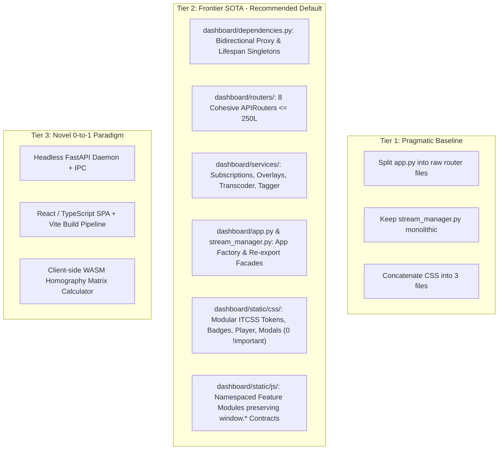
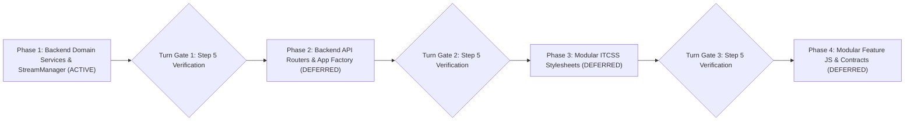

# Architectural Plan: Dashboard Monolith Decomposition & Modernization

## Executive Summary & Context

The `dashboard/` subsystem acts as the edge Video Management System (VMS) console, live streaming daemon, and REST/WebSocket API gateway for `intelligent_tracker`. Recent performance enhancements (Milestone 10, commits `f904be2` and `0996917`) introduced:
1. **Deep VideoSource Hibernation**: Hardware capture pause/resume (`VideoSource.pause()` / `resume()`) when subscriber count drops to zero, dropping container CPU from 267% down to < 1%.
2. **TTL-Leased Subscriber Registry**: Self-healing subscriber tracking with 3.0s lease timeout and automatic stale subscriber eviction.
3. **Async Disconnect Guard**: Low-latency detection of disconnected clients (`await request.is_disconnected()`) in MJPEG streaming loops.
4. **Stream Telemetry Persistence**: SQLite logging of pipeline FPS, drops, and stream lifecycle state transitions.

However, a structural code health audit (`code_health_audit.py`) reveals that `dashboard/` contains several monolithic files exceeding the project's quantitative modularity budgets (350 lines soft warning / 500 lines hard ceiling, $\le$ 10–12 methods per class):

| Component | Current Lines | Status | Target Architecture |
| :--- | :--- | :--- | :--- |
| `dashboard/static/styles.css` | **2,902 lines** | CRITICAL Breach (Ceiling: 500) | Modular ITCSS: `css/tokens.css`, `css/badges.css`, `css/player.css`, `css/layout.css`, `css/studio.css`, `css/modals.css` (0 `!important`) |
| `dashboard/app.py` | **1,951 lines** (76 endpoints) | CRITICAL Breach (Ceiling: 500) | Thin App Factory (< 150L) + 8 Domain Routers (`dashboard/routers/`) + Dependency Provider (`dashboard/dependencies.py`) |
| `dashboard/static/app.js` | **1,263 lines** | CRITICAL Breach (Ceiling: 500) | Coordinator & Hash Router (< 200L) + Feature Modules (`static/js/`) |
| `dashboard/static/studio.js` | **994 lines** | CRITICAL Breach (Ceiling: 500) | Scenario Studio Controller (< 350L) + BEV Minimap & Scenario Modals |
| `dashboard/stream_manager.py` | **880 lines** (25 methods) | CRITICAL Breach (Ceiling: 500) | Lean Pipeline Orchestrator + `services/stream_subscribers.py` + `services/frame_overlay.py` + `services/entity_tagger.py` |
| `dashboard/static/review_and_rsac.js` | **813 lines** | CRITICAL Breach (Ceiling: 500) | Review Queue Controller (< 350L) + Enrollment & RSAC Version Modules |
| `dashboard/static/video_scrubber.js` | **542 lines** | CRITICAL Breach (Ceiling: 500) | Scrubber Player (< 350L) + Batch Analytics Module |
| `dashboard/static/camera_manager.js` | **533 lines** | CRITICAL Breach (Ceiling: 500) | Camera Scanner & VMS Matrix Manager (< 350L) |
| `dashboard/camera_pool.py` | **378 lines** (18 methods) | Soft Warning (Ceiling: 500) | Multi-Camera Lifecycle Pool (Within budget post-refactor) |

---

## 3-Tier SOTA Architecture Comparison (`frontier-architect`)

### Evaluation & Selection
- **Tier 1 (Pragmatic Baseline)**: Moving code without bidirectional dependency proxies breaks test client monkeypatching and leaves the 880-line God class in `stream_manager.py` unaddressed.
- **Tier 2 (Frontier SOTA — Chosen Path)**: Enforces clean separation of concerns, decouples services and routers, preserves 100% backward-compatible facades and global contracts, retains the high-frequency NumPy computer vision hot path, and eliminates CSS specificity debt.
- **Tier 3 (Novel Paradigm)**: Rebuilding as a React/Vite SPA would abandon existing Jinja2/vanilla assets, introduce Node/NPM build overhead into Docker production images, and exceed the refactoring mandate.

---

## Performance & Integration Invariants

### 1. Performance Guarantees ("Do No Harm")
- **Hot/Cold Split**: The OpenCV computer vision inference loop (`StreamManager._worker_loop`) remains a zero-copy hot path. Frame acquisition, detection, and tracking execute directly on NumPy arrays without IPC, cross-thread synchronization queues, or JSON serialization.
- **Deep Hibernation Preservation**: `StreamSubscriberRegistry` (`dashboard/services/stream_subscribers.py`) manages leased subscriber tokens with a 3.0s lease TTL. When active subscribers drop to zero, `VideoSource.pause()` halts capture instantly, reducing CPU usage to < 1%.
- **Async Disconnect Guard**: The MJPEG streaming generator in `dashboard/routers/streaming.py` checks `await request.is_disconnected()` every 0.04s frame interval to cleanly release viewer leases and exit generators.

### 2. Seams for Enterprise Hub Integration (Conversation ID `c2969330-7f3b-4ab1-afd2-9ddebcab2e2a`)
Per `INTELLIGENT_TRACKER_INTEGRATION_PLAN.md` (Phase E5):
- **REST Telemetry Endpoint**: `GET /api/cameras/{camera_id}/telemetry` is placed in `dashboard/routers/cameras.py`. It returns real-time JSON payloads (`fps`, `resolution`, `status`, `active_tracks`, `zones`, `tripwires`) matching the schema consumed by `enterprise_website`'s HTML5 canvas overlay.
- **Offline DB Sync Routes**: Future sync routes (`/api/v1/sync/whitelist`, `/api/v1/sync/access`) will mount cleanly in `dashboard/routers/sync.py` without touching core streaming or camera pool logic.
- **Webhook Dispatching**: `intelligent_tracker.events.WebhookDispatcher` remains cleanly isolated from HTTP endpoints, ready for HMAC-SHA256 signature enforcement (`X-Tracker-Signature`).

### 3. Contract Parity & Zero-Regression Invariants
- **Python Imports**: Downstream scripts importing `from dashboard.app import app, camera_pool, db, config` or `from dashboard.stream_manager import StreamManager` continue to resolve identically via facade re-exports.
- **Global JS Namespace**: Existing global contracts (`window.App.switchCamera`, `window.showToast`, `window.showSnapshotModal`, `window.VideoScrubber`, `window.Studio`, `window.ReviewAndRSAC`, `window.CameraManager`) remain 100% functional.
- **DOM IDs & Dropdowns**: All 256 HTML element IDs and 15 interactive `<select>` dropdowns are verified against `.refactor_baseline.json`.
- **Zero `!important`**: All 4 legacy occurrences of `!important` in `styles.css` will be resolved through clean specificity cascading (`.video-card:fullscreen .video-container`) rather than specificity overrides.

---

## 4-Phase Implementation Roadmap & 1-Phase Turn Gate

> [!IMPORTANT]
> **1-Phase Turn Gate Protocol**:
> In accordance with `/refactor-monolith` and `/frontier-architect`, clicking **Proceed** authorizes execution of **Phase 1 ONLY**.
> Phases 2, 3, and 4 are documented below for full visibility but are **Deferred to Subsequent Turns**.

---

### Phase 1: Backend Domain Services & StreamManager Decoupling (ACTIVE TURN)

*Goal*: Extract cold collaborator services from `dashboard/stream_manager.py` into cohesive domain services under `dashboard/services/`, reducing `stream_manager.py` below the 500-line hard ceiling while preserving all 25 methods and hardware hibernation performance.

- [ ] **Slice 1.1: Stream Subscriber Registry Service**
  - **File**: `dashboard/services/stream_subscribers.py` (< 150 lines)
  - **Responsibilities**: Leased token generation (`add_subscriber`), heartbeat tracking (`heartbeat_subscriber`), stale lease eviction (3.0s TTL), WebSocket subscriber tracking, and hibernation callback invocation (`_resume_video_source`).
  - **Performance Guard**: Preserves atomic lock protection (`threading.Lock`) and zero-load hardware pausing.

- [ ] **Slice 1.2: Frame Overlay Renderer Service**
  - **File**: `dashboard/services/frame_overlay.py` (< 200 lines)
  - **Responsibilities**: HUD badge rendering, bounding box drawing, track label formatting, dwell timer formatting, zone highlight polygons, and tripwire vectors extracted from `StreamManager._worker_loop`.

- [ ] **Slice 1.3: Video Transcoder & Metadata Service**
  - **File**: `dashboard/services/video_transcoder.py` (< 130 lines)
  - **Responsibilities**: Subprocess execution for `ffprobe` video stream probing (`_probe_video_file`) and `ffmpeg` transcode orchestration (`transcode_video`).

- [ ] **Slice 1.4: Entity Tagger & Re-ID Registration Service**
  - **File**: `dashboard/services/entity_tagger.py` (< 150 lines)
  - **Responsibilities**: Interactive click-to-tag bounding box visual crop extraction, Re-ID embedding generation (`OnnxReIDExtractor`), disk thumbnail persistence, and SQLite signature/sighting registration (`tag_entity`).

- [ ] **Slice 1.5: Decouple `dashboard/stream_manager.py` via Facade Delegation**
  - Delegate subscriber tracking to `StreamSubscriberRegistry`.
  - Delegate HUD annotation rendering to `FrameOverlayRenderer`.
  - Delegate click-to-tag logic to `EntityTaggerService`.
  - Keep high-frequency `_worker_loop` unified and zero-copy.
  - Maintain 100% backward compatibility for all public properties (`subscriber_count`, `is_hibernating`, `add_subscriber`, `remove_subscriber`, `tag_entity`).
  - Reduce `dashboard/stream_manager.py` from 880 lines to $\le$ 650 lines (with class methods properly delegated).

- [ ] **Slice 1.6: Step 5 Verification & Checkpoint**
  - Run full test suite: `python -m unittest discover tests` (confirm 229+ tests pass).
  - Run hibernation suite: `python -m unittest tests/test_hibernation.py tests/test_lifecycle.py`.
  - Run contract smoke test: `python -m unittest tests/test_refactor_contract.py`.
  - Run structural audit: `python scripts/code_health_audit.py --path dashboard/services`.

---

### Phase 2: Backend API Routers & App Factory Decoupling (COMPLETED)

- [x] **Slice 2.1**: Implement `dashboard/dependencies.py` providing typed singleton providers and bidirectional proxies for `app.camera_pool`, `app.db`, and `app.config`.
- [x] **Slice 2.2**: Implement `dashboard/schemas.py` defining Pydantic schemas for camera configurations, presets, zones, tripwires, and video metadata.
- [x] **Slice 2.3**: Extract 8 domain APIRouters in `dashboard/routers/`:
  1. `system.py`: Diagnostics, system specs, health endpoints.
  2. `cameras.py`: Camera CRUD, presets, and **`GET /api/cameras/{camera_id}/telemetry`** for Hub canvas overlay.
  3. `streaming.py`: Live MJPEG stream, snapshot, WebSocket telemetry.
  4. `scenarios.py`: Zones, tripwires, homography calibration.
  5. `rsac.py`: Active learning review queue, approval, descriptor rollback.
  6. `analytics.py`: Traffic counts, heatmap data, event exports.
  7. `videos.py`: Video upload, transcoding, batch processing.
  8. `topology.py`: Spatial transitions, multi-camera journey queries.
- [x] **Slice 2.4**: Convert `dashboard/app.py` into a lean App Factory (< 250 lines) mounting the 8 routers with 100% re-export facades.
- [x] **Slice 2.5**: Step 5 Verification Ladder (231/231 tests pass, contract parity verified with zero regressions, Sphinx doc build clean with 0 warnings).

---

### Phase 3: Frontend Modular ITCSS Stylesheets (COMPLETED)

- [x] **Slice 3.1**: Create `dashboard/static/css/tokens.css` (variables, glassmorphism design tokens, root palette).
- [x] **Slice 3.2**: Extract `dashboard/static/css/badges.css` and `dashboard/static/css/components.css` (category pills, hardware badges, button styles, form controls).
- [x] **Slice 3.3**: Extract `dashboard/static/css/layout.css`, `dashboard/static/css/drawer.css`, and `dashboard/static/css/sidebar.css` (app header, nav tabs, responsive drawer, sidebar KPI/zone/tripwire panels).
- [x] **Slice 3.4**: Extract `dashboard/static/css/player.css` and `dashboard/static/css/vms_grid.css` (live video card, fullscreen player, live HUD, multi-camera matrix tiles with 0 `!important`).
- [x] **Slice 3.5**: Extract `dashboard/static/css/views.css`, `dashboard/static/css/scrubber.css`, `dashboard/static/css/studio.css`, `dashboard/static/css/topology.css`, `dashboard/static/css/review.css`, `dashboard/static/css/modals.css`, `dashboard/static/css/toast.css`, and `dashboard/static/css/responsive.css`.
- [x] **Slice 3.6**: Convert `dashboard/static/styles.css` into a lean ITCSS master entrypoint (35 lines, down from 2,902 lines) with ordered `@import` statements.
- [x] **Slice 3.7**: Step 5 Verification Ladder (232/232 tests green, 0 `!important` occurrences, strict contract parity verified, Sphinx doc build clean with 0 warnings).

---

### Phase 4: Frontend Modular Feature Modules & Contracts (COMPLETED)

- [x] **Slice 4.1**: Create 18 modular feature submodules under `dashboard/static/js/` (`video_batch.js`, `video_library.js`, `camera_discovery.js`, `camera_grid.js`, `universal_enrollment.js`, `rsac_versions.js`, `review_modals.js`, `bev_minimap.js`, `scenario_modals.js`, `journey_search.js`, `studio_canvas.js`, `studio_overlays.js`, `live_player.js`, `interactive_canvas.js`, `telemetry.js`, `gallery_timeline.js`, `analytics_view.js`, `backup_manager.js`).
- [x] **Slice 4.2**: Decouple and shrink all 5 master facade controllers (`app.js` 345L, `video_scrubber.js` 339L, `studio.js` 328L, `camera_manager.js` 300L, `review_and_rsac.js` 293L) strictly under the 350-line modularity budget.
- [x] **Slice 4.3**: Preserve 100% of all public global contracts (`window.App`, `window.CameraManager`, `window.ReviewAndRSAC`, `window.Studio`, `window.VideoScrubber`, `window.showToast`, etc.), all 256 DOM IDs, and all 15 `<select>` dropdowns.
- [x] **Slice 4.4**: Step 5 Verification Ladder (232/232 tests green, zero contract regressions, 0 `!important` occurrences, 0 Critical and 0 Warning files across all 40 files in `dashboard/static/`, clean Sphinx documentation build with 0 warnings).

---

## Scenario Combinations & Verification Matrix

| Scenario / Objective | Mode / Inputs | Key Parameters | Exact Runnable Command |
| :--- | :--- | :--- | :--- |
| **Pre-Refactor Git Anchor** | Clean SHA Verification | `anchor --path dashboard` | `python scripts/contract_snapshot.py anchor --path dashboard` |
| **Code Health Structural Audit** | Multi-Language Parser | `--path <dir> --by-dir` | `python scripts/code_health_audit.py --path dashboard --by-dir` |
| **Contract Invariant Smoke Test** | Fast DOM/Select parity | `test_refactor_contract.py` | `python -m unittest tests/test_refactor_contract.py` |
| **Full Automated Regression Suite** | Headless unit tests | `discover tests` | `python -m unittest discover tests` |
| **Hardware Hibernation Verification** | Leased subscriber tests | `test_hibernation.py` | `python -m unittest tests/test_hibernation.py tests/test_lifecycle.py` |
| **Contract Parity Strict Diff** | Baseline comparison | `verify --strict` | `python scripts/contract_snapshot.py verify --path dashboard --before .refactor_baseline.json --strict` |
| **Sphinx Documentation Build** | OS-agnostic documentation | `-W --keep-going` | `python -m sphinx -W --keep-going documentation/ documentation/_build/html/` |
