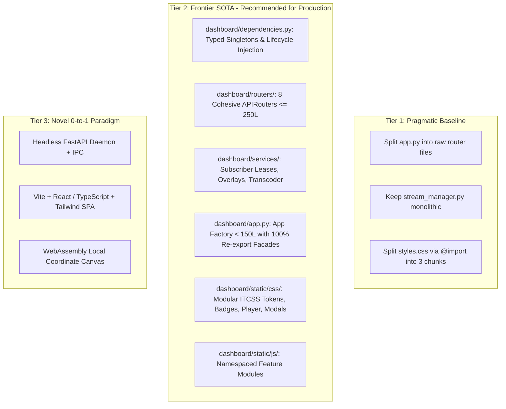

# Dashboard Architecture & Monolith Decomposition Plan

## Executive Summary & Context

The `dashboard/` directory serves as the edge Video Management System (VMS) interface, live streaming server, and operator console for `intelligent_tracker`. Recent performance enhancements (Milestone 10) introduced **deep hardware hibernation** (`VideoSource.pause()` / `resume()`), **TTL-leased subscriber tracking** (3.0s lease timeout), **async disconnect detection** (`await request.is_disconnected()`), and **system telemetry persistence** (`StreamLifecycleManager`), dropping idle container CPU from **267% down to 0.66%**.

However, structural code health analysis reveals that `dashboard/` is heavily monolithic, exceeding quantitative modularity budgets:

| Component | Current Lines | Modularity Status | Target Architecture |
| :--- | :--- | :--- | :--- |
| `dashboard/static/styles.css` | **2,902 lines** | CRITICAL Breach (Ceiling: 500) | Modular ITCSS: `css/tokens.css`, `css/badges.css`, `css/player.css`, `css/layout.css`, `css/studio.css`, `css/modals.css` |
| `dashboard/app.py` | **1,951 lines** (76 endpoints) | CRITICAL Breach (Ceiling: 500) | Thin App Factory (< 150 lines) + 8 Domain Routers (`dashboard/routers/`) + Dependency Provider (`dashboard/dependencies.py`) |
| `dashboard/static/app.js` | **1,263 lines** | CRITICAL Breach (Ceiling: 500) | Core App Controller + Feature Modules (`static/js/`) |
| `dashboard/static/studio.js` | **994 lines** | CRITICAL Breach (Ceiling: 500) | Calibration Service + BEV Canvas Renderer + Journey Controller |
| `dashboard/stream_manager.py` | **880 lines** (25 methods) | CRITICAL Breach (Ceiling: 500) | Lean Pipeline Orchestrator + `services/stream_subscribers.py` + `services/frame_overlay.py` |
| `dashboard/static/review_and_rsac.js` | **813 lines** | CRITICAL Breach (Ceiling: 500) | Active Learning Review Queue + Universal Enrollment Modal Controller |
| `dashboard/static/video_scrubber.js` | **542 lines** | CRITICAL Breach (Ceiling: 500) | Scrubber Player + Batch Analytics Client |
| `dashboard/static/camera_manager.js` | **533 lines** | CRITICAL Breach (Ceiling: 500) | Camera Scanner + Grid Layout Manager |
| `dashboard/camera_pool.py` | **378 lines** (18 methods) | Soft Warning (Ceiling: 500) | Camera Pool Lifecycle Manager (Within budget post-refactor) |

This plan defines the **Frontier SOTA target architecture** and a **4-Phase Dependency-Ordered Migration Roadmap** that guarantees:
1. **Zero Breaking Imports**: 100% backward compatibility via facade re-exports in `dashboard/app.py` and `dashboard/stream_manager.py`.
2. **Zero Performance Regression**: The high-frequency computer vision hot path (`StreamManager._worker_loop`) remains zero-copy and unified, avoiding IPC, thread hopping, or serialization overhead.
3. **Zero Cascade Specificity Regression**: Full preservation of natural CSS specificity without `!important`, responsive overflow containment (`min-width: 0`), and `:fullscreen` player rules.
4. **Integration Readiness with Enterprise Hub (Conversation `c2969330-7f3b-4ab1-afd2-9ddebcab2e2a`)**: Cleanly decoupled routes and repositories ready for HMAC-SHA256 webhooks, REST telemetry polling (`GET /api/cameras/{camera_id}/telemetry`), zero-copy clip registration, and offline SQLite delta sync (`ETag`).

---

## 3-Tier SOTA Architecture Comparison



### Evaluation of Tiers

1. **Tier 1 (Pragmatic Baseline)**:
   - *Description*: Move route functions into arbitrary router files; leave `stream_manager.py` untouched; concatenate CSS files.
   - *Verdict*: Fragile. Lacks unified dependency injection, fails to address the 880-line God class in `stream_manager.py`, and leaves frontend state tightly coupled.

2. **Tier 2 (Frontier SOTA — Recommended Default)**:
   - *Description*:
     - **Backend**: Strict layered DAG (`App Facade -> APIRouters -> Domain Services -> Repositories -> Models/Utils`). Decouples subscriber leases and frame overlay drawing into domain collaborator services while keeping the inference hot path in `StreamManager`. Introduces `dependencies.py` for FastAPI dependency injection with fallback global accessors for existing tests.
     - **Frontend**: Modular ITCSS (`css/tokens.css`, `css/badges.css`, `css/player.css`, `css/modals.css`, `css/studio.css`) and modular component scripts (`js/core/`, `js/features/`) preserving vanilla browser compatibility without complex build steps or node dependencies.
   - *Verdict*: **Optimal balance**. Maximum maintainability, sub-300 line files, zero build tooling overhead on the edge device, 100% test compatibility, and clean seam for Hub integration.

3. **Tier 3 (Novel Moonshot — Headless Micro-Frontend)**:
   - *Description*: Rewrite the frontend in React/Vite/TypeScript with Tailwind and WebAssembly canvas rendering, serving the frontend from a separate container.
   - *Verdict*: Over-engineered for a standalone CCTV edge appliance; introduces heavy Node.js build dependencies, breaks existing offline installation simplicity, and violates the "Do No Harm" performance guard.

---

## Target Architecture Blueprint (Tier 2)

```
dashboard/
├── __init__.py                     # Package entrypoint (re-exports app, CameraPool, StreamManager)
├── app.py                          # Slim App Factory (< 150 lines) + Facade Re-exports
├── dependencies.py                 # Dependency Providers (CameraPool, StreamManager, Lifecycle)
├── camera_pool.py                  # Multi-camera pool coordinator (378 lines)
├── stream_manager.py               # StreamManager pipeline facade & hot worker loop
├── routers/                        # FastAPI APIRouters (<= 250 lines each)
│   ├── __init__.py
│   ├── streaming.py                # MJPEG /stream/{camera_id}, /ws/{camera_id}, /status
│   ├── cameras.py                  # Camera CRUD, discovery, presets, test, telemetry
│   ├── videos.py                   # Video upload, transcode, batch analytics, add_as_camera
│   ├── scenarios.py                # Zones, tripwires, homography calibration, BEV minimap
│   ├── topology.py                 # Spatial transitions, priors, trajectory journey search/export
│   ├── analytics.py                # Heatmap, sightings, events, entity CRUD, tagging, crops
│   ├── rsac.py                     # RSAC categories, rules, pet whitelist, active learning queue
│   └── system.py                   # Backups, lifecycle diagnostics, eviction, hibernate_all
├── services/                       # Extracted Collaborator Services (<= 250 lines each)
│   ├── __init__.py
│   ├── stream_subscribers.py       # Leased subscriber registry, heartbeat, auto-prune TTL
│   ├── frame_overlay.py            # Bounding boxes, zone overlays, HUD indicators, trajectories
│   └── video_transcoder.py         # Video probing, ffmpeg transcoding, thumbnailing
└── static/                         # Modular Frontend Assets
    ├── index.html                  # Semantic SPA Shell linking modular CSS & JS
    ├── css/                        # ITCSS Layered Stylesheets
    │   ├── tokens.css              # CSS Custom Properties, color palette, typography
    │   ├── badges.css              # Category badge colors (1,576 lines extracted from styles.css)
    │   ├── layout.css              # Grid system, header, navigation tabs, card containers
    │   ├── player.css              # Live video card, HUD badges, :fullscreen rules (no !important)
    │   ├── modals.css              # Standardized scroll-contained modal dialogs, toasts, forms
    │   └── studio.css              # Interactive canvas overlay, BEV minimap, homography UI
    ├── styles.css                  # Master stylesheet importing css/ sub-modules
    └── js/                         # Modular Feature Scripts
        ├── core/
        │   ├── event_bus.js        # Lightweight event mediator
        │   ├── toast.js            # Toast notifications & alert banners
        │   └── router.js           # Hash-based tab routing & history state
        └── features/
            ├── live_player.js      # MJPEG connection, WebSocket telemetry, fullscreen
            ├── camera_manager.js   # Camera scanning, grid rendering (1x1, 2x2, 3x3)
            ├── video_scrubber.js   # Offline video playback & batch analytics
            ├── studio.js           # Zone drawing, homography calibration, BEV minimap
            └── review_rsac.js      # Active learning queue, enrollment & RSAC rules
```

---

## 4-Phase Phased Decomposition Roadmap

### Phase 1: Backend Collaborator Services & Dependency Providers
- [ ] **Slice 1.1**: Create `dashboard/dependencies.py` providing typed accessors (`get_camera_pool`, `get_stream_manager`, `get_scenario_manager`, `get_lifecycle_manager`, `get_tracker_db`). Wire existing globals in `dashboard/app.py` so downstream routers can import cleanly without circular dependencies.
- [ ] **Slice 1.2**: Extract `dashboard/services/stream_subscribers.py` (`StreamSubscriberRegistry`):
  - Encapsulate `_subscribers: Dict[str, float]`, `_ws_subscribers`, TTL auto-pruning (3.0s), heartbeat, and eviction.
  - Wire into `StreamManager` via composition; maintain `add_subscriber`, `remove_subscriber`, `subscriber_count`, `is_hibernating` public methods.
- [ ] **Slice 1.3**: Extract `dashboard/services/frame_overlay.py` (`FrameOverlayRenderer`):
  - Move bounding box annotations, zone polygon drawing, label rendering, and trajectory trails out of `StreamManager`.
  - Keep `StreamManager.get_latest_frame_jpeg()` and `_render_overlay()` as thin delegating methods.
- [ ] **Slice 1.4**: Extract `dashboard/services/video_transcoder.py` (`VideoTranscodeService`):
  - Move `_probe_video_file`, video transcoding subprocess logic, and upload validation out of `dashboard/app.py`.
- [ ] **Verification**: Run `python -m unittest discover tests` (confirm 229 tests pass).

### Phase 2: FastAPI Domain APIRouters
- [ ] **Slice 2.1**: Extract `dashboard/routers/streaming.py` (`/stream/{camera_id}`, `/ws/{camera_id}`, `/status`).
- [ ] **Slice 2.2**: Extract `dashboard/routers/cameras.py` (`/cameras`, `/api/cameras`, `/api/cameras/discover`, `/api/cameras/test`, presets, telemetry snapshot, overlays, freeze frame).
- [ ] **Slice 2.3**: Extract `dashboard/routers/videos.py` (`/api/videos`, upload, transcode, delete, add_as_camera, analyze).
- [ ] **Slice 2.4**: Extract `dashboard/routers/scenarios.py` (Zones, tripwires, homography, BEV minimap, `/zones`).
- [ ] **Slice 2.5**: Extract `dashboard/routers/topology.py` (Spatial transitions, priors, trajectory journey search & export).
- [ ] **Slice 2.6**: Extract `dashboard/routers/analytics.py` (Heatmaps, sightings, events, entity CRUD, tagging, crops).
- [ ] **Slice 2.7**: Extract `dashboard/routers/rsac.py` (RSAC categories, rules, pet whitelist, active learning, descriptor version rollback).
- [ ] **Slice 2.8**: Extract `dashboard/routers/system.py` (Backup import/export, system processes, eviction, hibernate_all, metrics, events).
- [ ] **Slice 2.9**: Refactor `dashboard/app.py` to be a lean App Factory (< 150 lines) mounting the 8 APIRouters and maintaining backward-compatible re-exports.
- [ ] **Verification**: Run `python -m unittest discover tests` (confirm 229 tests pass); verify `code_health_audit.py` shows `dashboard/app.py` < 150 lines.

### Phase 3: Frontend CSS Modularization (ITCSS Architecture)
- [ ] **Slice 3.1**: Create `dashboard/static/css/tokens.css` with CSS custom properties (`:root` variables, colors, font stacks, layout constants).
- [ ] **Slice 3.2**: Extract `dashboard/static/css/badges.css` containing the 1,576 lines of `.badge-category*` definitions.
- [ ] **Slice 3.3**: Extract `dashboard/static/css/layout.css` (header, navbar tabs, content containers, responsive card grid).
- [ ] **Slice 3.4**: Extract `dashboard/static/css/player.css` (unified `.video-card` player root, live indicators, HUD badges, `:fullscreen` rules with 0 `!important`).
- [ ] **Slice 3.5**: Extract `dashboard/static/css/modals.css` (scroll-contained dialogs, toasts, form controls).
- [ ] **Slice 3.6**: Extract `dashboard/static/css/studio.css` (interactive canvas overlay, BEV minimap, homography calibration tools).
- [ ] **Slice 3.7**: Update `dashboard/static/styles.css` to act as an ITCSS master entrypoint using `@import` rules (or update `index.html` link tags).
- [ ] **Verification**: Inspect DOM with `cdp_inspect.py` or automated layout check; assert 0 visual regressions and 0 `!important` occurrences.

### Phase 4: Frontend JavaScript Modularization
- [ ] **Slice 4.1**: Create `dashboard/static/js/core/event_bus.js` and `dashboard/static/js/core/toast.js` extracting notification logic from `static/app.js`.
- [ ] **Slice 4.2**: Extract `dashboard/static/js/features/live_player.js` from `static/app.js` (fullscreen management, stream detachment on `pagehide`/`beforeunload`, telemetry WebSocket).
- [ ] **Slice 4.3**: Modularize `dashboard/static/studio.js` into sub-controllers (`zone_editor.js`, `homography_calibrator.js`, `bev_renderer.js`).
- [ ] **Slice 4.4**: Modularize `dashboard/static/review_and_rsac.js` into `review_queue.js` and `enrollment_modal.js`.
- [ ] **Verification**: Run full test suite; verify in browser with `cdp_inspect.py`.

---

## Performance & Edge-to-Hub Integration Contract

### Performance Invariants (Guaranteed by Design)
1. **Zero-Copy Hot Path**: `StreamManager._worker_loop` continues to process frames directly from NumPy arrays without passing through HTTP/JSON layers or thread synchronization barriers.
2. **Deterministic Leased Hibernation**: `StreamSubscriberRegistry` auto-evicts inactive subscribers after 3.0s TTL. When subscriber count hits 0, `VideoSource.pause()` is called immediately, reducing frame acquisition to 0.0 FPS.
3. **Async Disconnect Guard**: MJPEG streaming routes (`StreamingResponse`) monitor `await request.is_disconnected()` every frame interval (0.04s) and cleanly exit generators within `finally:` blocks.

### Seams for Enterprise Hub Integration (Conversation `c2969330-7f3b-4ab1-afd2-9ddebcab2e2a`)
- **Telemetry Ingestion**: The route `GET /api/cameras/{camera_id}/telemetry` in `dashboard/routers/cameras.py` provides immediate, low-latency bounding box snapshots for the Central SOC Dashboard.
- **HMAC Security Alerts**: Clean isolation of `intelligent_tracker.events.WebhookDispatcher` from web routes allows adding `X-Tracker-Signature` (HMAC-SHA256) signing without modifying dashboard routing logic.
- **Offline DB Synchronization**: Future offline access sync routes (`/api/v1/sync/whitelist`, `/api/v1/sync/access`) mount cleanly under `dashboard/routers/sync.py` without touching core camera or stream code.

---

## Scenario Combinations & Verification Matrix

| Scenario / Objective | Mode / Inputs | Key Verification Command | Expected Outcome |
| :--- | :--- | :--- | :--- |
| **Code Health Structural Audit** | AST & Brace Line Counter | `python C:/Users/User/.gemini/config/skills/refactor-monolith/scripts/code_health_audit.py --path dashboard --top 15` | All refactored files $\le$ 350L (hard ceiling 500L); classes $\le$ 10–12 methods |
| **Fast Automated Unit Tests** | Headless unit test suite | `python -m unittest discover tests` | 229 / 229 tests passing (100% green in ~30s) |
| **Stream Lifecycle & Hibernation** | Unit tests for pause/resume | `python -m unittest tests/test_hibernation.py tests/test_lifecycle.py` | 11 / 11 tests passing; 0-load verified |
| **VMS REST API Conformance** | FastAPI TestClient route tests | `python -m unittest tests/test_vms_api.py tests/test_scenario_api.py tests/test_m9_api.py` | All API routes respond with expected JSON schemas |
| **Zero CSS `!important` Audit** | Grep check across stylesheets | `grep -rn "!important" dashboard/static/css/` | 0 occurrences found |
| **Sphinx Documentation Build** | OS-agnostic documentation check | `python -m sphinx -W --keep-going documentation/ documentation/_build/html/` | Clean build with 0 warnings |
