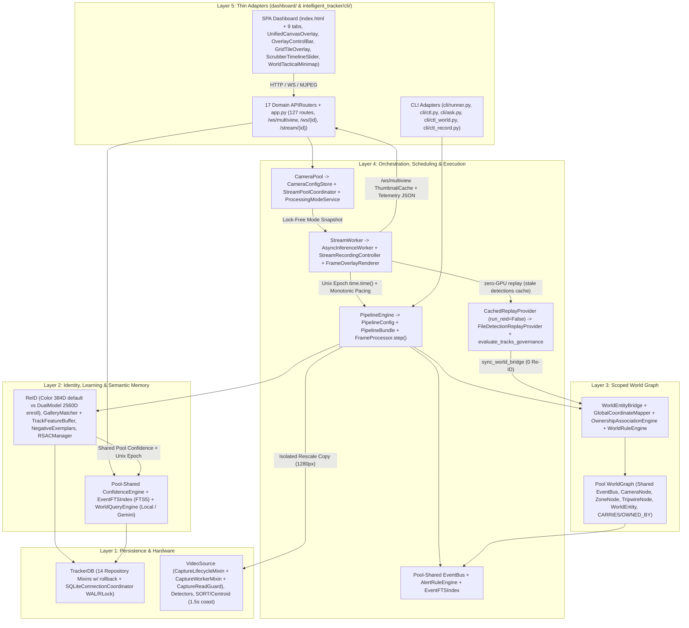

# Intelligent Tracker — Current Architecture & Alignment Audit

> **Snapshot Basis**: Branch `feature/integration-remediations` at commit `a0a50e2` (post-Steps 1–4 of `.TODO/tracking_intelligence_ux_master_roadmap.md`).
> **Measured Static & Test Baseline**: `plan_engine.py status` = `1,008` passing tests (`MPLBACKEND=Agg .venv/bin/python -m unittest discover tests`); `diagnose.py arch-map` = `365` source files, `67,929` lines, `127` FastAPI route decorators across 17 routers + `dashboard/app.py`, `0` upward imports from `intelligent_tracker/` to `dashboard/` or `scripts/`, `0` CSS `!important` across `26` stylesheets; `diagnose.py scan` = `0` active defects (`65` resolved); `diagnose.py surface --verify` = `3` missing-ID mismatches (`#btn-outline`, `#btn-primary` in `dashboard/static/js/camera_ai_config.js`, `#candidate-discourage-btn` in `dashboard/static/js/tag_feedback_actions.js`); `diagnose.py audit` flags `171` (`intelligent_tracker`) + `172` (`dashboard`) + `1` (`scripts`) `mypy` errors and `array_utils.py:134` `ruff F821`; `4/4` registered workspace probes passing (`cold_boot_world_probe`, `replay_pipeline_probe`, `video_studio_contract_probe`, `spa_nine_tab_cdp_probe`).
> **Reference Target**: [Ideal World Architecture & Target Blueprint](IDEAL_WORLD_ARCHITECTURE.md) (`ADRs 01–12`, Layers 1–5).

### Pre-Run Verification One-Liners

```bash
MPLBACKEND=Agg python -m unittest discover tests
python -m sphinx -W --keep-going documentation/ documentation/_build/html/
python skills/system-diagnostics/scripts/diagnose.py arch-map --path .
```

---

## 1. Executive Alignment Verdict vs. `IDEAL_WORLD_ARCHITECTURE.md`

- **Structural Convergence (~93% across ADRs 01–12 / Layers 1–5)**: Unified `PipelineEngine` + `FrameProcessor.step()`, pool-scoped `WorldGraph` + `EventBus`, Kalman/SORT `1.5 s` coasting + `TrackFeatureBuffer` + `CARRIES`/`OWNED_BY` ownership edges, `NegativeExemplarService`, `/api/enroll/check-collision`, SQLite time-bucketed `/analytics/flows`, calibrated `WorldTacticalMinimap` (`/api/topology/world-map`), `/api/entities/suggest`, 17 modular FastAPI routers, `Depends(get_db)`, and `rollback()` across all 14 `*_repo.py` mixins are verified on `HEAD`.
- **Operational End-to-End Parity (~84% — Active Post-UX-Roadmap Gaps)**: Live user & cross-layer verification exposed **BUG-01..BUG-09** covering **User Findings 1–5** and **User Ideas 1–5**: a P0 Re-ID embedding dimension split-brain + stale detection caches (`BUG-01`), missing automatic sighting crops (`BUG-02`), cramped modal columns & missing `.form-row`/`.col-*` CSS (`BUG-03`), blind `#gallery` Enrollment source & stacked duplicate `<video>` (`BUG-04`), `#studio` broken initial `alt="Studio Feed"` & empty `` surfaces (`BUG-05`), confusing `#modal-tag-entity` + `ConfidenceEngine.record_human_feedback` crash (`BUG-06`), `#alerts` badge stuck at `"8"` + empty camera dropdown + default `restricted_vault` (`BUG-07`), residual lock-over-I/O & unshared `VideoIndexer` singletons (`BUG-08`), and surface/modal initializer bugs (`BUG-09`).

| ADR / Layer | Target Blueprint | Current Branch Status | What Is Genuinely Achieved | Remaining Drift / Gaps |
| :--- | :--- | :--- | :--- | :--- |
| **ADR-01: Unified Core Engine** | Single `PipelineEngine` + `FrameProcessor` for CLI & Dashboard | **Achieved (Legacy Forms Kept)** | CLI (`pipeline_builder.py`, `runner.py`), Dashboard (`pipeline_factory.py`), and `VideoIndexer` share `PipelineEngine`; `pyproject.toml` defines all 3 `console_scripts`. | `cli/runner.py:27` & `interactive.py:274` retain legacy `--gui forms` (`high_objects.py`, `523L`). |
| **ADR-02: Scoped `WorldGraph`** | Scoped `WorldGraph`, reactive rules, `CARRIES`/`OWNED_BY` | **Achieved (`WorldPolicy` Unwired)** | `CameraPool` shares `EventBus` into `WorldGraph`; `ScenarioManager` re-applies overlays on restart; `OwnershipAssociationEngine` (`world/ownership.py`) links person+bag edges. | `WorldPolicy` (`world/nodes.py:182-198`) lacks REST/CLI CRUD and pipeline rule readers; `configs/alert_demo.yaml` (`restricted_vault`) loads by default. |
| **ADR-03 & ADR-10: Memory, `DualModel` Re-ID & Auto-Crops** | Canonical `DualModel`, throttled sighting crops, retroactive run relabeling, FTS + Q&A | **Needs Remediation (`BUG-01`, `BUG-02`, `BUG-06`)** | `EventFTSIndex`, `ConfidenceEngine`, `WorldQueryEngine`, `/api/enroll/check-collision`, and `NegativeExemplarService` exist; `1x1` ROI double-crop is fixed (`is_direct_crop=True`). | `VideoIndexer`/`StreamPipelineFactory`/`RoiRecognitionService` default to `384`-dim `"color"` vs. `2560`/`2432`-dim `DualModel`; `emit_periodic_sighting` passes no crop (`BUG-02`); `record_human_feedback` crashes on `"reject"` + `camera_id`/`zone_id` (`BUG-06`); `create_video_indexer` omits shared `confidence_engine`/`world_graph` (`BUG-08`). |
| **ADR-04: `arch-map` & Modularity** | `< 350L`/file (`< 500L` hard), `<= 12` methods/class, `<= 40L`/fn, clean DI | **Partial (`mypy` & DI/Lock Gaps)** | `0` upward imports, `0` CSS `!important`, `0` active `scan` defects (`65` resolved), routers use `Depends(get_db)`, all 14 `*_repo.py` call `rollback()`. | `1` legacy hard overrun (`high_objects.py` `523L`), `5` warn files, `48` functions `> 40L`; `mypy` (`171+172+1`); `array_utils.py:134` `F821`; `BackupManager` & fallback `ScenarioManager()` bypass shared DB (`BUG-08`). |
| **ADR-05 & ADR-11: Modal Ergonomics, `MediaEmptyState`, Categories & Tag UX** | Wide resizable modals, unified Enrollment stage, shared `MediaEmptyState`, SSOT categories, 2-state Tag modal | **Needs Remediation (`BUG-03`..`BUG-06`, `BUG-09`)** | `OverlayControlBar`, `UnifiedCanvasOverlay`, `ResizeObserver` on `2x2..4x4` grid tiles, `object-fit: contain` ROI thumbs, and `ScrubberTimelineSlider` exist. | Cramped `960px` `1fr 1fr` modals + missing `.form-row`/`.col-*` CSS (`BUG-03`); blind `#gallery` Enroll + stacked duplicate `<video>` + hardcoded 30 FPS (`BUG-04`); raw `alt` broken images on `#studio`/modals (`BUG-05`); 1-state `#modal-tag-entity` + modal-closing `✕` (`BUG-06`); category mismatches vs. residential demo seeds (`Idea 1`); `surface --verify` mismatches (`BUG-09`). |
| **ADR-06 & ADR-07: Clocks, Coasting & Locks** | Monotonic vs. Unix epoch, `1.5s` coasting, lock-free I/O | **Partial (`BUG-08` Locks/Clock)** | `app.state.db` decoupled from `primary_sm`; `StreamRecordingController` out-of-lock persistence; `SortTracker`/`CentroidTracker` 1.5s coasting + `TrackFeatureBuffer` active. | `CameraConfigStore.load_cameras`, `retry_camera_connection`, and `CameraPool.list_cameras` hold locks across I/O or nested locks; `AsyncInferenceWorker._run_loop` (`:151-153`) has legacy monotonic fallback. |
| **ADR-09 & ADR-12: Traceability, Alert Lifecycle & Studio Editing** | `#timeline` pagination/source, `#analytics` drill-down, stateful `#alerts`, editable `#studio` | **Partial (Step 4 Landed; `BUG-07`, `Ideas 2–4`)** | SQLite `/analytics/flows`, calibrated `WorldTacticalMinimap`, `/api/entities/suggest`, `/events` server filters, and bidirectional `#review` sync are live. | `#timeline` lacks `offset` pagination & `Source` (`Idea 2`); `#analytics` lacks X/Y scales & peak/32x24 click drill-down (`Idea 3a`); `#alerts` badge stuck at `"8"`, `#alerts-filter-camera` unpopulated, no ack/delete/export (`BUG-07`); `#studio` lacks in-place vertex editing, interactive minimap cones & 0-GPU re-eval (`Idea 4`). |

---

## 2. Current Layered Architecture & Actual Runtime Data Flow

Dependencies flow strictly downward (`dashboard/` and `intelligent_tracker/cli/` -> `intelligent_tracker/`): `arch-map` confirms **0** upward imports from `intelligent_tracker/` into `dashboard/` or `scripts/`.



---

## 3. Measured Package Footprint, Modularity Debt & CLI <-> Dashboard Parity

### Directory Footprint (`diagnose.py arch-map`)

| Directory | Files | Lines | Primary Ownership |
| :--- | ---: | ---: | :--- |
| `.` | 2 | 161 | `main.py`, `setup.py` (`pyproject.toml` also at root) |
| `dashboard` | 167 | 34,239 | FastAPI app (`app.py`, `dependencies.py`), 17 routers (`routers/`), orchestration/replay/multiview (`services/`), modular SPA (`static/js/`, `static/css/`, `static/partials/`) |
| `documentation` | 1 | 180 | Sphinx `.rst` docs & `conf.py` |
| `intelligent_tracker` | 189 | 32,513 | Core CV (`detectors/`, `tracker/`, `reid/`, `matching/`, `geometry/`), `pipeline/`, `world/`, `memory/`, `events/`, `analytics/`, `repositories/`, `video/`, `cli/` |
| `scripts` | 6 | 836 | `run_dashboard.py`, `stream_ctl.py`, `cdp_inspect.py`, `diagnostics.py`, `download_models.py`, `camera_manager.py` |
| **Total** | **365** | **67,929** | **127 API route decorators across 17 routers + `dashboard/app.py`** |

### Remaining Modularity Budget Overruns

- **Hard Ceiling (`>= 500L`) — 1 legacy file**: `intelligent_tracker/high_objects.py` (`523` lines; `Scene` `25` methods).
- **Soft Warning (`350–499L`) — 5 files**: `dashboard/static/js/video_library.js` (`471`), `intelligent_tracker/interactive.py` (`451`), `scripts/cdp_inspect.py` (`436`), `intelligent_tracker/rsac.py` (`412`), `dashboard/routers/rsac.py` (`352`).
- **Near-Ceiling Targets (`<= 350L` / strict caps — DO NOT EXPAND)**: `dashboard/static/studio.js` (`349L`), `dashboard/static/js/universal_enrollment.js` (`345L`), `dashboard/static/js/interactive_canvas.js` (`239L` vs `< 240L`), `dashboard/static/partials/modals/camera_modals.html` (`238L`), `dashboard/static/partials/modals/entity_modals.html` (`237L` vs `< 240L`).
- **Heavy Classes (`>= 11` methods or `> 300L`) — 8 flagged**: `Scene` (`25`m, `269L`, `high_objects.py`), `TailItem` (`20`m, `172L`, `core/tails.py`), `Group` (`19`m, `149L`, `core/groups.py`), `EventFigure` (`19`m, `164L`, `forms.py`), `GroupMutationMixin` (`15`m, `164L`, `core/group_mutations.py`), `RSACManager` (`14`m, `210L`, `rsac.py`), `SpatialMixin` (`12`m, `302L`, `repositories/spatial_repo.py`), `WorldEntityBridge` (`11`m, `322L`, `world/entity_bridge.py`).
- **Functions `> 40L` — 48 flagged**: Top offenders include `run_interactive_app` (`151L`, `interactive.py:274`), `apply_windows_iocp_patch` (`129L`, `dashboard/services/windows_resilience.py:31`), `main_async` (`111L`, `scripts/cdp_inspect.py:302`), `setup_event_pipeline` (`109L`, `intelligent_tracker/events/pipeline.py:12`), `build_generic_audit_js` (`100L`, `scripts/cdp_inspect.py:143`), `cnt_intersection` (`91L`, `intelligent_tracker/geometry/intersections.py:171`), `transcode_to_h264_async` (`84L`, `dashboard/services/video_transcoder.py:258`), `generate_poly_indexes` (`83L`, `intelligent_tracker/geometry/indexing.py:12`), `object_hook_DEVJSONDecoder` (`81L`, `intelligent_tracker/persistence.py:130`), and `evaluate` (`80L`, `intelligent_tracker/events/rules.py:142`), plus `38` more.
- **Unused Import**: `intelligent_tracker/video/_capture_guard_worker.py` (`typing.Tuple` flagged by `arch-map`).

### CLI <-> Dashboard Operator Parity Matrix (9 Domains)

| Operational Domain | Dashboard Router(s) | CLI Surface (`ctl.py` / `runner.py` / Tools) | Remaining Parity Gaps |
| :--- | :--- | :--- | :--- |
| **Live Pipeline & Benchmark** | `streaming.py` (2), `cameras.py` | `runner.py` (`--source`, `--detector`, `--tracker`, `--reid`, `--governance`, `--headless`, `--benchmark`) | Covered locally; `interactive.py` keeps legacy `--gui forms` loop. |
| **WorldGraph & Semantic Q&A** | `world.py` (5) | `ctl.py ask` / `ask.py`, `ctl.py world [summary\|entities\|snapshot]` | Missing CLI parity for `/api/world/confidence/{id}`, `/api/world/timeline`, and `WorldPolicy` CRUD. |
| **Models & Diagnostics** | `system.py` (11), `camera_diagnostics.py` (5) | `ctl.py models [status\|verify\|download]`, `ctl.py stats/list/evict/prune/history/metrics`, `camera_tool.py` | Missing remote `ctl` parity for `/api/cameras/{id}/diagnostics`, `/probe`, `/release`, and traces. |
| **Camera Recording** | `camera_recording.py` (3) | `ctl.py record [start\|stop\|status]` (`ctl_record.py`) | Full remote parity (`ctl_record.py` still defaults `--camera-id` to `"cam_01"`). |
| **Backup & Restore** | `system.py` (`/api/backup/*`) | `intelligent_tracker/backup.py` (`--export`, `--import`, `--info`) | Local parity; no remote `ctl backup` subcommand. |
| **Batch Video Indexing** | `videos.py` (6), `video_jobs.py` (12) | `intelligent_tracker/batch.py`, `batch_reporting.py` | No CLI parity for transcoding, async job queue, report delete, or `--scenario-camera-id`. |
| **Camera Pool CRUD & Modes** | `cameras.py` (17), `processing_mode.py` (2) | `ctl.py list` (read-only), `camera_tool.py` (local HW only) | Zero CLI parity for camera `add`/`update`/`delete`/`toggle`/`retry`/`discover`/`overlays` or `processing-mode`. |
| **Scenarios, Topology & Journeys** | `scenarios.py` (11), `topology.py` (10) | `interactive.py` (local draw without DB/YAML save) | Zero CLI parity for zones, tripwires, homography CRUD, topology links, `world-map`, or `/api/journey/*`. |
| **Entities, Tagging, RSAC & Review** | `analytics.py` (10), `tagging.py` (5), `rsac.py` (18), `review.py` (6), `categories_and_collision.py` (2) | `interactive.py` / `display.py` (local `db.enroll_entity` only) | Zero CLI parity for review queue, RSAC rules/categories, alerts ack/delete/export, or ROI tagging. |

---

## 4. Verified Remediations Landed (Steps 1–4 of Both Master Roadmaps)

The following `P0`/`P1`/`P2` items from `integration_hardening_master_roadmap.md` and `tracking_intelligence_ux_master_roadmap.md` are verified fixed on `HEAD` (`a0a50e2`):

1. **`primary_stream` Aliasing Eliminated**: `resolve_stream_manager()` (`dashboard/dependencies.py:225-239`) returns `None` when explicit `camera_id` is missing across `/stream/{id}`, `/ws/{id}`, `/freeze_frame`, and `/ws/multiview`.
2. **`1x1` ROI Double-Crop Fixed**: `RoiRecognitionService.extract_roi_crop()` (`dashboard/services/roi_recognition_service.py:206-213`) returns `(frame, (0, 0, fw, fh))` immediately when `is_direct_crop=True`, and frontend callers omit `bbox` when `cropBase64` is active (`interactive_canvas.js:195`, `tag_feedback_actions.js:15`).
3. **Repository `rollback()` Coverage (`BE-1`) & Independent `app.state.db` (`BE-2`)**: All 14 `*_repo.py` mixins (including `signature_repo.py:60-62,114-116`) execute `self._conn.rollback()` on exceptions; `dashboard/app.py:155-156,176-180,206-207` opens `owned_db` for `app.state.db` independent of `primary_sm.db`.
4. **Kalman/SORT Coasting & Person+Bag `WorldGraph` Ownership (`BE-3` / `ADR-07`)**: `PipelineConfig` defaults `tracker_coast_seconds=1.5`, `tracker_coast_frames=15`; `CentroidTracker` & `SortTracker` emit `coasting`/`occluded` tracks; `TrackFeatureBuffer` retains Re-ID features (`coast_grace_seconds=2.0`); `OwnershipAssociationEngine` (`world/ownership.py`) maintains symmetric `CARRIES`/`OWNED_BY` edges and unattended-item alerts.
5. **Lock Order, DI & Multiview `ResizeObserver`**: `StreamRecordingController` moves SQLite/indexing writes outside `self._lock`; routers use `Depends(get_db)`/`Depends(get_camera_pool)`; `CameraGrid` + `UnifiedCanvasOverlay` keep `2x2 <-> 3x3 <-> 4x4` overlay parity; `RoiDrawTagger` drag rects survive telemetry; `/api/enroll/check-collision`, `NegativeExemplarService`, SQLite `/analytics/flows`, `WorldTacticalMinimap`, `/api/entities/suggest`, and bidirectional `#review` sync are implemented.

---

## 5. Active Post-UX-Roadmap Bug & Gap Catalog (`BUG-01`..`BUG-09`)

> **Discovery Basis**: Post-`tracking_intelligence_ux_master_roadmap.md` audit (`a0a50e2`) verifying User Findings 1–5 and User Ideas 1–5.

| ID | Sev | Symptom / Finding / Idea | Verified Root Cause (`file:line`) |
| :--- | :--- | :--- | :--- |
| **BUG-01** | **P0** | Enrolled Gallery Entities invisible on Video Studio, Replay & default Live feeds *(Idea 5)* | **3-layer split-brain**: (1) `UniversalEnrollmentManager` (`intelligent_tracker/enrollment.py:46`) writes `2560`/`2432`-dim `DualModel` vectors while `VideoIndexer` (`batch.py:88`), `StreamPipelineFactory` (`pipeline_factory.py:82-86`, `probe_db_reid=False`), and `RoiRecognitionService` (`roi_recognition_service.py:104-109`, requests unregistered `"osnet"` instead of `"onnx"` in `reid/factory.py:14-21`) run `384`-dim `"color"` — `get_gallery_embeddings` (`signature_repo.py:180-181`) silently skips dim mismatches. (2) Post-index tagging never relabels `video_runs.frame_detections_json` (`video_run_repo.py:167-200`) and `CachedReplayProvider` defaults `run_reid=False` (`cached_replay_provider.py:93`). (3) `OverlayLayers.ensureLoaded` (`overlay_layers.js:97-124`) ignores `{force: true}` on `streamCache`. |
| **BUG-02** | **P1** | `#timeline` only shows images for manual ROIs; automatic sightings lack crops *(Finding 4)* | `emit_periodic_sighting()` (`intelligent_tracker/matching/_gallery_signals.py:156-189`) never receives `frame` or writes crops (`snapshot_path=""` in `analytics_repo.py:128-136`); `_enrich_sighting()` (`dashboard/routers/analytics.py:200-203`) omits entity thumbnail fallback; `gallery_timeline.js:156` hides failed `` (`display='none'`). |
| **BUG-03** | **P1** | Enrollment & Camera VMS dialogs cramped (~450px/col); paired form fields collapse *(Findings 2 & 3)* | `#modal-universal-enrollment` (`entity_modals.html:59-150`) & `#modal-camera-manager` (`camera_modals.html:2-199`) force `1fr 1fr` inside `max-width: 960px` (`modals.css:42-44`) without `min-width: 0` on `.modal-left-col`/`.modal-right-col`, squeezing a 6-col table & non-wrapping `.section-subhead`; `.form-row` and `.col-4`..`.col-8` have **0 CSS rules** in `dashboard/static/css/`. |
| **BUG-04** | **P1** | `#gallery` Enroll opens blind to active camera; video source stacks duplicate `<video>` & hardcodes 30 FPS *(Finding 1)* | `openModal()` (`universal_enrollment.js:58-71`) silently picks `App.getActiveCameraId()` with no badge on `gallery.html:20-22`; `mountEnrollmentScrubber` (`scrubber_timeline_slider.js:30-34,127-162`) stacks a `140px` `<video>` under `#enroll-bbox-canvas`, skips `timeupdate` canvas sync during Play, hardcodes `fps = 30`, and drops `video:` source context on submit (`universal_enrollment.js:215`). |
| **BUG-05** | **P1** | `#studio` initial feed broken (`alt="Studio Feed"`); 6+ `` tags risk raw `alt` icons *(Finding 5)* | `#studio-live-img` (`studio.html:39`) lacks initial poster/`onerror`; tab entry triggers competing attaches (`live_player.js:259` + `studio.js:338-341`), ignores `offline`/`disabled`/`null` cameras (`studio.js:119`), and `clearStudioLiveImage()` (`studio.js:62`) assigns `img.src = ''` (fetching `/`). Same missing fallback on `#tag-roi-crop-img`, `#static-heatmap-img`, `#snapshot-modal-img`, `#enroll-crop-preview-img`, and `#test-preview-img`. |
| **BUG-06** | **P1** | `#modal-tag-entity` always shows `"Not This"`, candidate `✕` closes dialog, & `ConfidenceEngine` crashes *(Idea 5)* | `#btn-tag-discourage` (`entity_modals.html:50`) stays visible on blank ROIs; candidate `✕` (`tag_feedback_actions.js:48`) calls `closeTagModal()`; `match_crop_to_gallery` (`roi_recognition_service.py:244-262`) lacks threshold/`is_known` & ignores `negative_exemplars`; `record_human_feedback()` (`roi_recognition_service.py:63-67`, `negative_exemplar_service.py:117-121`) passes invalid `action="reject"` & `camera_id`/`zone_id` to `confidence.py:27` (`TypeError`/`ValueError` swallowed). |
| **BUG-07** | **P1** | `#alerts` badge stuck at `"8"`, `"All Cameras"` empty, & demo `"restricted_vault"` loaded *(Idea 3b)* | `_extract_recent_alerts` (`stream_telemetry.py:7-18`) slices `event_bus.get_recent_events(limit=8)` and `app.js:179-183` sets badge text to `recent_alerts.length` (while `app_ui_helpers.js:55` targets missing `#drawer-alert-count`); `#alerts-filter-camera` (`alerts.html:9-11`) is never populated; `alert_demo.yaml:42` loads `restricted_vault` by default (`stream_manager.py:84`); no `is_read`/ack/delete/export endpoints. |
| **BUG-08** | **P1** | Residual lock-over-I/O, nested locks, unshared `VideoIndexer` singletons & single-stream entity delete | JSON I/O under `pool._lock` (`camera_config_store.py:90-110`, `camera_source_bootstrap.py:185-187`); nested `pool._lock -> health._lock / sm._lock` (`camera_pool_queries.py:174-178`); `create_video_indexer` (`video_analytics_service.py:150-174`) omits `confidence_engine`/`world_graph`; `DELETE /entities/{id}` (`analytics.py:185-186`) reloads only `primary_stream`; `BackupManager` (`system.py:84,112`) & fallback `ScenarioManager()` (`dependencies.py:181-190`) open unshared DBs; monotonic fallback at `async_inference_worker.py:151-153`. |
| **BUG-09** | **P2** | `surface --verify` mismatches, `ruff F821`, bypassed `openModal()`, & UX traceability/studio gaps *(Ideas 1–4)* | `#btn-outline`/`#btn-primary` (`camera_ai_config.js`) & `#candidate-discourage-btn` (`tag_feedback_actions.js`) query classes as IDs; undefined `overlay` (`array_utils.py:134`); drawer/hash modals bypass `openModal()`; `entities.category` mismatches `custom_categories` (`family_car` demo seeds); `#timeline` lacks `offset`/`source`; `#analytics` lacks X/Y scales & peak/hotspot click; `#studio` lacks in-place vertex editing & interactive minimap cones. |

---

## 6. Why Bugs Slipped Past Existing Tooling — & Exact Enhancements

| Blind Spot Category | Concrete Example Missed | Why Current Checks Missed It | Recommended Tool / Probe Enhancement |
| :--- | :--- | :--- | :--- |
| **Split-Brain Unit/Probe Pipelines** | `BUG-01` (Re-ID 2560D vs 384D mismatch & stale `frame_detections_json`/`streamCache`) & `BUG-08` (`create_video_indexer`) | Unit tests mock uniform-dim `extract()`; `video_studio_contract_probe.py:43` constructs `VideoIndexer` directly instead of calling `/api/enroll` + `create_video_indexer()` + `/detections`. | Upgrade `video_studio_contract_probe.py` to test `/api/enroll` -> `create_video_indexer()` -> `/detections` & post-index relabeling, verifying `entity_name` resolves on live, video, and replay tracks. |
| **Swallowed Signature Drift (`TRY/EXCEPT`)** | `BUG-06` (`ConfidenceEngine.record_human_feedback("reject", camera_id=..., zone_id=...)` failing silently) | No static AST rule checks callee signatures inside broad `try...except Exception` blocks, and unit tests mocked `ConfidenceEngine`. | Add `CALLABLE_SIGNATURE_DRIFT` AST rule to `system-diagnostics` (`cross_module_rules.py`) flagging keyword/positional mismatches against local class methods. |
| **Orphaned HTML Layout Classes & Squeezed Modals** | `BUG-03` (`.form-row`, `.col-4`..`.col-8` undefined in CSS; 6-col table squeezed inside 450px modal column) | `audit_layout.js` checks root/container horizontal overflow only; `surface_verifier.py` verifies IDs and `fetch` routes, not CSS layout grid classes. | Add `[UNDEFINED_LAYOUT_CLASS]` check to `surface_verifier.py` and extend `audit_layout.js` to flag modal `.data-table` horizontal overflow and squeezed `< 140px` form inputs. |
| **Zero-Data / Happy-Path Probe Seeding** | `BUG-02` (empty auto-sighting crops), `BUG-05` (`#studio` broken `alt` on cold/offline/0-cam), `BUG-07` (stuck `"8"`, empty `#alerts-filter-camera`) | `spa_nine_tab_cdp_probe.py` seeds `0` entities, `0` automatic sightings, and `0` `EventBus` alerts, always boots with an active stream, and never inspects `<select>` option counts or `img.getAttribute('src') === ''`. | Extend `audit_layout.js` for empty `src=""`/broken ``; upgrade `spa_nine_tab_cdp_probe.py` & `replay_pipeline_probe.py` to seed auto-sightings + `>= 12` events + 2 cameras + cold `#studio` hash/offline checks + non-closing candidate `✕`. |
