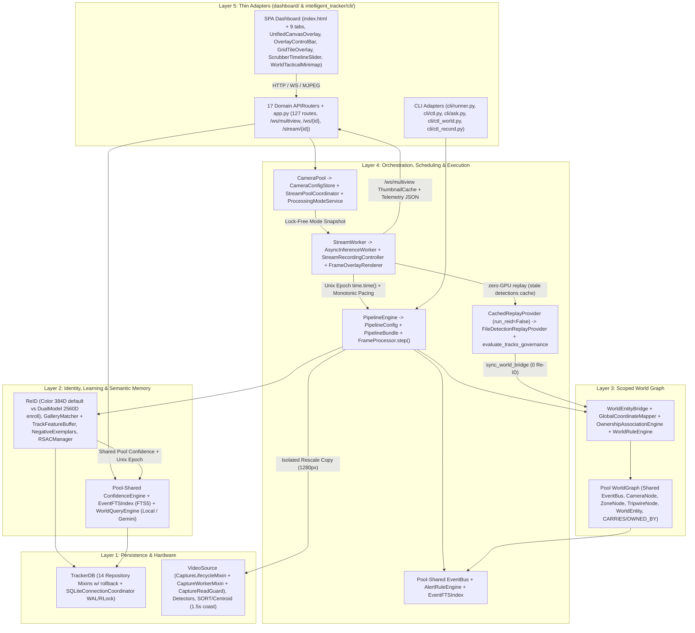

# Intelligent Tracker — Current Architecture & Alignment Audit

> **Snapshot Basis**: Branch `feature/reid-and-traceability-unification` at commit `49e508b` (post-Steps 1–4 of `.TODO/reid_unification_traceability_and_studio_ux_master_roadmap.md`).
> **Measured Static & Test Baseline**:
> - `MPLBACKEND=Agg .venv/bin/python -m unittest discover tests` = `1,077` total (`1,075` passed, `1` failure: `test_video_jobs.TestVideoJobAPI.test_07_analytics_detections_count_and_persistence`, `1` error: `test_ctl_record.TestCtlRecordParity.test_ctl_record_start_status_and_stop`).
> - `diagnose.py arch-map` = `392` source files, `72,175` lines, `138` API routes across 19 routers + `dashboard/app.py`; `0` upward imports from `intelligent_tracker/` to `dashboard/` or `scripts/`; `0` CSS `!important`; `1` unused route import (`dashboard/routers/rsac.py` -> `dashboard.routers.categories.create_custom_category`) + `1` unused import (`intelligent_tracker/video/_capture_guard_worker.py` -> `typing.Tuple`); `1` hard overrun (`high_objects.py` `523L`), `6` WARN files (`video_library.js` `471L`, `interactive.py` `451L`, `scripts/cdp_inspect.py` `436L`, `intelligent_tracker/rsac.py` `402L`, `dashboard/routers/rsac.py` `360L`, `dashboard/services/roi_recognition_service.py` `354L`), `52` functions `> 40L`.
> - `diagnose.py surface --verify` = `0` mismatches (`417` IDs, `28` selects, `743` globals, `138` routes).
> - `diagnose.py scan` = `0` active defects (`65` resolved).
> - `diagnose.py audit` = `mypy`: `171` (`intelligent_tracker`) + `172` (`dashboard`) + `1` (`scripts`); `ruff`: `59` + `4` + `2`.
> - Workspace probes: `3/4` passing (`cold_boot_world_probe`, `replay_pipeline_probe`, `video_studio_contract_probe`), while `spa_nine_tab_cdp_probe` exited `cdp_exit_code: 1` with an empty `sweep: {}` (`0` tabs), emitting 16 cascading failures — rendering the prior "4/4 probes passing" sign-off untrustworthy (`INFRA_UNAVAILABLE` blind spot).
> - Runtime traces (`diagnose.py traces`): `TRC-015` / `TRC-017` code-guarded but still marked `active`; `TRC-018` Windows temp-file lock (`[WinError 32]`).
> **Reference Target**: [Ideal World Architecture & Target Blueprint](IDEAL_WORLD_ARCHITECTURE.md) (`ADRs 01–20`, Layers 1–5).

### Pre-Run Verification One-Liners

```bash
MPLBACKEND=Agg python -m unittest discover tests
python -m sphinx -W --keep-going documentation/ documentation/_build/html/
python skills/system-diagnostics/scripts/diagnose.py arch-map --path .
```

---

## 1. Executive Alignment Verdict vs. `IDEAL_WORLD_ARCHITECTURE.md`

- **Structural Convergence (~93% across ADRs 01–12 / Layers 1–5)** vs. **Operational End-to-End Parity (~65%)**: Static diagnostics report `0` surface mismatches and `0` active `scan` defects, yet real-world usage and cross-layer verification uncovered **21 active integration-seam bugs (`BUG-10`..`BUG-30`, including 7 P0s)**. The previous roadmap built individual features that break where layers meet: YAML vs. Python defaults (`BUG-10`, `BUG-11`), stale replay caches (`BUG-12`), `EventBus` shadowing SQLite alerts (`BUG-13`), missing cross-page navigation/source state (`BUG-14`), Studio drag-to-`PUT` geometry rollbacks (`BUG-15`), and missing video-enrollment sightings (`BUG-16`). *Note: Prior audit IDs `BUG-01`..`BUG-09` are resolved or superseded by `BUG-10`..`BUG-30` below.*

| ADR / Layer | Target Blueprint | Current Branch Status | What Is Genuinely Achieved | Remaining Drift / Gaps |
| :--- | :--- | :--- | :--- | :--- |
| **ADR-01: Unified Core Engine** | Single `PipelineEngine` + `FrameProcessor` for CLI & Dashboard | **Achieved (Legacy Forms Kept)** | CLI (`pipeline_builder.py`, `runner.py`), Dashboard (`pipeline_factory.py`), and `VideoIndexer` share `PipelineEngine`; `pyproject.toml` defines all 3 `console_scripts`. | `cli/runner.py:27` & `interactive.py:274` retain legacy `--gui forms` (`high_objects.py`, `523L`). |
| **ADR-02: Scoped `WorldGraph`** | Scoped `WorldGraph`, reactive rules, `CARRIES`/`OWNED_BY` | **Achieved (`WorldPolicy` & Classes Gap)** | `CameraPool` shares `EventBus` into `WorldGraph`; opt-in `alert_demo.yaml` isolated; `OwnershipAssociationEngine` (`world/ownership.py`) wired. | `WorldPolicy` (`world/nodes.py:182-198`) lacks CRUD/readers; wiped detector `classes` omit bag labels so ownership rarely fires (`BUG-23`). |
| **ADR-03 & ADR-10/13/16/19: `DualModel` Re-ID, Provenance & Review** | Single `ReidProfile` SSOT, cropped sightings, reversible review | **Broken (`BUG-10`, `BUG-16`, `BUG-24`)** | `EventFTSIndex`, `ConfidenceEngine`, `WorldQueryEngine`, auto-sighting crops in `replay_pipeline_probe`, and `VideoRunRelabelService` exist. | `configs/default.yaml:26-28` & `demo.yaml:26-28` force `reid.model: "color"` while `signature_repo.py:180-181` silently skips dim mismatches (`BUG-10`); `stream_telemetry.py:61-77` drops `entity_id`; video enrollments/relabels write zero `sightings` (`BUG-16`); review lacks undo and unknown queueing (`BUG-24`). |
| **ADR-04 & ADR-20: `arch-map`, Modularity & Seam Gates** | `< 350L`/file (`< 500L` hard), `<= 12` methods/class, clean probes | **Partial (`mypy`, Budgets & `INFRA` Blind Spot)** | `0` upward imports, `0` CSS `!important`, `0` active `scan` defects, `Depends(get_db)`, all 14 `*_repo.py` call `rollback()`. | `high_objects.py` (`523L`), 6 WARN files (`roi_recognition_service.py` `354L`, `routers/rsac.py` `360L`, etc.), `mypy` (`171+172+1`); `spa_nine_tab_cdp_probe` empty sweep (`cdp_exit_code: 1`) went undetected as `INFRA_UNAVAILABLE`. |
| **ADR-05 & ADR-11/15/18: Modals, Navigation & Tag UX** | `SourceRef` navigation, auto-fit modals, multi-box picker, `MediaEmptyState` | **Broken at Seams (`BUG-14`, `BUG-19`..`BUG-22`)** | `OverlayControlBar`, `UnifiedCanvasOverlay`, `MediaEmptyState`, `CategoryBadgeManager`, and Two-State `#modal-tag-entity` exist. | No `App.navigate(tab, SourceRef)` or full `switchCamera` sync (`BUG-14`); `.modal-lg` `@container` + `1fr 1fr` squeezes layout (`BUG-20`); enrollment grabs black frame on `loadedmetadata` (`BUG-19`); `STANDBY_POSTER_SVG` uses invalid `&bull;` (`BUG-21`); single hit-test (`BUG-22`). |
| **ADR-06, ADR-07 & ADR-17: Clocks, Detector Config, Replay & Tracking** | Deep-merged config, agnostic NMS, matching replay, SORT+hysteresis | **Partial (`BUG-11`, `BUG-12`, `BUG-18`, `BUG-23`, `BUG-29`)** | 3/4 `BUG-08` items fixed (`CameraConfigStore` I/O, pool locks, `create_video_indexer` singletons); `TRC-015`/`TRC-017` code-guarded. | Shallow config merge wipes `classes` + `None` cannot clear (`BUG-11`); `OnnxDetector` lacks cross-class NMS (`BUG-18`); live video feeds replay mismatched `video_runs` (`BUG-12`); default `centroid` + non-sticky `entity_id` (`BUG-23`); `async_inference_worker.py:151-155` wall-clock leak (`BUG-29`). |
| **ADR-09, ADR-12 & ADR-14/15: Traceability, SQLite Alerts & `#studio`** | SQLite alert SSOT, filtered `#timeline`, working drag-`PUT` `#studio` | **Partial (`BUG-13`, `BUG-15`, `BUG-17`, `BUG-25`..`BUG-28`, `BUG-30`)** | `#timeline` `count_sightings` total works; `PUT` scenario backend & interactive minimap exist; `events_admin` CSV/JSON export works. | `EventBus` shadows SQLite rows in `alerts_query_service.py:109-116` (`BUG-13`); dragged shapes snap back via `b[1][1]` typo + canvas-only `mouseup` + skipped YAML sync 404 (`BUG-15`); timeline drops `startTime`/`endTime` & races filters (`BUG-17`); minimap/BEV, `#analytics` camera select, connection pill, and provenance gaps (`BUG-25`..`BUG-30`). |

---

## 2. Current Layered Architecture & Actual Runtime Data Flow

Dependencies flow strictly downward (`dashboard/` and `intelligent_tracker/cli/` -> `intelligent_tracker/`): `arch-map` confirms **0** upward imports from `intelligent_tracker/` into `dashboard/` or `scripts/`.



---

## 3. Measured Package Footprint, Modularity Debt & CLI <-> Dashboard Parity

### Directory Footprint (`diagnose.py arch-map`)

| Directory | Files | Lines | Primary Ownership |
| :--- | ---: | ---: | :--- |
| `.` | 2 | 161 | `main.py`, `setup.py` (`pyproject.toml` also at root) |
| `dashboard` | 188 | 37,522 | FastAPI app (`app.py`, `dependencies.py`), 19 routers (`routers/`), orchestration/replay/multiview (`services/`), modular SPA (`static/js/`, `static/css/`, `static/partials/`) |
| `documentation` | 1 | 180 | Sphinx `.rst` docs & `conf.py` |
| `intelligent_tracker` | 195 | 33,476 | Core CV (`detectors/`, `tracker/`, `reid/`, `matching/`, `geometry/`), `pipeline/`, `world/`, `memory/`, `events/`, `analytics/`, `repositories/`, `video/`, `cli/` |
| `scripts` | 6 | 836 | `run_dashboard.py`, `stream_ctl.py`, `cdp_inspect.py`, `diagnostics.py`, `download_models.py`, `camera_manager.py` |
| **Total** | **392** | **72,175** | **138 API route decorators across 19 routers + `dashboard/app.py`** |

### Remaining Modularity Budget Overruns

- **Hard Ceiling (`>= 500L`) — 1 legacy file**: `intelligent_tracker/high_objects.py` (`523` lines; `Scene` `25` methods).
- **Soft Warning (`350–499L`) — 6 files**: `dashboard/static/js/video_library.js` (`471`), `intelligent_tracker/interactive.py` (`451`), `scripts/cdp_inspect.py` (`436`), `intelligent_tracker/rsac.py` (`402`), `dashboard/routers/rsac.py` (`360`), `dashboard/services/roi_recognition_service.py` (`354`).
- **Near-Ceiling Targets (`<= 350L` / strict caps — DO NOT EXPAND)**: `dashboard/dependencies.py` (`348L`), `dashboard/static/studio.js` (`347L`), `dashboard/static/js/live_player.js` (`347L`), `dashboard/static/js/universal_enrollment.js` (`347L`), `dashboard/static/js/gallery_timeline.js` (`343L`), `intelligent_tracker/detectors/onnx_detector.py` (`342L`), `dashboard/static/js/camera_ai_config.js` (`279L` vs `< 280L`), `dashboard/static/partials/modals/camera_modals.html` (`238L` vs `< 240L`), `intelligent_tracker/scenario_storage.py` (`236L` vs `< 240L`), `dashboard/static/js/interactive_canvas.js` (`236L` vs `< 240L`), `dashboard/static/partials/modals/entity_modals.html` (`219L` vs `< 240L`), `dashboard/static/index.html` (`171L` vs `< 180L`).
- **Heavy Classes (`>= 11` methods or `> 300L`) — 8 flagged**: `Scene` (`25`m, `269L`, `high_objects.py`), `TailItem` (`20`m, `172L`, `core/tails.py`), `Group` (`19`m, `149L`, `core/groups.py`), `EventFigure` (`19`m, `164L`, `forms.py`), `GroupMutationMixin` (`15`m, `164L`, `core/group_mutations.py`), `RSACManager` (`14`m, `211L`, `rsac.py`), `SpatialMixin` (`12`m, `302L`, `repositories/spatial_repo.py`), `WorldEntityBridge` (`11`m, `322L`, `world/entity_bridge.py`). *(Also at 12-method ceiling: `VideoIndexer`, `RoiRecognitionService`, `StreamManager`.)*
- **Functions `> 40L` — 52 flagged**: Top offenders include `run_interactive_app` (`151L`, `interactive.py:274`), `apply_windows_iocp_patch` (`129L`, `dashboard/services/windows_resilience.py:31`), `main_async` (`111L`, `scripts/cdp_inspect.py:302`), `setup_event_pipeline` (`109L`, `intelligent_tracker/events/pipeline.py:12`), `build_generic_audit_js` (`100L`, `scripts/cdp_inspect.py:143`), `cnt_intersection` (`91L`, `intelligent_tracker/geometry/intersections.py:171`), `transcode_to_h264_async` (`84L`, `dashboard/services/video_transcoder.py:258`), `generate_poly_indexes` (`83L`, `intelligent_tracker/geometry/indexing.py:12`), `object_hook_DEVJSONDecoder` (`81L`, `intelligent_tracker/persistence.py:130`), and `evaluate` (`80L`, `intelligent_tracker/events/rules.py:142`), plus `42` more.
- **Unused Imports**: `dashboard/routers/rsac.py` (`dashboard.routers.categories.create_custom_category`) and `intelligent_tracker/video/_capture_guard_worker.py` (`typing.Tuple`).

### CLI <-> Dashboard Operator Parity Matrix (9 Domains)

| Operational Domain | Dashboard Router(s) | CLI Surface (`ctl.py` / `runner.py` / Tools) | Remaining Parity Gaps |
| :--- | :--- | :--- | :--- |
| **Live Pipeline & Benchmark** | `streaming.py` (2), `cameras.py` | `runner.py` (`--source`, `--detector`, `--tracker`, `--reid`, `--governance`, `--headless`, `--benchmark`) | Covered locally; `interactive.py` keeps legacy `--gui forms` loop. |
| **WorldGraph & Semantic Q&A** | `world.py` (5) | `ctl.py ask` / `ask.py`, `ctl.py world [summary\|entities\|snapshot]` | Missing CLI parity for `/api/world/confidence/{id}`, `/api/world/timeline`, and `WorldPolicy` CRUD. |
| **Models & Diagnostics** | `system.py` (11), `camera_diagnostics.py` (5) | `ctl.py models [status\|verify\|download]`, `ctl.py stats/list/evict/prune/history/metrics`, `camera_tool.py` | Missing remote `ctl` parity for `/api/cameras/{id}/diagnostics`, `/probe`, `/release`, and traces. |
| **Camera Recording** | `camera_recording.py` (3) | `ctl.py record [start\|stop\|status]` (`ctl_record.py`) | Full remote parity (`ctl_record.py` still defaults `--camera-id` to `"cam_01"`). |
| **Backup & Restore** | `system.py` (`/api/backup/*`) | `intelligent_tracker/backup.py` (`--export`, `--import`, `--info`) | Local parity; no remote `ctl backup` subcommand. |
| **Batch Video Indexing** | `videos.py` (6), `video_jobs.py` (13) | `intelligent_tracker/batch.py`, `batch_reporting.py` | No CLI parity for transcoding, async job queue, report delete, or `--scenario-camera-id`. |
| **Camera Pool CRUD & Modes** | `cameras.py` (17), `processing_mode.py` (2) | `ctl.py list` (read-only), `camera_tool.py` (local HW only) | Zero CLI parity for camera `add`/`update`/`delete`/`toggle`/`retry`/`discover`/`overlays` or `processing-mode`. |
| **Scenarios, Topology & Journeys** | `scenarios.py` (13), `topology.py` (10) | `interactive.py` (local draw without DB/YAML save) | Zero CLI parity for zones, tripwires, homography CRUD, topology links, `world-map`, or `/api/journey/*`. |
| **Entities, Tagging, RSAC & Review** | `analytics.py` (11), `tagging.py` (5), `rsac.py` (15), `review.py` (6), `categories.py` (5), `categories_and_collision.py` (2), `events_admin.py` (5) | `interactive.py` / `display.py` (local `db.enroll_entity` only) | Zero CLI parity for review queue, RSAC rules/categories, alerts ack/delete/export, or ROI tagging. |

---

## 4. Verified Remediations Genuinely Landed (`49e508b`)

The following items from `.TODO/reid_unification_traceability_and_studio_ux_master_roadmap.md` are verified working on `HEAD` (`BUG-01`..`BUG-09` from the prior audit are resolved or superseded by `BUG-10`..`BUG-30` below):

1. **Timeline `count_sightings` Total**: `GET /sightings?paginated=true` computes total counts via `db.count_sightings` (`analytics_query_service.py:184`, `gallery_timeline.js:233-244`) when `paginated=true`.
2. **Dynamic Category Registry SSOT & Opt-In Demo**: `custom_categories` and `/api/rsac/categories` (`dashboard/routers/categories.py`) unify category validation/presets cleanly, and `configs/alert_demo.yaml` (`restricted_vault`) loads strictly on `--demo` / `IT_LOAD_DEMO_SCENARIOS=1`.
3. **Scenario `PUT` Editing Backend**: `PUT /api/scenarios/zones/{camera_id}/{zone_id}` and `/tripwires/{camera_id}/{tripwire_id}` (`scenarios.py:315-339`) update existing DB-backed zones/tripwires in place.
4. **Auto-Sighting Crop Persistence**: `emit_periodic_sighting()` writes bounded crops in isolated pipeline execution (`replay_pipeline_probe` `auto_sighting_crop_persisted: True`).
5. **`create_video_indexer` Shared Singletons & Concurrency Hardening**: `video_analytics_service.py:150-194` wires shared `confidence_engine`/`world_graph`; `camera_config_store.py:88-123` & `camera_source_bootstrap.py:179-187` perform JSON I/O outside `pool._lock`; `camera_pool.py:174-179` & `camera_pool_queries.py:47-83` eliminate nested pool/health locks; `TRC-015` (`async_inference_worker.py:126-127,202`) & `TRC-017` (`camera_config_store.py:69-77`) are guarded in code.

---

## 5. Active Integration Seam & UX Bug Catalog (`BUG-10`..`BUG-30`)

> **Discovery Basis**: Post-`reid_unification_traceability_and_studio_ux_master_roadmap` audit (`49e508b`) verifying User Findings 1–15 and User Ideas 1–14.

| ID | Sev | Symptom / Finding / Idea | Verified Root Cause (`file:line`) |
| :--- | :--- | :--- | :--- |
| **BUG-10** | **P0** | Re-ID never matches enrolled entities; tag modal shows `"No gallery match"`, live boxes show `"person"` *(Live Ideas 3–4)* | `configs/default.yaml:26-28` & `configs/demo.yaml:26-28` force `reid.model: "color"` overriding `default_reid_model="dual"` (`pipeline/config.py:147-152`, `pipeline_factory.py:82-87`); `signature_repo.py:180-181` silently skips mismatched dims (`roi_recognition_service.py:255` gets empty matrix); `stream_telemetry.py:61-77` drops `entity_id`. |
| **BUG-11** | **P0** | Detector config wiped (`usb_0` runs all 80 COCO classes at `0.25`); cleared `classes` cannot reset *(Finding 2)* | `dashboard/stream_manager.py:91` shallow-merges `{**loaded_cfg, **custom_cfg}` and `stream_pool_coordinator.py:31` passes `{"detector":{"model":"yolov8"}}`, erasing `default.yaml:13-14` `classes: ["person"]` (`pipeline/config.py:175-176` defaults to all COCO); `camera_config_store.py:160-161` skips `None` so `classes` cannot be cleared. |
| **BUG-12** | **P0** | Video cameras in `#live` replay stale Video Studio runs (e.g. `"car"`-only), ignoring live config *(Finding 2)* | `stream_worker.py:121` & `async_inference_worker.py:273-279` -> `file_detection_replay.py:227` -> `video_run_repo.py:167-187` unconditionally fetch `ORDER BY timestamp DESC LIMIT 1` without matching the camera's active detector config. |
| **BUG-13** | **P0** | `#alerts` Mark All Seen & Clear Matching appear broken; no row checkboxes *(Finding 13)* | `alerts_query_service.py:109-116` collects `EventBus` items before SQLite rows and deduplicates on `(event_type, camera_id, round(ts,3))`, so bus items lacking `id`/`is_read` shadow SQLite rows; `events_admin.py:45-73` mutates SQLite only; `alerts.html:32-44` & `alerts_view.js:88-96` lack selection checkboxes. |
| **BUG-14** | **P0** | Cross-tab Live/Studio/Analytics deep links ignore params & desync `#live` UI *(Findings 8, 11b, 12)* | `app.js:126-144` `handleHashRoute` ignores query params; `App.switchCamera` (`app.js:146-156`) swaps only WS (skipping `#live-stream-img`, `#active-camera-select`, title, and `CameraManager.focusCamera` `camera_grid.js:293-318`); callers (`gallery_timeline.js:166-171`, `alerts_admin.js:161-181`, `analytics_drilldown.js:116-159`) switch tab before camera, race `loadStudioChannels()`, or drop `zoneId`/`cell`/`time`. |
| **BUG-15** | **P0** | `#studio` dragged zone/tripwire vertices & shapes snap back on release *(Finding 15)* | `studio_shape_editor.js:18` typo `p[1] !== b[1][1]` (should be `b[i][1]`) drops vertical drags; `studio_canvas.js:218` binds `mouseup` only on canvas; `scenario_storage.py:221-226` skips YAML->DB sync if any DB row exists, causing `PUT` 404 (`spatial_edit_helpers.py:33-35`, `scenarios.py:315-339`) and editor rollback (`studio_shape_editor.js:183`). |
| **BUG-16** | **P0** | Video-enrolled entities have zero sightings on `#timeline` *(Finding 6)* | `enrollment.py:139-176`, `routers/rsac.py:80-121`, `active_learning_actions.py:90-145`, and `video_run_relabel_service.py:104-138` never write `sightings`; `sightings` (`schema_manager.py:31-37`) conflates `camera_id` & `video_filename` in `source`. |
| **BUG-17** | **P1** | `#timeline` Source stuck on `"All Sources"`; `startTime`/`endTime` ignored *(Findings 9, 11b)* | `app.js:110` fires `loadTimelineFilters()` unawaited, overwriting `#timeline-source-select` after `applyTimelineFilter()`; `/sightings/sources` omits zero-sighting cameras; `gallery_timeline.js:223-266` ignores `startTime`/`endTime`. |
| **BUG-18** | **P1** | Superposed `person`/`dog`/`cat` boxes on one person *(Finding 2)* | `onnx_detector.py:255-256` offsets boxes by `class_ids * 4096.0` before `nms_numpy`, disabling cross-class NMS. |
| **BUG-19** | **P1** | `#video` Enrollment opens with black canvas at `00:00` until slider moves *(Finding 4)* | `scrubber_timeline_slider.js:155` calls `grab` on `loadedmetadata` (`readyState=1`) instead of `loadeddata`/`seeked`, and `enrollment_stage_controller.js:26-34` never seeks to Video Studio's `currentTime`. |
| **BUG-20** | **P1** | `#enroll-camera-select` overflows; Enrollment/Camera VMS dialogs cramped *(Findings 3, 5)* | `modals.css:42-52,156-174` `.modal-lg` `@container (inline-size < 900px)` + `1fr 1fr` squeezes 6-col table & form; `entity_modals.html:64-71` `<select style="width:auto">` in non-wrapping flex parent without `min-width:0`; `modals.css:176-183` `.section-subhead` lacks `flex-wrap:wrap`. |
| **BUG-21** | **P1** | Pause shows `alt="Live Camera Stream"` & breaks feed; `#studio` lacks pause *(Finding 11)* | `live_player.js:9` embeds invalid XML entity `&bull;` in `STANDBY_POSTER_SVG`; `live_player.js:172` blocks reattach while `streamPaused`; `studio.html` does not wire `/api/cameras/{id}/freeze_frame` (`cameras.py:308-341`). |
| **BUG-22** | **P1** | Clicking overlapping boxes opens only one track in `#modal-tag-entity` *(Live Ideas 1–2)* | `interactive_canvas.js:57-66` & `roi_draw_tagger.js:61-72` return a single hit instead of collecting all overlapping boxes into a picker/queue. |
| **BUG-23** | **P1** | Centroid default tracker, frame-by-frame identity flicker & omitted ownership classes *(Ideas 2–4)* | `pipeline/config.py:164,181-182,234` defaults to `centroid`; `GalleryMatcher.match_track` (`gallery.py:192-219`, `_gallery_signals.py:286-293`) re-evaluates `entity_id` every frame without hysteresis lock; wiped/person-only `classes` exclude bag classes for `OwnershipAssociationEngine`. |
| **BUG-24** | **P1** | `#review` ignores unknowns/re-evals and lacks Undo / `"Correct..."` *(Review Ideas 5, 8)* | Queue admits only `0.45 <= sim < 0.65` (`_gallery_matching.py:142-144`, `active_learning_triage.py:59-65`); 0-GPU re-evals skip queueing; `routers/review.py` has no undo/audit reversal. |
| **BUG-25** | **P1** | `#studio` minimap lacks zoom/fit/pan; 4-pt BEV quad omitted from video feed *(Ideas 9–10)* | `world_minimap.js:14-40,156-180` & `world_minimap_interactions.js:143-179` render fixed `320x320` canvas without zoom/fit/pan; `studio.js:58-63,253` & `studio_canvas.js:172-190` never render saved `homography.src_points` in idle mode. |
| **BUG-26** | **P1** | `#analytics` lacks a camera selector *(Idea 8)* | `analytics.html` exposes no camera selector; `analytics_view.js:66,96` reads `App.getActiveCameraId()` passively. |
| **BUG-27** | **P2** | `#connection-status-pill` ignores `synthetic_01` `simulation`/hibernating states; drawer static *(Findings 1, 10)* | `app.js:197-214` & `telemetry.js:54,58` update only on WS `onopen`/`onclose`, ignoring `status`/`detector_status` (`stream_telemetry.py:130,153-154`, `stream_worker.py:128,188-198`); `#drawer-connection-status-pill` (`index.html:111`) is never updated. |
| **BUG-28** | **P2** | `#studio-status-banner` permanently visible, duplicating dropdown *(Finding 14)* | `studio.html:32-35` & `studio.js:301` keep banner visible for routine channel selection. |
| **BUG-29** | **P2** | Residual wall-clock fallback on `AsyncInferenceWorker` legacy tuples | `async_inference_worker.py:151-155` assigns `mono_ts = wall_ts` on 2/3-tuple `_pending` items instead of `time.monotonic()`. |
| **BUG-30** | **P2** | Remaining provenance, journey fallback & enrollment pause gaps *(Idea 7, 13–14)* | `journey_search.js:44` lacks `onerror`/Live jump; `JourneyHop` lacks `track_id`; analytics flows lack media refs; review items lack `run_id` (`_gallery_matching.py:59-63`); Enrollment camera preview lacks Pause/Resume toggle. |

---

## 6. Why Bugs Slipped Past Existing Tooling — & Exact Enhancements

| Blind Spot Class | Bugs Missed | Why Existing Checks Missed It | Planned Tool / Probe Upgrade |
| :--- | :--- | :--- | :--- |
| **Real config files never loaded** | `BUG-10`, `BUG-11` | Tests pass inline config dicts bypassing `configs/default.yaml` & `cameras.json` merge. | Add workspace `effective_config_probe` booting from copies of real `configs/*.yaml` + `cameras.json`; assert Re-ID dim equals gallery dim and `classes != None`. |
| **Silent shape-skip `continue`** | `BUG-10` | `signature_repo.py:180-181` silently skips mismatched dims with zero logs or counters. | Add `scan` AST rule flagging shape/dim-guarded `continue` without logging/metric + `GET /api/system/gallery-health`. |
| **Mocked `window.App` / `fetch` in Node VM** | `BUG-14`, `BUG-15`, `BUG-17` | Node VM tests stub `window.App.switchCamera`, `fetch`, and canvas DOM. | Add `deep_link_navigation_probe` (CDP) clicking Live/Studio/Timeline jump buttons and asserting camera select, stream `src`, and URL hash sync. |
| **Editor methods called directly** | `BUG-15` | Shape-editor tests invoke `onMouseDown/Move/Up` directly with mocked `fetch({ok:true})`. | Add `studio_drag_put_probe` performing real canvas drag + `PUT` + re-fetch against a temp SQLite DB. |
| **Empty `EventBus` in tests** | `BUG-13` | `test_step3_alerts_backend.py` sets `stream_manager=None`, hiding bus-vs-DB shadowing. | Add `alerts_store_probe` seeding both `EventBus` and SQLite and asserting `ack`/`clear`/`delete` update `GET /events`. |
| **CDP infra failure counted as probe result** | `spa_nine_tab_cdp_probe` (`0` tabs, 16 false failures) | `probe_runner` & `spa_nine_tab_cdp_probe` treat `cdp_exit_code=1` + `sweep={}` like normal probe results. | Upgrade `probe_runner.py` to emit `INFRA_UNAVAILABLE` and reject empty sweeps; `plan_engine verify` rejects non-passing probes. |
| **Short data & default viewport** | `BUG-20` | `audit_layout.js` checks `scrollWidth` at one viewport with short text (`Cam1`). | Extend `audit_layout.js` + `cdp_inspect.py` with child-box-outside-parent overflow checks across `960`/`1280`/`1920` viewports and long `<option>` strings. |
| **No `data:image` decode or pixel luminance check** | `BUG-19`, `BUG-21` | `audit_layout.js` checks only initial `` `naturalWidth > 0`. | Add `data:image/svg+xml` XML decode verification and first-frame enrollment canvas luminance check. |
| **No provenance or jump contract** | `BUG-16`, `BUG-17`, `BUG-30` | No schema or surface rule checks `SourceRef` carry-through on produced artifacts or jump buttons. | Add `sightings_provenance_probe` + `surface_contracts.py` fetch-method parity and `App.navigate` jump-button verification. |

---

## 7. Integration Seams & Entity Persistence Master Roadmap Completion (`BUG-10`..`BUG-30`)

All 4 steps of `.TODO/integration_seams_entity_persistence_master_roadmap.md` (`ADR-13`..`ADR-20`) are implemented, including Step 4 (`step_4_reversible_review_and_studio_ux.md`):

- **Reversible `review_decisions` Audit Trail (`PRAGMA user_version = 5`, `ADR-19`, `BUG-24`)**: `intelligent_tracker/repositories/review_schema.py`, `review_decision_repo.py` (`ReviewDecisionMixin`), `dashboard/services/reversible_review_service.py`, `dashboard/schemas_review.py`, and `dashboard/routers/review.py` / `tagging.py` (`/api/review/decisions`, `/undo`, `/report-wrong`, `/api/tag/correct`).
- **Recurring Unknowns & Timeline/Tag UX (`BUG-24`)**: `ActiveLearningTriage(unknown_min_dwell_sec=3.0)`, `_gallery_matching.py`, `video_scenario_reeval_service.py`, `tag_modal_state.js`, `tag_feedback_actions.js`, and `review_undo_and_flag.js`.
- **Studio Minimap Zoom/Fit/Pan, 4-Point BEV Quad & `< 260L` Split (`BUG-25`)**: `dashboard/static/js/studio_media.js` split from `studio_canvas.js` (`< 260L`), `world_minimap.js`, and `world_minimap_interactions.js`.
- **Journey, Analytics & Snapshot Overlay Isolation (`ADRs 09, 12`)**: `journey_search.js` empty-prefix suggestions, `analytics_flow_helpers.py` (`zone_id`, `event_type`, `page`, `page_size`, `video:<filename>`), and `dashboard/static/js/snapshot_modal_overlay.js` (`ResizeObserver` + `#timeline` reset).
- **Seam Probe**: `.diagnostics/probes/reversible_review_and_minimap_probe.py` alongside the 9 workspace seam probes.
