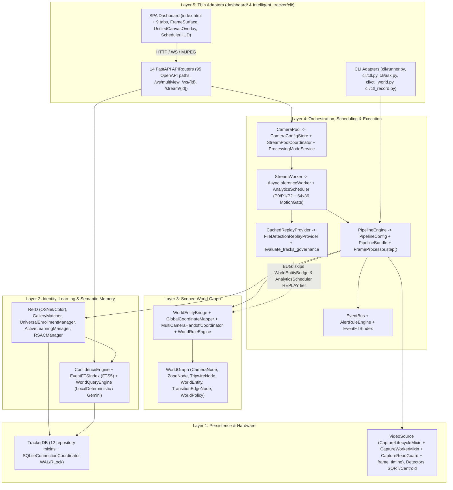

# Intelligent Tracker — Current Architecture & Alignment Audit

> **Snapshot Basis**: Branch `feature/integration-performance-improvements` (`diagnose.py arch-map`: 336 source files, 61,340 lines, 112 FastAPI route decorators / 95 OpenAPI paths; `diagnose.py tests`: 861 unit/integration tests passing).
> **Reference Target**: [Ideal World Architecture & Target Blueprint](IDEAL_WORLD_ARCHITECTURE.md) (`ADRs 01–04`, Layers 1–5).

---

## 1. Executive Alignment Summary vs. `IDEAL_WORLD_ARCHITECTURE.md`

The branch has substantially converged on the target 5-layer architecture, moving from the pre-roadmap baseline (222 files / 45,267 lines with dual pipeline loops, global `MetaSpace`, `1,688L` `index.html`, and `sys.modules` DI) to a unified `PipelineEngine`, scoped `WorldGraph`, `ConfidenceEngine`/`WorldQueryEngine`, WAL-coordinated `TrackerDB`, and scalable `/ws/multiview` + `AnalyticsScheduler` runtime.

| ADR / Target Area | Target Blueprint | Current Branch Status | Remaining Gaps / Drift |
| :--- | :--- | :--- | :--- |
| **ADR-01: Unified Core Engine + Thin Adapters** | Single `PipelineEngine` + `FrameProcessor.step()` for CLI and Dashboard | **Mostly Achieved** — `PipelineEngine.build()` and `FrameProcessor.step()` power both `CliAppRunner` and `StreamPipelineFactory` / `StreamWorker` | `VideoIndexer` (`batch.py`) builds a manual `PipelineBundle` without `WorldGraph`/`ConfidenceEngine`; `interactive.py` bypasses `PipelineEngine`; `AsyncInferenceWorker` + `CachedReplayProvider` introduced timing/scheduler bypass bugs |
| **ADR-02: Scoped `WorldGraph` + Reactive Rules** | Instance-scoped `WorldGraph`, `WorldEntityBridge`, `GlobalCoordinateMapper`, retiring `MetaSpace`/`high_objects.py` | **Mostly Achieved** — `WorldGraph`, `WorldEntityBridge`, `WorldRuleEngine`, `GlobalCoordinateMapper`, and `MultiCameraHandoffCoordinator` are wired in `CameraPool` & `PipelineEngine` | `ScenarioManager.load_scenarios()` syncs homography on startup but not loaded DB/YAML zones/tripwires to `WorldGraph`; `CachedReplayProvider` skips `WorldEntityBridge` updates; `high_objects.py` (`523L`) still called by `cli/runner.py --gui forms`; `core/` still imports `core/spaces.py` |
| **ADR-03: Hybrid Local Memory + Pluggable Q&A** | `ConfidenceEngine`, `EventFTSIndex`, `WorldQueryEngine` + `SemanticProvider` | **Achieved (Core)** — Implemented in `intelligent_tracker/memory/`, wired in `PipelineEngine`, `/api/world/*`, and `intelligent-tracker ask` | `dashboard/app.py` does not bind `ConfidenceEngine` or `WorldQueryEngine` into `app.state` (`get_world_query_engine()` constructs fresh instances per request); offline `VideoIndexer` omits `ConfidenceEngine` |
| **ADR-04: `arch-map` Verification & Modularity** | Zero active files `>= 500L`; `<= 12` methods/class; `<= 40L`/fn; zero `sys.modules` DI hacks | **Largely Achieved** — `index.html` (`168L`), `analytics/`, `periferials.py` (`29L` shim), `camera_pool.py`, `dependencies.py` (`app.state` DI) refactored | 1 legacy `>= 500L` file (`high_objects.py` `523L`), 10 `350–499L` files (including `capture_worker.py` `353L`), heavy legacy classes (`Scene`, `TailItem`, `Group`, `CaptureReadGuard`, `RSACManager`), and `65` functions `> 40L` |
| **Layer 1: SQLite Concurrency & Packaging** | `pyproject.toml` entrypoints + WAL pooled/serialized DB coordinator | **Achieved** — `pyproject.toml` defines `console_scripts`; `SQLiteConnectionCoordinator` enforces WAL + `RLock` + refcounted `TRUNCATE` checkpoint | `intelligent_tracker/backup.py` still uses raw `sqlite3.connect()`; `dashboard/routers/analytics.py` reads `mgr.db` via `get_active_stream_manager` instead of `Depends(get_db)` |
| **Layer 5: CLI ↔ Dashboard Operator Parity** | Full operational parity and thin routers | **Partial** — `ctl.py`, `ask.py`, `ctl_world.py`, `ctl_record.py` cover stream inspection, recording, models, world, and Q&A | `ctl.py` lacks camera pool CRUD, processing mode, scenario/topology, RSAC/active-learning, and video job commands; `ctl_record.py` still defaults `camera_id` to `"cam_01"` |

---

## 2. Current Layered Architecture & Actual Runtime Data Flow

Dependencies flow downward from `dashboard/` and `intelligent_tracker/cli/` into `intelligent_tracker/` (`arch-map` confirms **0** upward imports from `intelligent_tracker/` into `dashboard/` or `scripts/`).

---

## 3. Package & Module Inventory (Measured Footprint)

| Directory | Files | Lines | Primary Ownership |
| :--- | ---: | ---: | :--- |
| `.` | 2 | 161 | `main.py`, `setup.py` (`pyproject.toml` also at root) |
| `dashboard/` | 149 | 30,252 | FastAPI app (`app.py`, `dependencies.py`), 14 routers (`routers/`), orchestration/replay/multiview (`services/`), modular SPA (`static/js/`, `static/css/`, `static/partials/`, `templates/`) |
| `intelligent_tracker/` | 178 | 29,911 | Core CV (`detectors/`, `tracker/`, `reid/`, `matching/`, `geometry/`), unified `pipeline/`, `world/`, `memory/`, `events/`, `analytics/`, `repositories/`, `video/`, `cli/` |
| `scripts/` | 6 | 836 | `run_dashboard.py`, `stream_ctl.py`, `cdp_inspect.py`, `diagnostics.py`, `download_models.py`, `camera_manager.py` |
| `documentation/` | 1 | 180 | Sphinx `.rst` docs & `conf.py` |

### Remaining Modularity Budget Overruns (`diagnose.py arch-map`)

- **Hard Ceiling (`>= 500L`)**: `intelligent_tracker/high_objects.py` (`523L`; legacy `Scene` has `25` methods).
- **Soft Warning (`350–499L`)**:
  - Frontend JS: `dashboard/static/js/video_jobs.js` (`493L`), `video_library.js` (`471L`), `video_scrubber.js` (`389L`), `app.js` (`373L`), `camera_manager.js` (`365L`).
  - Python: `intelligent_tracker/interactive.py` (`451L`), `scripts/cdp_inspect.py` (`436L`), `intelligent_tracker/matching/gallery.py` (`425L`), `intelligent_tracker/rsac.py` (`412L`), `intelligent_tracker/video/capture_worker.py` (`353L`, newly over `350L` in staged diff).
- **Heavy Classes (`> 12` methods)**: `Scene` (`25`), `TailItem` (`20`), `Group` (`19`), `EventFigure` (`19`), `CaptureReadGuard` (`16`), `GroupMutationMixin` (`15`), `RSACManager` (`14`).

---

## 4. Recent Feature Integrations & Observed Architectural Drift

The current branch layered three major initiatives on top of the World Architecture roadmap:
1. **Live & Video Studio Unification** (client-side `UnifiedCanvasOverlay`, ROI drag-tagger, SQLite `video_runs` SSOT, live-record metadata handoff, `VideoIndexer` via `FrameProcessor.step()`).
2. **Performance & Processing Modes** (event-loop offloading, subscriber-aware JPEG encoding, tab-scoped streams, `ProcessingModeService`: `focus_only`, `full_realtime`, `capture_only`, `paused`).
3. **Real-Time Multiview & Resource-Aware Analytics Scheduler** (`/ws/multiview` binary canvas tiles, `ThumbnailCache`, `AnalyticsScheduler` P0/P1/P2 + `64x36` `MotionGate`, `dt`-aware trackers, `CachedReplayProvider`, `SchedulerHUD`).

### Verified Integration Bugs & Architectural Gaps

#### A. Pipeline, Scheduler, Replay & Timing Bugs
1. **Staged Media Timing & Replay Sync Fix (plus remaining FPS/clock drift)**:
   - *Staged fix*: `VideoSource` / `CaptureWorkerMixin` lacked `last_media_time_s` and `measured_fps`, clamped files via `fps_limit=30`, and drifted via wall-clock sleep deltas; `build_worker_step_result` did not forward `fps` or `media_time_s` to `CachedReplayProvider`.
   - *Remaining issue*: `CaptureWorkerMixin._capture_worker()` still mixes `time.monotonic()` deadlines with `time.time()` (`loop_start` and `_record_fps_telemetry(time.time())`), and `StreamWorker` reports `step_res.fps` (which is `0.0` when `run_vision=False` or before the first async inference completes) instead of `vs.measured_fps` in `build_stream_telemetry()` and `CameraHealthManager().set_online()`.
2. **Broken `WorldEntityBridge` & RSAC Governance on `CachedReplayProvider`**:
   - `StreamWorker.run()` instantiates `CachedReplayProvider(..., processor=processor)` with `run_reid=False`.
   - `evaluate_tracks_governance()` skips `GalleryMatcher.match_tracks()` when `run_reid=False`, then calls `sync_world_bridge()`.
   - `sync_world_bridge()` (`intelligent_tracker/pipeline/post_detection_governance.py`) inspects `bundle.gallery_matcher` directly and early-returns whenever `gallery_matcher.world_bridge is bridge`, **skipping `WorldEntityBridge.prune_stale_tracks()` and `sync_camera_tracks()` on all non-empty replay frames**.
   - Additionally, `Track.to_dict()` (`intelligent_tracker/tracker/track.py`) omits `category`, `entity_category`, and `entity_id`; `ReplayTrack` lacks `entity_id` and `entity_category` (so `zone_stats.py` falls back to `trk.label`); and `FileDetectionReplayProvider.ensure_loaded()` caches `self._loaded = True` permanently even when `video_runs` returns `None`, preventing a running `video_file` stream from picking up a newly completed indexing job.
3. **`AnalyticsScheduler` `REPLAY` Tier Never Recorded**:
   - `build_live_step_result()` (`dashboard/services/async_inference_worker.py`) short-circuits on `provider.build_step_result(...)` before calling `scheduler.should_schedule_frame(..., is_replay=True)`.
   - `AnalyticsScheduler` never records `PriorityTier.REPLAY`, causing `ProcessingModeService.get_state()` to report `"P2"` instead of `"REPLAY"` for active replay cameras.
4. **Coordinate Scale Mismatch on `> 1280px` Streams (`AsyncInferenceWorker` `max_dim=1280`)**:
   - `AsyncInferenceWorker._run_loop()` invokes `FrameProcessor.step(frame, max_dim=1280)`. `prepare_frame()` downscales frames `> 1280px` and computes tracks in downscaled coordinates, while `_merge_cached_step_result()` attaches those downscaled tracks onto the **original full-resolution `frame`**, shifting bounding boxes and click-to-tag ROIs off target in `StreamWorker` and `UnifiedCanvasOverlay`.
5. **`StreamRecordingMixin` Wrong `fps` Attribute & `capture_only` Waste**:
   - `dashboard/services/stream_recording.py` reads `getattr(self.video_source, "fps", None)`, whereas `VideoSource` exposes `source_fps` and `measured_fps` (never `.fps`), forcing recordings to fall back to the `20.0` FPS config default.
   - `StreamWorker._process_single_frame()` still calls `_encode_annotated_frame()` whenever `is_rec=True`, even in `capture_only` mode where `StreamRecordingController` discards the annotated frame.

#### B. WorldGraph, Memory, Router DI & Offline Ecosystem Bugs
6. **Cold-Start `ScenarioManager` Zones/Tripwires Missing from `WorldGraph`**:
   - `ScenarioManager.load_scenarios()` (`intelligent_tracker/scenario_storage.py`) calls `sync_loaded_homographies_to_world()` and `apply_to_stream_manager()`, but **does not call `sync_zone_to_world()` or `sync_tripwire_to_world()`** for loaded DB/YAML definitions. Zones/tripwires remain absent from `WorldGraph` on boot until mutated via API.
7. **Offline `VideoIndexer` Missing `WorldGraph` & `ConfidenceEngine` + Ephemeral Alerts**:
   - `VideoIndexer._build_frame_processor()` (`intelligent_tracker/batch.py`) constructs a `PipelineBundle` with `world_graph=None`, `world_bridge=None`, `world_rule_engine=None`, and `confidence_engine=None`.
   - `dashboard/services/video_analytics_service.py` creates an ephemeral job-local `EventBus` that is stopped and discarded on job finish, while `GET /events` (`dashboard/routers/analytics.py`) only reads the active live `StreamManager.event_bus` — so offline video alerts never appear in `#alerts`.
   - `intelligent_tracker/memory/_event_formatters.py` and `intelligent_tracker/repositories/memory_repo.py` (`_INSERT_TIMELINE_SQL`) drop `video_filename` and `media_offset_sec` when persisting `world_timeline_events`.
8. **Video Studio ROI Tagging Drops Media Offsets & Uses Heuristic / `color` Fallback**:
   - `dashboard/services/roi_recognition_service.py` does not pass `video_filename` or `media_offset_sec=timestamp_sec` into `db.record_sighting()`, and because `dashboard/routers/tagging.py` passes `stream_manager=None` when `camera_id` is `None`, Video Studio ROI tagging falls back to aspect-ratio heuristic classification and `color` Re-ID instead of the configured production detector/`osnet` extractor.
9. **Dashboard Router DI, Shadowing & `app.state` Gaps**:
   - `dashboard/routers/analytics.py` (`/entities`, `/entities/{id}`, `/sightings`, `/events`) resolves DB via `get_active_stream_manager().db` instead of `Depends(get_db)`, failing with empty lists or `503` when no stream is active.
   - `dashboard/routers/analytics.py` (`GET /crops/{filename}`) is shadowed by `StaticFiles` mount `/crops` in `dashboard/app.py`.
   - `dashboard/app.py` does not bind `ConfidenceEngine` or `WorldQueryEngine` into `bind_app_state()`, causing `get_world_query_engine()` to allocate fresh instances per request.
   - `dashboard/routers/videos.py` shares handler name `serve_video_stream` across `GET` and `HEAD`, triggering FastAPI's `Duplicate Operation ID` warning.

#### C. Frontend Integration & Contract Bugs
10. **Scrubber Timeline Ticks & Deep-Link Video Playback 404 / Schema Mismatch**:
    - `dashboard/static/js/scrubber_library_bridge.js` fetches `/api/videos/{filename}/report` (singular -> HTTP `404`; backend route is `/api/videos/{filename}/reports` plural returning a run list) and deep-links to `/api/videos/{fn}` instead of `/videos/{fn}` (`404` when card is not in DOM).
    - `dashboard/static/js/video_timeline_links.js` reads `report.occurrences`, whereas `format_occurrence_report()` / `finalize_analytics_report()` emit `entities` and `alerts` (never `occurrences`).
11. **`BEVMinimap` Never Renders Live Entities + `ScenarioStudio` Video Profile 404**:
    - `dashboard/static/js/bev_minimap.js` reads `window.latestTelemetry?.active_tracks`, which is never written by `app.js` or `telemetry.js`.
    - `dashboard/static/studio.js` still requests `/api/cameras/{targetId}/overlays` (`404`) when `#studio-camera-select` selects a recorded video.
12. **Missing `armed` Camera UI + Boot Socket Leak on Hash Routes**:
    - `dashboard/static/partials/modals/camera_modals.html` and `dashboard/static/camera_manager.js` expose no UI input for the `armed` flag, and `CameraPool` updates to `mgr.is_armed` do not update `AsyncInferenceWorker._is_armed`.
    - `dashboard/static/js/camera_ai_config.js` attaches `#live-stream-img` as soon as `/api/cameras` resolves, even if the user booted directly on a non-`#live` hash route (e.g., `#videos`).
13. **Active Diagnostics & Static/Trace Findings**:
    - `diagnose.py scan`: 2 active `SILENT_BARE_EXCEPT` defects in `dashboard/static/js/multiview/multiview_client.js` (lines 248, 320).
    - `diagnose.py audit`: 3 `invalid_signature` warnings on Win32 `ctypes.Structure` classes in `dashboard/services/process_supervisor.py`.
    - `diagnose.py traces`: Active historical traces include `TRC-014` (`stream_telemetry.py` `homography.is_calibrated` `AttributeError`) and `TRC-015` (`async_inference_worker.py` `NoneType` result).

---

## 5. Why Integration Bugs Evaded Existing Tests & Tooling

| Blind Spot Category | Example Bug That Slipped Through | Why Current Checks Missed It | Recommended Tool / Probe Enhancement |
| :--- | :--- | :--- | :--- |
| **Mock / `SimpleNamespace` Drift** | `VideoSource` lacked `last_media_time_s` & `measured_fps`; `StreamRecordingMixin` read non-existent `VideoSource.fps` | Unit tests stubbed `VideoSource` and `StreamManager` with permissive `SimpleNamespace` / `MagicMock`, masking real attribute mismatches | **Protocol Conformance & Real-Fixture Integration Probes**: Enforce `inspect`/attribute parity against real classes; add a `diagnose.py probe` driving real `VideoSource -> StreamWorker -> CachedReplayProvider` |
| **Cross-Module Contract & Early-Return Blindness** | `CachedReplayProvider` + `sync_world_bridge()` early-return; `Track.to_dict()` omitting `category`/`entity_id`; `FrameProcessor` `max_dim=1280` coordinate drift | `shadow_prober.py` (`diagnose.py scan`) only performs **single-file** AST checks (`self.func_sigs` / `self.class_methods`) and never tracks cross-module calls or dict/schema keys | **Cross-Module Call & Dict-Key Contract Audit**: Extend `arch_mapper.py` / `static_auditor.py` to verify cross-module attribute/method contracts and dict payload schemas |
| **Python Schema ↔ JS Consumer Drift** | `/api/videos/{fn}/report` (`404`), `/api/videos/{fn}` (`404`), `report.occurrences` vs `entities`, `window.latestTelemetry` with 0 writers | `surface_scanners.py` extracts flat IDs, `fetch` calls, and routes without cross-referencing JS `fetch()` URLs against `app.openapi()`, `window.*` writers vs readers, or response keys | **Frontend–Backend Contract Verifier**: Enhance `surface_scanners.py` (or `diagnose.py surface --verify`) to cross-check JS `fetch()` vs FastAPI OpenAPI paths, `window.*` read/write symmetry, and HTML IDs |
| **Synthetic Clock (`now=1.0`) vs Real Clock Domain Bugs** | `time.time()` vs `time.monotonic()` mismatch in `AsyncInferenceWorker` / `AnalyticsScheduler`; OS sleep drift in `CaptureWorkerMixin` | Unit tests passed deterministic `now=1.0` floats, masking `1.79e9` vs monotonic uptime deltas and real OpenCV timer drift | **Dual-Clock & Unmocked Timing Gate**: Add an AST scan rule flagging mixed `time.time()` and `time.monotonic()` inside scheduler/worker/timing modules, plus real-clock smoke assertions |
| **Silent Boot-State & Lifecycle Disconnection** | `ScenarioManager.load_scenarios()` skipping `WorldGraph` zone/tripwire sync; `analytics.py` failing when no stream is active; `GET /events` ignoring offline alerts | Lifespan/router tests constructed pre-populated mocks or active streams instead of cold-booting from DB/YAML or zero-stream states | **Cold-Boot Lifecycle Probe**: Add a `diagnose.py probe` booting `create_app()` with a seeded temp DB/config (including `video_file`, scenarios, and disabled streams) and verifying `WorldGraph`, `ProcessingModeService`, and `/api/*` E2E |
