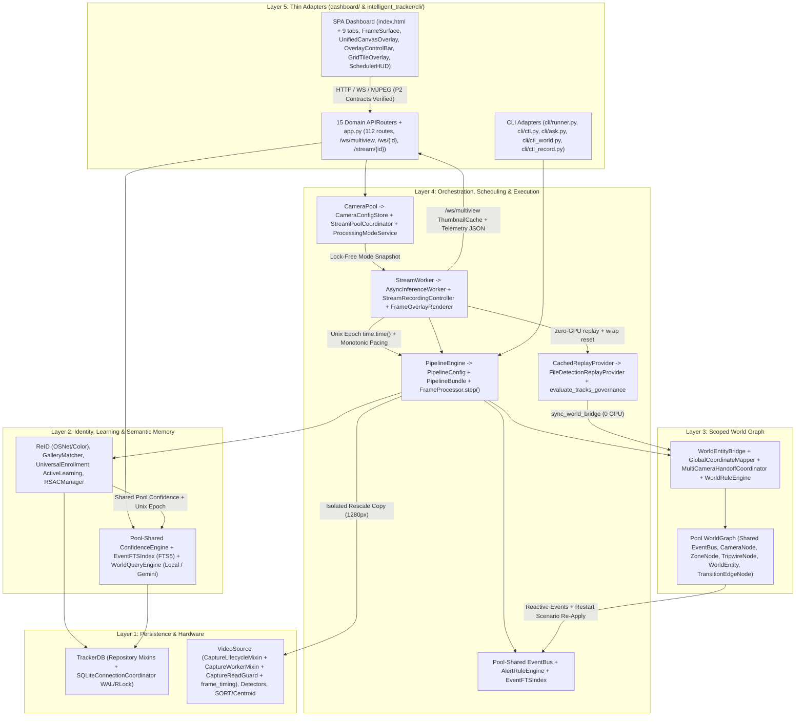

# Intelligent Tracker — Current Architecture & Alignment Audit

> **Snapshot Basis**: Branch `feature/integration-remediations` (post-Steps 1–4 of `integration_hardening_master_roadmap.md`: `P0-1`..`P0-5`, `P1-6`..`P1-13`, `P2-14`..`P2-26`, and `P3-1`..`P3-5` resolved).
> **Measured Static & Test Baseline**: `diagnose.py arch-map` = `343` source files, `63,418` lines, `112` FastAPI route decorators across 15 routers + `dashboard/app.py`, `0` upward imports from `intelligent_tracker/` to `dashboard/` or `scripts/`, `0` CSS `!important` across `25` stylesheets; `sphinx -W` = `0` warnings; `diagnose.py scan` = `0` active defects (`44` resolved); `4` workspace probes passing (`cold_boot_world_probe`, `replay_pipeline_probe`, `video_studio_contract_probe`, `spa_nine_tab_cdp_probe`).
> **Reference Target**: [Ideal World Architecture & Target Blueprint](IDEAL_WORLD_ARCHITECTURE.md) (`ADRs 01–06`, Layers 1–5).

### Pre-Run Verification One-Liners

```bash
MPLBACKEND=Agg python -m unittest discover tests
python -m sphinx -W --keep-going documentation/ documentation/_build/html/
python skills/system-diagnostics/scripts/diagnose.py arch-map --path .
```

---

## 1. Executive Alignment Verdict vs. `IDEAL_WORLD_ARCHITECTURE.md`

- **Structural Convergence (~95%)**: All 5 target layers, ADRs 01–06, `PipelineEngine`, pool-scoped `WorldGraph` with `EventBus`, shared `ConfidenceEngine` / `EventFTSIndex` / `WorldQueryEngine`, `SQLiteConnectionCoordinator` (WAL + `RLock`), `/ws/multiview` binary + telemetry JSON transport, `AnalyticsScheduler`, unified `OverlayControlBar`, Zero-CLS HUD, and 15 modular FastAPI routers are implemented and verified.
- **Operational End-to-End Integration (~95%)**: Steps 1–4 resolved all `P0-1`..`P0-5`, `P1-6`..`P1-13`, `P2-14`..`P2-26`, and `P3-1`..`P3-5` runtime seams (dual-clock domain boundary, AB-BA lock-order elimination, `max_dim` coordinate copy isolation, 16:9 heatmap rendering, pool-scoped singletons, scenario persistence across restarts, Zero-CLS HUD hysteresis, multiview AI boxes/alerts/toggle, and 9-tab headless CDP parity). Remaining debt is limited to legacy `high_objects.py` (`523L`) and optional CLI remote parity (`Section 3`).

| ADR / Layer | Target Blueprint | Current Branch Status | What Is Genuinely Achieved | Remaining Drift / Gaps |
| :--- | :--- | :--- | :--- | :--- |
| **ADR-01: Unified Core Engine + Thin Adapters** | Single `PipelineEngine` + `FrameProcessor.step()` for CLI and Dashboard | **Achieved (Legacy CLI Retained)** | `PipelineConfig`, `PipelineEngine`, and `FrameProcessor.step()` unify CLI (`intelligent_tracker/cli/pipeline_builder.py`, `runner.py`) and Dashboard (`dashboard/services/pipeline_factory.py`, `stream_worker.py`); `pyproject.toml:59-62` defines all 3 `console_scripts`. | `intelligent_tracker/interactive.py` and `cli/runner.py` retain legacy `--gui forms` (`high_objects.World`) for backward compatibility. |
| **ADR-02: Scoped `WorldGraph` + Reactive Rules** | Instance-scoped `WorldGraph`, `WorldEntityBridge`, `GlobalCoordinateMapper` | **Achieved** | `CameraPool` shares a single `EventBus` into `WorldGraph` (`P0-5`); `ScenarioManager` syncs DB/YAML on boot and re-applies across `restart_stream`/`retry_camera_connection` (`P1-8`); `DELETE /api/scenarios/homography/{id}` clears stale matrices; disabled/offline cameras remain registered with `is_armed`. | `WorldPolicy` (`world/nodes.py`) and legacy `high_objects.py` (`523L`) remain optional/legacy paths. |
| **ADR-03: Hybrid Local Memory + Pluggable Q&A** | `ConfidenceEngine`, `EventFTSIndex`, `WorldQueryEngine` + `SemanticProvider` | **Achieved** | Pool-shared `ConfidenceEngine` + `EventFTSIndex` bound on `app.state`; live `AsyncInferenceWorker` and offline `VideoIndexer` pass Unix epoch `time.time()` (`base_epoch + video_ts`) (`P0-1`); `_gallery_signals.py` and `query_engine.py` preserve `video_filename`/`media_offset_sec` citations (`P1-11`). | None in core runtime. |
| **ADR-04: `arch-map` Verification & Modularity** | Zero active files `>= 500L`; `<= 12` methods/class; `<= 40L`/fn; zero `sys.modules` DI hacks | **Achieved (1 Legacy File)** | `0` upward imports from `intelligent_tracker/`, `0` CSS `!important`, `0` active `scan` defects (`44` resolved), `dependencies.py` uses `app.state`, Step 4 frontend modules split (`camera_form_helpers.js`, `video_jobs_ui.js`, `overlay_control_bar.js`, `grid_tile_overlay.js`). | `1` legacy hard overrun (`intelligent_tracker/high_objects.py` `523L`). |
| **ADR-05: Reusable Frontend SSOT, Zero-CLS HUD & Grid AI** | Shared variant UI components, single button per intent, zero-CLS HUD, multiview AI boxes/alerts/toggle | **Achieved** | `OverlayControlBar` (`variant: 'live'|'scrubber'`) unifies Live Monitor & Video Studio (`P2-26`); single `#btn-fullscreen-toggle` (`P2-26`); `.hud-center` `8px` gap + `tabular-nums` + `#stream-lag-badge` EMA hysteresis + `P1` 1 FPS suppression (`P2-24`, `P3-5`); `GridTileOverlay` + `UnifiedCanvasOverlay` render multiview AI boxes, FPS/tier, pool-wide alerts, and per-tile `armed` toggle (`P2-25`); `P2-14`..`P2-22` contracts verified via Node VM & 9-tab CDP. | Optional unwired endpoints (`P2-23`: `/api/world/*` UI panels, `/api/rsac/rules` UI) remain available for future feature panels. |
| **ADR-06: Dual-Clock Contract & Pool Singletons** | Monotonic timing vs. Unix epoch domain timestamps + shared pool `EventBus`/`WorldGraph`/`ConfidenceEngine`/`EventFTSIndex` | **Achieved** | Strict dual-clock separation (`time.monotonic()` for `AnalyticsScheduler`, `ProcessingModeService`, FPS pacing; Unix epoch `time.time()` for domain events/DB/FTS/ConfidenceEngine) (`P0-1`); lock-order inversion eliminated (`P0-2`); pool-scoped singletons wired across `CameraPool`, `StreamManager`, and `app.state` (`P0-5`). | None. |
| **Layer 1: SQLite Concurrency & Hardware** | `pyproject.toml` entrypoints + WAL pooled/serialized DB coordinator | **Achieved** | `SQLiteConnectionCoordinator` enforces WAL + per-path `RLock` + refcounted `TRUNCATE` checkpoint; all repository mixins guard `self._conn is None`; `BackupManager.restore_backup` rejects ZIP symlinks/traversal and cleans WAL/SHM sidecars; `CaptureReadGuard` uses `time.monotonic()` (`P1-13`). | None. |
| **Layer 2: Identity, Learning & RSAC** | Unified Re-ID, Active Learning, RSAC & descriptor versioning | **Achieved** | `RoiRecognitionService` and `EntityTaggerService` write `is_anchor=1, locked=1`, call `record_descriptor_version`, update `ConfidenceEngine`/`EventFTSIndex`, and sync live `Track`/`WorldEntityBridge` (`P1-12`); `post_detection_governance.py` preserves `zone_id`. | None. |
| **Layer 3 & 4: WorldGraph, Scheduler & Multiview** | Scoped graph, P0/P1/P2 scheduler, zero-GPU replay, binary `/ws/multiview` | **Achieved** | `FrameProcessor.step(max_dim=1280)` isolates rescaling without mutating `CentroidTracker` (`P0-3`); `FrameOverlayRenderer` renders 16:9-safe `heatmap.draw()` (`P0-4`); `capture_only` falls back to `_latest_raw_jpeg` (`P1-6`); `vs.measured_fps` drives stream FPS (`P1-7`); `/ws/multiview` emits telemetry JSON + binary JPEG with per-camera timeout isolation (`P2-25`, `P3-3`). | None. |
| **Layer 5: Thin Adapters & CLI <-> Dashboard Parity** | Full operational parity and thin routers | **Achieved (CLI Parity Partial)** | 15 domain routers cleanly split under `dashboard/routers/`; `dependencies.py` uses `app.state`; frontend-backend JSON contracts aligned (`P2-14`..`P2-22`). | `ctl.py` covers `list/stats/evict/prune/history/metrics/ask/world/models/record`; remote `ctl` parity for camera CRUD, scenarios, RSAC, and video jobs remains future work. |

---

## 2. Current Layered Architecture & Actual Runtime Data Flow

Dependencies flow strictly downward (`dashboard/` and `intelligent_tracker/cli/` -> `intelligent_tracker/`): `arch-map` confirms **0** upward imports from `intelligent_tracker/` into `dashboard/` or `scripts/`.



---

## 3. Measured Package Footprint, Modularity Debt & CLI <-> Dashboard Parity

### Directory Footprint (`diagnose.py arch-map`)

| Directory | Files | Lines | Primary Ownership |
| :--- | ---: | ---: | :--- |
| `.` | 2 | 161 | `main.py`, `setup.py` (`pyproject.toml` also at root) |
| `dashboard` | 155 | 31,636 | FastAPI app (`app.py`, `dependencies.py`), 15 routers (`routers/`), orchestration/replay/multiview (`services/`), modular SPA (`static/js/`, `static/css/`, `static/partials/`) |
| `documentation` | 1 | 180 | Sphinx `.rst` docs & `conf.py` |
| `intelligent_tracker` | 179 | 30,605 | Core CV (`detectors/`, `tracker/`, `reid/`, `matching/`, `geometry/`), `pipeline/`, `world/`, `memory/`, `events/`, `analytics/`, `repositories/`, `video/`, `cli/` |
| `scripts` | 6 | 836 | `run_dashboard.py`, `stream_ctl.py`, `cdp_inspect.py`, `diagnostics.py`, `download_models.py`, `camera_manager.py` |
| **Total** | **343** | **63,418** | **112 API route decorators across 16 Python modules** |

### Remaining Modularity Budget Overruns

- **Hard Ceiling (`>= 500L`) — 1 legacy file**: `intelligent_tracker/high_objects.py` (`523` lines; legacy `Scene` `25` methods).
- **Soft Warning (`350–499L`) — 7 files**: `dashboard/static/js/video_library.js` (`471`), `intelligent_tracker/interactive.py` (`451`), `scripts/cdp_inspect.py` (`436`), `intelligent_tracker/matching/gallery.py` (`425`), `intelligent_tracker/rsac.py` (`412`), `dashboard/services/roi_recognition_service.py` (`407`), `dashboard/static/video_scrubber.js` (`389`). (Step 4 extracted `camera_form_helpers.js`, `video_jobs_ui.js`, `overlay_control_bar.js`, and `grid_tile_overlay.js` to bring `camera_manager.js`, `video_jobs.js`, `app.js`, and `camera_grid.js` below `350L`.)
- **Heavy Classes (`> 12` methods or `> 300L`) — 8 classes**: `Scene` (`25`m, `269L`, `high_objects.py`), `TailItem` (`20`m, `172L`, `core/tails.py`), `Group` (`19`m, `149L`, `core/groups.py`), `EventFigure` (`19`m, `164L`, `forms.py`), `CaptureReadGuard` (`16`m, `251L`, `video/capture_guard.py`), `GroupMutationMixin` (`15`m, `164L`, `core/group_mutations.py`), `RSACManager` (`14`m, `210L`, `rsac.py`), `GalleryMatcher` (`10`m, `307L`, `matching/gallery.py`).
- **Functions `> 40L` — 59 functions**: Top offenders include `run_interactive_app` (`151L`, `interactive.py:274`), `FrameOverlayRenderer.render` (`134L`, `dashboard/services/frame_overlay.py:25`), `apply_windows_iocp_patch` (`129L`, `dashboard/services/windows_resilience.py:31`), `main_async` (`111L`, `scripts/cdp_inspect.py:302`), `setup_event_pipeline` (`109L`, `intelligent_tracker/events/pipeline.py:12`), `build_generic_audit_js` (`100L`, `scripts/cdp_inspect.py:143`), `enroll` (`96L`, `intelligent_tracker/enrollment.py:51`), `create_backup` (`91L`, `intelligent_tracker/backup.py:78`), `cnt_intersection` (`91L`, `intelligent_tracker/geometry/intersections.py:171`), and `transcode_to_h264_async` (`84L`, `dashboard/services/video_transcoder.py:258`), plus `49` more.
- **Unused Imports**: `dashboard/services/stream_worker.py:9` (`time` flagged by `arch-map`), plus `intelligent_tracker/video/legacy_camera.py:154` (`PiRGBArray` inside `try...except ImportError` fallback).

### CLI <-> Dashboard Operator Parity Matrix (9 Domains)

| Operational Domain | Dashboard Router(s) | CLI Surface (`ctl.py` / `runner.py` / Tools) | Remaining Parity Gaps |
| :--- | :--- | :--- | :--- |
| **Live Pipeline & Benchmark** | `streaming.py` (2), `cameras.py` | `runner.py` (`--source`, `--detector`, `--tracker`, `--reid`, `--governance`, `--headless`, `--benchmark`) | Covered locally; `interactive.py` maintains a separate non-unified loop. |
| **WorldGraph & Semantic Q&A** | `world.py` (5) | `ctl.py ask` / `ask.py`, `ctl.py world [summary\|entities\|snapshot]` | Missing CLI parity for `/api/world/confidence/{id}`, standalone `/api/world/timeline` (`start_time`/`end_time`), and REST/CLI `WorldPolicy` CRUD. |
| **Models & Diagnostics** | `system.py` (11), `camera_diagnostics.py` (5) | `ctl.py models [status\|verify\|download]`, `ctl.py stats/list/evict/prune/history/metrics`, `camera_tool.py` | Missing remote `ctl` parity for `/api/cameras/{id}/diagnostics`, `/probe`, `/release`, and `/api/cameras/diagnostics/traces/recent`. |
| **Camera Recording** | `camera_recording.py` (3) | `ctl.py record [start\|stop\|status]` (`ctl_record.py`) | Full remote parity (`ctl_record.py` still defaults `--camera-id` to `"cam_01"`). |
| **Backup & Restore** | `system.py` (`/api/backup/*`) | `intelligent_tracker/backup.py` (`--export`, `--import`, `--info`) | Local parity; no remote `ctl backup` subcommand. |
| **Batch Video Indexing** | `videos.py` (6), `video_jobs.py` (12) | `intelligent_tracker/batch.py`, `batch_reporting.py` | No CLI parity for H.264 transcoding, async job queue (`jobs`/`cancel`/`stream`), report delete, or `--scenario-camera-id` in `batch_reporting.py`. |
| **Camera Pool CRUD & Modes** | `cameras.py` (16), `processing_mode.py` (2) | `ctl.py list` (read-only), `camera_tool.py` (local HW only) | Zero CLI parity for camera `add`/`update`/`delete`/`toggle`/`retry`/`discover`/`overlays` or `processing-mode` (`focus_only`/`full_realtime`/`capture_only`/`paused`). |
| **Scenarios, Topology & Journeys** | `scenarios.py` (11), `topology.py` (7) | `interactive.py` (local draw without DB/YAML save) | Zero CLI parity for zones, tripwires, homography CRUD, topology links, `world-map`, or `/api/journey/search` & `/export`. |
| **Entities, Tagging, RSAC & AL** | `analytics.py` (9), `tagging.py` (2), `rsac.py` (18) | `interactive.py` / `display.py` (local `db.enroll_entity` only) | Zero CLI parity for review queue (`confirm`/`reassign`/`enroll-new`/`dismiss`), RSAC rules/categories/pet whitelist, descriptor rollback, ROI tagging, or entity CRUD. |

---

## 4. Verified Remediations Landed on This Branch (M1–M3 + `400bc9f`)

These fixes from `integration_diagnostics_and_remediation_plan.md` and commit `400bc9f` are verified in code and covered by `882` tests + `3` workspace probes:

1. `intelligent_tracker/video/capture_worker.py` unified its capture pacing loop on `time.monotonic()` and split helpers back under `350L` (`< 350L`).
2. `VideoSource.resume()` (`intelligent_tracker/video/hibernation.py:28`) and paused `capture_worker.py:331` clear `_last_frame_time = None` so hibernation wakeups do not depress `measured_fps`.
3. `FileDetectionReplayProvider.ensure_loaded()` (`dashboard/services/file_detection_replay.py`) adds a bounded empty-DB TTL re-check and tightens `tolerance_s` from `video_runs.config.sample_rate` (`intelligent_tracker/repositories/video_run_repo.py:166-184`, commit `400bc9f`).
4. `Track.to_dict()` (`intelligent_tracker/tracker/track.py`) emits `entity_id`, `category`, and `entity_category` via `getattr(self, ..., None)` without breaking legacy `hasattr(trk, 'entity_id') == False` invariants.
5. `sync_world_bridge()` (`intelligent_tracker/pipeline/post_detection_governance.py`) executes under `CachedReplayProvider(..., run_reid=False)` at zero GPU cost.
6. `AsyncInferenceWorker` (`dashboard/services/async_inference_worker.py:127-128,212-216`) guards `result is None` (`TRC-015` resolved) and calls `scheduler.should_schedule_frame(..., is_replay=True)` to record `PriorityTier.REPLAY`.
7. `ScenarioManager.load_scenarios()` (`intelligent_tracker/scenario_storage.py`) syncs loaded DB/YAML zones and tripwires into `WorldGraph` on boot.
8. `world_timeline_events` (`intelligent_tracker/memory/_event_formatters.py`, `fts_index.py`, `repositories/memory_repo.py`) stores `video_filename` + `media_offset_sec` on `EventBus` alerts, and `GET /events` (`dashboard/routers/analytics.py`) merges persisted timeline rows.
9. `dashboard/routers/analytics.py` switched primary entity/sighting/event routes to `Depends(get_db)` and removed the `/crops/{filename}` route shadowed by `StaticFiles`; `dashboard/routers/videos.py` resolved duplicate `operationId`.
10. `dashboard/app.py` binds `confidence_engine` and `world_query_engine` into `app.state`.
11. `dashboard/static/js/scrubber_library_bridge.js` fetches plural `/api/videos/{fn}/reports` and deep-links `/videos/{fn}`, and `dashboard/static/js/video_timeline_links.js` reads `entities` + `alerts` (removing `occurrences`).
12. `dashboard/static/partials/modals/camera_modals.html` and `camera_manager.js` expose the `armed` toggle, `StreamWorker` binds `is_armed_getter`, and `camera_ai_config.js` gates boot `#live-stream-img` attach on `active_tab === 'tab-live'`.
13. `dashboard/services/process_supervisor.py` and `dashboard/static/js/multiview/multiview_client.js` cleared all `invalid_signature` and `SILENT_BARE_EXCEPT` (`DEFECT-001`/`002`) active scan alerts.

---

## 5. Integration Hardening Resolution Summary (`P0`–`P3`, Steps 1–4 Complete)

> **Status**: All `P0-1`..`P0-5`, `P1-6`..`P1-13`, `P2-14`..`P2-26` (except optional future UI panels for `P2-23`), and `P3-1`..`P3-5` items below were resolved and verified across Steps 1–4 of `.TODO/integration_hardening_master_roadmap.md` (`cold_boot_world_probe`, `replay_pipeline_probe`, `video_studio_contract_probe`, and `spa_nine_tab_cdp_probe`).

### P0 — Critical Runtime, Data Corruption & Deadlock Bugs (5)

1. **`P0-1` Live & Offline Clock-Domain Corruption (`time.monotonic()` / `0.0s` Injected as Unix Epoch)**
   - **Evidence**: `dashboard/services/async_inference_worker.py:81,228,266` (`now = time.monotonic()` -> `FrameProcessor.step(..., timestamp=ts)` -> `post_detection_governance.py:147,164,167`); `intelligent_tracker/batch.py:254-256` (`video_ts` starting at `0.0s` passed as `timestamp`); downstream consumers `intelligent_tracker/rsac.py:60-63` (`datetime.fromtimestamp(ts)`), `intelligent_tracker/repositories/analytics_repo.py:21` (`time.gmtime(ts)`), `intelligent_tracker/memory/confidence.py:117-122,200`, `intelligent_tracker/memory/query_engine.py:244`, `dashboard/static/js/telemetry.js:144`, `dashboard/services/multiview/thumbnail_cache.py:106,111`.
   - **Impact**: Every live sighting/FTS/alert/RSAC timestamp resolves to **`1970-01-01`**, live/offline `ConfidenceEngine` confidence immediately decays ~56 years (`1.79e9 - 1e4`) to `decay_floor = 0.10`, RSAC schedules evaluate against 1970, and `WorldQueryEngine` relative time queries (`"last 2 hours"`, `"today"`) never match live events.

2. **`P0-2` AB-BA Lock-Order Deadlock (`ProcessingModeService` <-> `StreamRecordingController`)**
   - **Evidence**: `dashboard/services/processing_mode_service.py:124-147,192-202` (`get_state(pool)` holds `ProcessingModeService._lock` -> reads `sm.is_recording` -> `dashboard/services/stream_recording.py:90` acquires `StreamRecordingController._lock`) vs `dashboard/services/stream_recording.py:81-85,100,133,223,241,248` (`start`, `write_frame`, `stop`, `finalize_if_active` hold `StreamRecordingController._lock` -> call `_current_processing_mode()` / `enqueue_deferred_indexing()` -> acquire `ProcessingModeService._lock` at `processing_mode_service.py:49,188`). Also `processing_mode_service.py:126-128,156` iterates `pool.streams.items()` without `pool._lock`.
   - **Impact**: Concurrent `/api/system/processing-mode` polling and recording (`write_frame` / `/record/start|stop`) can deadlock the server worker and HTTP threads.

3. **`P0-3` `FrameProcessor.step(..., max_dim=1280)` Corrupts `CentroidTracker` Coordinate Space In-Place**
   - **Evidence**: `intelligent_tracker/pipeline/frame_processor.py:59-78,123-139`, `dashboard/services/async_inference_worker.py:26,118`, `intelligent_tracker/tracker/centroid.py:122,161,228`.
   - **Impact**: `_rescale_tracks_and_detections` mutates `trk.bbox`, `trk.centroid`, and `trk.velocity` **in-place** on live `Track` objects kept inside `CentroidTracker.tracks` from `1280x720` back to `1920x1080`, so the next frame matches `1920x1080` track boxes against `1280x720` detections (causing ID churn and velocity spikes). It also never rescales `detections` and returns downscaled `processed` as `result.frame` alongside full-res `tracks`.

4. **`P0-4` Heatmap Overlay `AttributeError` & 16:9 Shape Crash**
   - **Evidence**: `dashboard/services/frame_overlay.py:45-49` (`analytics.draw_heatmap_overlay(annotated, alpha=0.55)`) vs `intelligent_tracker/analytics/engine.py:24-204` (only `heatmap.draw(...)` and `draw(..., draw_heatmap=True)` exist); `intelligent_tracker/pipeline/bundle.py:152-160` + `intelligent_tracker/video/capture_helpers.py:55-57` + `intelligent_tracker/analytics/heatmap.py:154-160`.
   - **Impact**: Live heatmap overlay fails every frame with `AttributeError` (silently swallowed in `logger.debug`). Even with `heatmap.draw`, `OccupancyHeatmap` initializes to `640x480` before 16:9 `probe_capture_dimensions` resizes frames to `640x360`, crashing `cv2.addWeighted` on shape mismatch.

5. **`P0-5` Split-Brain `WorldGraph(event_bus=None)`, Unshared `ConfidenceEngine` & Startup `TRC-017` Crash**
   - **Evidence**: `dashboard/camera_pool.py:51` (`WorldGraph(coordinate_mapper=...)` with `event_bus=None`); `intelligent_tracker/pipeline/bundle.py:234,304` (per-stream `ConfidenceEngine`, skips attaching `event_bus` when `world_graph` passed); `dashboard/app.py:171`; `dashboard/dependencies.py:286-294` (`confidence_engine=None` fallback); `dashboard/services/camera_config_store.py:89-91` -> `dashboard/services/stream_pool_coordinator.py:93` (`TRC-017`).
   - **Impact**: Dashboard `WorldGraph` mutations never emit reactive events; multi-camera `cam_02` observations mutate an isolated `ConfidenceEngine` invisible to `WorldQueryEngine` (`app.state`); offline Active Learning feedback skips confidence updates; and `cameras.json` containing `{"cameras": [...]}` or any non-dict entry crashes boot with `AttributeError: 'list' object has no attribute 'get'`.

### P1 — Core Pipeline, Replay, Lifecycle & Persistence Bugs (8)

6. **`P1-6` `capture_only` Freezes `annotated=True` MJPEG Feeds**: `dashboard/services/stream_worker.py:166-172` skips `_encode_annotated_frame()`, while `dashboard/services/stream_media.py:77-82` keeps returning the stale `_latest_jpeg` placeholder/previous frame instead of falling back to `_latest_raw_jpeg`, freezing `/stream/{id}`, Burned-Box mode, and `2x2` MJPEG fallback tiles.
7. **`P1-7` Inference-Latency FPS Reported as Stream FPS**: `intelligent_tracker/pipeline/frame_processor.py:121,133-136` computes `1.0 / processing_s` (e.g. `2000+ FPS` on Mock or `100 FPS` while throttled to `1 FPS`), and `dashboard/services/stream_worker.py:145-146,172,180-181` prefers `step_res.fps` over `vs.measured_fps`. `VideoSource` also fails to clear `_measured_fps` on `pause()`, and `capture_worker.py:324-325` caches `effective_fps` once across reconnects.
8. **`P1-8` Stream Restart Wipes `WorldGraph` & Scenarios + Teardown/Lock Leaks**: `WorldGraph.register_camera` (`intelligent_tracker/world/graph.py:66-71`) overwrites `homography`/`world_pose`; `bundle.py:305-310` hardcodes `name=config.camera_id`; `restart_stream` and `retry_camera_connection` (`dashboard/services/stream_pool_coordinator.py:137-164`) never re-run `ScenarioManager.apply_to_stream_manager(new_mgr)`; `DELETE /api/scenarios/homography/{id}` (`dashboard/routers/scenarios.py:259-276`) leaves stale matrices in `WorldGraph` and `GlobalCoordinateMapper`; `StreamManager.stop()` (`dashboard/stream_manager.py:245-261`) never calls `self._pipeline_bundle.close()`; disabled/offline cameras are absent from `WorldGraph` and omit `is_armed`; `CameraPool._lock` is held across blocking init.
9. **`P1-9` `REPLAY` <-> `LIVE` & Mode Transition Races**: `AnalyticsScheduler.should_schedule_frame` (`intelligent_tracker/pipeline/analytics_scheduler.py:165-166`) returns early on `paused`/`capture_only` without resetting `last_tier`/`last_target_fps` (and `build_live_step_result` omits `decision` at `231-233`); `LIVE -> REPLAY` hot-swap (`async_inference_worker.py:238-239`) leaves stale async cache and allows concurrent in-flight mutation of `analytics`/`gallery_matcher`; `FileDetectionReplayProvider.ensure_loaded()` (`file_detection_replay.py:208-209`) stays stuck in `REPLAY` after run deletion; live looping files without replay never reset tracker/analytics centroids; `VideoSource.read()` (`source.py:83-84`) silently restarts `loop_video=False` files after EOF.
10. **`P1-10` Hibernation & Multiview Lifecycle Bugs**: `StreamWorker.run()` (`stream_worker.py:130-134`) runs `with vs:` (`wait_ready()` up to 3s + hardware open) before checking `_handle_hibernation()`; `StreamSubscriberRegistry` (`stream_subscribers.py:68-72,120-124`) calls `vs.resume()` even under `paused` mode; `build_camera_status_row()` (`camera_pool_queries.py:16-26`) ignores `is_hibernating`; `StreamLifecycleManager.evict_subscribers()` (`lifecycle.py:158-160`) omits `_subscriber_modes`; `FrameSurface.draw` (`frame_surface.js:82`) drops new frames after stream restart `seq` reset (`camera_grid.js:44`); `camera_grid.js:237,287` mismatches `2x2` degraded pagination vs `3x3`/`4x4` WS subscription.
11. **`P1-11` Offline Video Studio, FTS & Citation Leaks**: `_gallery_signals.py:153-157` drops `video_filename`/`media_offset_sec` in `fts_index.index_sighting()`; `query_engine.py:38-53` drops media fields from citations; `post_detection_governance.py:115-119` drops `zone_id` when converting `EntityIdentifiedEvent`; `video_analytics_service.py:193` + `batch_reporting.py:107-110` aggregate global DB sightings into per-video reports; `video_jobs.py:201-217` omits `scenario_camera_id` query param; `analytics.py:90-108` mixes `_resolve_analytics_db` and `Depends(get_db)`.
12. **`P1-12` ROI Tagging & Live Track Propagation Gaps**: `RoiRecognitionService.commit_roi_tag` (`roi_recognition_service.py:259-290`) writes `is_anchor=0, locked=0`, skips `record_descriptor_version`, `ConfidenceEngine`, `EventFTSIndex`, and live `Track`/`WorldEntityBridge` updates, and silently falls back to frame `0` on seek failure (`135-137`); `EntityTaggerService._update_live_track_identity` (`entity_tagger.py:120-122`) skips `entity_id`, `entity_category`, `identity_label`, and `WorldEntityBridge.reassign_track()` (and `94` uses 1s `int(time.time())` filenames).
13. **`P1-13` Persistence, Security & Thread-Safety**: `BackupManager.restore_backup` (`backup.py:190-261`) lacks ZIP symlink rejection, WAL/SHM cleanup, and `hot_reload` handling; 9/10 repository mixins omit `if self._conn is None` guards; `ScenarioManager` (`scenarios.py:52`) and `VideoIndexer` (`batch.py:153`) leak `TrackerDB` handles (`TRC-018`); `CaptureReadGuard` (`capture_guard.py:206-215,227-235,271-279`) mixes `time.time()` and mutates state outside lock; `lifecycle.py:35-58` holds `self._lock` across open and pins un-stopped instances in `atexit`; `stream_media.py:64-67` accesses missing `SortTracker.tracks`; `world/minimap.py:106` mixes uncalibrated pixel polygons into meter-scale bounds.

### P2 — Frontend–Backend Contracts, UI Wiring & Unwired Capabilities (13)

14. **`P2-14` Review & Learn Queue Schema Drift & 404 Assets**: `dashboard/static/review_and_rsac.js:106-149,200` reads `item.similarity_score`, `item.matched_entity_name`, `item.created_at`, `item.notes`, and `data.entity_name` while backend emits `similarity`, `suggested_name`, `timestamp`, no `notes` column (`schema_manager.py:111-118`, `learning_repo.py:60-74`), and `{status, item_id, entity_id, notes}` (`active_learning_actions.py:165`); `cropUrl` prefixes `/` onto `data/crops/...` (`app.py:240-241` has no `/data` mount) and `onerror` requests non-existent `/static/avatar-placeholder.png` (also in `gallery_timeline.js:53,58,172`).
15. **`P2-15` Video Studio Click-to-Tag `track?.id` vs `track_id`**: `dashboard/static/js/interactive_canvas.js:156,160,169` reads `track?.id` whereas `Track.to_dict()` (`intelligent_tracker/tracker/track.py:146`, served by `/api/videos/{fn}/detections`) emits `track_id`, showing `#undefined` and sending `track_id: null`.
16. **`P2-16` Security Alerts Schema Drift**: `dashboard/static/js/analytics_view.js:99-121` and `telemetry.js:151` read `ev.entity_name` instead of `ev.name` (`events/types.py:190,205`), ignore `ev.severity` in favor of substring matching (classifying `rsac_violation` as `INFO`), ignore `ev.message`/`reason`/`title`/`summary`, and show `Snapshot: None` for DB-merged `world_timeline_events`.
17. **`P2-17` Live Monitor Overlay Toolbar & BEV PiP Mismatch**: `dashboard/static/js/studio_overlays.js:35,56` posts to Scenario Studio's `state.activeCamera` (404/422 if recorded video or empty) and sends unsupported `toast_prompts` (`schemas.py:163-173`, `stream_manager.py:46-52`) while `clutter` has no toggle; `#overlay-toggle-bev_minimap` (`live.html:144-147`) has no client-side renderer (`unified_canvas_overlay.js:16-19`).
18. **`P2-18` Camera Manager CRUD & Diagnostics Drift**: `dashboard/static/js/camera_manager.js:226-234,284-296` maps `cam.type` onto vendor-only `#cam-preset-select` (clobbering `usb`/`synthetic`/`video_file` to `'rtsp'`), hardcodes `enabled: true`, sends unaccepted `device_name` (`schemas.py:49-78`), and races async `loadCapabilities()` vs synchronous `setValues()`; `camera_modals.html:189` Cancel bypasses `closeModal()`/`resetForm()`; `camera_discovery.js:188` omits `device_name`/`type`; `camera_diagnostics_ui.js:121` calls non-existent `CameraManager.getActiveCameras()`.
19. **`P2-19` Enroll & Quick-Tag Modal Failures**: `#btn-quick-tag` (empty tracks, `app.js:271-273`) and `#btn-enroll-modal` (`gallery_timeline.js:119-121`) submit `bbox: null, crop_base64: null` to `/api/tag/commit` -> HTTP 400 (`roi_recognition_service.py:171`); `#enroll-camera-select` (`entity_modals.html:124-126`) is never populated; `universal_enrollment.js:190-193,231` blocks image uploads without a camera and leaves stale `selectedCropBase64`/`selectedBbox` after reset; `app.js:159-168,304-313` opens modals directly without init callbacks.
20. **`P2-20` Scenario Studio & BEV Minimap Coordinate/Video Bugs**: `dashboard/static/js/bev_minimap.js:46-52,73-78` renders uncalibrated pixel `ground_pos` (`[320, 240]`) as meters and divides zones by hardcoded `640x480` instead of `homography_matrix`, while `studio.html:50` hardcodes `"Calibrated"`; `studio.html:40` + `studio_canvas.js:9-17` scale against hardcoded `640x480` without `computeContainBox` and never render saved shapes; `studio.js:86-93,116,188-199,291-293` omits initial live attach, silently drops 422s on empty `camera_id: null`, and `live_player.js:207-211` overwrites recorded-video selection with `/stream/<filename>` (HTTP 503) on tab re-entry.
21. **`P2-21` Dead/Broken Controls, Races & Selector Collisions**: `#fullscreen-btn` (`live.html:35`) has no click listener (`live_player.js:234,270-272`); `gallery_timeline.js:81-89,226-229` races `.btn-view-sightings` filter dropdown load and opens continuous MJPEG stream on `#btn-snapshot-save`; `journey_search.js:80,101` never sends `track_id` and triggers 422 via `isNaN("") === false`; `analytics_view.js:138,150` omits `?camera_id=`; `rsac_versions.js:41-43` reads missing `similarity_to_anchor`; `interactive_canvas.js:81-87,157` drops COCO labels on `#tag-category-select`; `camera_ai_config.js:126-133` binds global `.btn-tag-preset` across unrelated modals.
22. **`P2-22` SPA Boot, Cache, Socket & Hygiene Bugs**: `index.html:152-153` loads `app.js` before `nav_tabs_manager.js`, so initial `#videos`/`#studio` hash routes run before `window.switchTab` is wrapped; `nav_tabs_manager.js:13-49` caches `/api/cameras` and `/api/videos` for `2000ms` without invalidating on mutations; `telemetry.js:29,69-76` omits `?token=` and leaks reconnect timers after `closeWebSocket()`; `camera_grid.js:235-249,303,318` resumes paused grids on `refreshCameras()` and leaks non-live `#live-stream-img` attaches; `video_batch.js:64-75` loads scenarios from `/api/cameras` instead of `/api/scenarios`; `camera_recording.js:175-182` does not refresh `ProcessingModeUI` on deferred jobs; `scrubber_library_bridge.js:118-123` + `video_jobs.js:446` miss active-video checks; `index.html:100,103,112` drawer badges are never updated; `studio_overlays.js:79,96,122` + `gallery_timeline.js:182` interpolate unescaped inline `onclick` literals.
23. **`P2-23` Unwired Backend Capabilities**: `/api/world/*` (`query`, `confidence/{entity_id}`, `timeline`, `snapshot`, `entities`), `/api/rsac/rules`, `/api/pets/whitelist`, `/api/topology/world-map`, `/api/topology/priors`, `/api/cameras/{id}/retry`, and `/api/system/{processes,metrics,events,models}` have zero UI callers in `dashboard/static/`.
24. **`P2-24` Live Monitor HUD Flicker, `0px` Gaps & Title Layout Shifts**: `dashboard/static/css/player.css:239-246` (`.hud-center` has no `gap`, leaving `#stream-telemetry-hud`, `#stream-lag-badge`, and `#scheduler-tier-pill` flush at `0px`), `dashboard/static/js/live_player.js:53-60` (`#stream-lag-badge` toggles `hidden` on every frame crossing `120ms` with no hysteresis/smoothing or reserved slot, causing continuous vertical reflow/CLS), and `dashboard/static/partials/tabs/live.html:9,14` (`#video-stream-title` shifts header layout across short/long camera names without fixed truncation containment and `tabular-nums`).
25. **`P2-25` Multiview (`2x2`/`3x3`/`4x4`) Missing Client-Side AI Boxes, Frozen `0 tracks`, Isolated Alerts & No Per-Tile AI Toggle**: `dashboard/services/multiview/session.py:6` sends raw `annotated=False` frames without JSON track/FPS/tier metadata; `dashboard/static/js/camera_grid.js:84-123,168-181` mounts no per-tile overlay canvas and only shows static boot `GET /api/cameras` `active_tracks_count` (`0 tracks`); `Recent Alerts` only listens to one camera's per-stream `EventBus` via `/ws/{activeCameraId}`; grid tiles expose no AI-active indicator or click toggle (`armed`).
26. **`P2-26` Duplicate Broken Fullscreen Button & Duplicated `"Video Overlays"` Toolbars**: `dashboard/static/partials/tabs/live.html:35` (`#fullscreen-btn`, unwired) duplicates working `live.html:102` (`#btn-fullscreen-toggle`, `live_player.js:234,270-272`); `live.html:111-157` (`studio_overlays.js` checkboxes) and `dashboard/static/partials/tabs/videos.html:35-36` (`dashboard/static/js/overlay_layer_toolbar.js` `aria-pressed` pills) implement two separate toolbars for the exact same `UnifiedCanvasOverlay` feature flags without sharing a reusable component.

### P3 — Suspected Edge Cases for Empirical `/app-debugger` Probes (5)

1. **`MotionGate` Stale-Background False Burst (`intelligent_tracker/pipeline/motion_gate.py:80-98`)**: Hibernating/resuming an `armed` camera leaves old `bg_luma` intact, likely triggering a false 3-second P1 motion burst on wakeup.
2. **File Slow-Disk Timeout Severing (`intelligent_tracker/video/capture_worker.py:307-318`)**: A single disk read timeout (`is_severed=True`) on a `video_file` (`is_file=True`) kills the capture thread instead of reopening the file.
3. **`MultiviewSession._flush_camera` Slow-Client HOL Blocking (`dashboard/services/multiview/session.py:284-285,321`)**: Sequential per-camera `send_timeout_s=0.5` stalls other camera tiles when one WS client stalls, and `wait_for` cancellation can drop partial ASGI sends.
4. **FFmpeg Container `CAP_PROP_POS_FRAMES=0` Rewind Failure (`intelligent_tracker/video/capture_helpers.py:70`)**: Containers ignoring `POS_FRAMES=0` hit 6 failed reads and trip `CaptureReadGuard` `RECONNECTING` before reopen.
5. **1 FPS P1 Heartbeat Triggering False `AI Lag` Badge (`dashboard/static/js/live_player.js:11,53`)**: Idle `armed` 1 FPS heartbeat produces `(now - inf_ts) * 1000.0` up to `~999ms`, exceeding `LAG_THRESHOLD_MS = 120` when inspected.

---

## 6. Why Integration Bugs Slipped Past Existing Tooling — & Recommended Enhancements

### Blind-Spot & Tool Enhancement Matrix

| Blind Spot Category | Concrete Example Missed | Why Current Checks Missed It | Recommended Tool / Probe Enhancement |
| :--- | :--- | :--- | :--- |
| **False-Green Workspace Probes** | `replay_pipeline_probe.py:69-75` passed with `hd_track_x1: None` (missing `else: failures.append(...)`); `video_studio_contract_probe.py:82-90` only grepped 2 strings | Probes omitted strict assertions on skipped branches and never booted headless CDP across all 9 SPA tabs | Enforce non-empty assertion guards in `replay_pipeline_probe.py`; add a 9-tab headless CDP probe (`diagnose.py ui --capture-runtime`) exercising hash routing, tabs, modals, and live WS payloads |
| **`surface_scanners.py` & `surface_verifier.py` Gaps** | `P2-14`–`P2-22` (`similarity_score`, `track?.id`, `ev.entity_name`, `/data/crops/*`, `/static/avatar-placeholder.png`, missing `?token=`) | `walk_source_files(..., include_tests=True)` mixes test IDs/routes into production pools; verifier ignores HTTP methods, `img.src`/`video.src`/`new WebSocket`/`window.open` URLs, inline `onclick` targets, and JSON request/response keys | Filter `include_tests=False` by default in `surface --verify`; verify HTTP methods, asset/WS URLs, and inline `onclick` targets; add OpenAPI/Pydantic/SQLite-to-JS JSON key contract checks |
| **`shadow_prober.py` & `static_auditor.py` Gaps** | `P0-1` monotonic-vs-epoch leakage (`async_inference_worker.py:266` -> `FrameProcessor` -> `RSAC`/`ConfidenceEngine`), `P0-2` AB-BA lock inversion, `P0-4` `draw_heatmap_overlay()`, `P2-18` `getActiveCameras()`, `P1-13` `SortTracker.tracks` | `shadow_prober.py` is single-file AST only (`MIXED_CLOCK_DOMAIN` missed cross-module calls); no cross-module attribute/method resolver or lock-order graph checker; `ruff`/`mypy` not installed in the project virtualenv (`[typecheck] SKIPPED`) | Install `ruff` + `mypy` in project dependencies; add cross-module attribute/method checker (and JS global member checker), lock-acquisition order graph rule, and pipeline clock-domain taint rule (`monotonic` vs `epoch`) |
| **`trace_recorder.py` Test Noise & Mock Isolation** | Intentional unit-test exceptions (`TRC-012` x287, `TRC-013` x52) clutter `.diagnostics/trace_catalog.json` alongside real `TRC-017` and `TRC-018`; synthetic `now=1.0` & `SimpleNamespace` stubs masked `P0-1`, `P0-2`, `P0-3`, `P0-4` | Test runner shares workspace `.diagnostics/` without filtering intentional fault-injection tests; unit tests substitute permissive stubs for `VideoSource`, `StreamManager`, and real clocks | Exclude/isolate test-runner traces from production `trace_catalog.json`; expand `.diagnostics/probes/` with unmocked multi-camera `PipelineEngine` + `ProcessingModeService` + `StreamRecordingController` real-clock + `1920x1080` `CentroidTracker` multi-step stress probes |
| **`audit_layout.js` Static-Only & Dead/Duplicate Control Blind Spots** | `P2-24` (`AI Lag` CLS jitter, `0px` `.hud-center` gap, camera-title layout shifts) and `P2-26` (unwired `#fullscreen-btn`, duplicate `"Fullscreen"` buttons) | `audit_layout.js` captures only a single static snapshot (no multi-frame `DOMRect` CLS stability sampling and no flex sibling gap `< 4px` check); neither `surface_verifier.py` nor `audit_layout.js` checks for unwired visible `<button>` elements or duplicate same-label controls within an active view | Extend `audit_layout.js` with multi-frame layout-stability/jitter sampling (`--stability-ms`), flex/toolbar sibling-gap (`< 4px`) audit, and visible duplicate-button detection; extend `surface_verifier.py` with unwired/dead HTML `<button>` ID detection |

### Recommended `/app-debugger` + Upgraded Tooling Workflow (Scenario Matrix)

| Phase / Objective | Target Scope | Recommended Runnable Command |
| :--- | :--- | :--- |
| **1. Pre-Fix Surface & Static Gate** | Routes, IDs, `window.*`, JSON schemas, clock/attribute/lock smells | `python skills/system-diagnostics/scripts/diagnose.py surface --verify --strict; python skills/system-diagnostics/scripts/diagnose.py scan --path intelligent_tracker dashboard scripts --strict` |
| **2. Unmocked Integration Probes** | Cold boot, `1920x1080` multi-step replay, recording AB-BA lock, real-clock memory | `python skills/system-diagnostics/scripts/diagnose.py probe run cold_boot_world_probe; python skills/system-diagnostics/scripts/diagnose.py probe run replay_pipeline_probe; python skills/system-diagnostics/scripts/diagnose.py probe run video_studio_contract_probe` |
| **3. Headless 9-Tab Runtime CDP** | Console errors, uncaught JS exceptions, HTTP >= 400, layout overflows across `#live`..`#world` | `python skills/system-diagnostics/scripts/diagnose.py ui --url "$APP_URL" --headless --capture-runtime --audit-layout --strict` |
| **4. Post-Fix Regression & Docs Gate** | Full Python/JS suite, modularity budgets, zero-warning Sphinx build | `MPLBACKEND=Agg python -m unittest discover tests; python skills/system-diagnostics/scripts/diagnose.py arch-map --path .; python -m sphinx -W --keep-going documentation/ documentation/_build/html/` |
