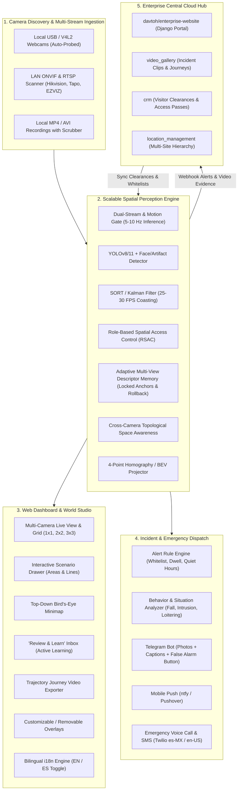
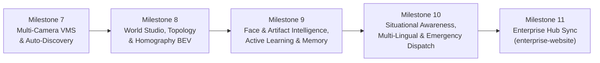

# Frontier AI Spatial Security & World Modeling Platform
## Scalable Enterprise Architecture & Phased Roadmap

---

### 1. Executive Architecture & Core Philosophy

The design philosophy of [`intelligent_tracker/high_objects.py`](intelligent_tracker/high_objects.py) (`Scene`, `Space`, `Agent`, `calibration_cubes`, `Area`, `Line`) establishes a **Spatial World Model**—a virtual representation of physical spaces where multiple cameras act as sensory perspectives projecting into a shared coordinate system, exactly like cameras and entities inside a 3D simulation or game engine.

---

### 2. Architectural Answers to System Design Inquiries

#### A. Internationalization (i18n) & Spanish Language: Django vs. Native Async i18n
- **Should we rewrite the edge engine in Django?**
  - **Verdict: NO.** Migrating the core vision engine to Django would introduce heavy blocking WSGI overhead, degrade the low-latency ASGI event loop required for 25 FPS video streaming and WebSockets, and consume 150MB+ extra RAM on edge devices (critical for Raspberry Pi).
- **The SOTA Scalable i18n Architecture (<10KB, 0ms overhead):**
  - **Backend Localization (`intelligent_tracker/i18n.py`):**
    - Standard GNU `gettext` or a lightweight JSON translation catalog (`locales/es.json`, `locales/en.json`).
    - Translates incident reports, Telegram alerts, and **Twilio Voice Call Text-to-Speech** (Twilio natively speaks Spanish with `<Say language="es-MX" voice="Polly.Mia">`).
    - Allows per-operator language settings (e.g. Operator A gets English alerts, Operator B gets Spanish).
  - **Frontend Dashboard Localization (`dashboard/static/i18n.js`):**
    - Client-side dictionary replacing DOM text via `data-i18n` attributes.
    - Instant in-browser language toggle (🇺🇸 English / 🇪🇸 Español) in the navbar without page reloads.

#### B. Custom Category Filters & Area Permissions (Role-Based Spatial Access Control - RSAC)
- **Beyond hardcoded categories:** Users can define custom categories with custom badges (e.g., `family_car`, `delivery_vehicle`, `guard_dog`, `maintenance_staff`, `vip_guest`, `unauthorized_vehicle`).
- **Interactive Permissions Matrix per Area/Line:**
  - **Allowed Categories (Whitelist):** e.g., Zone `"Driveway"` allows `family_car` and `delivery_vehicle` during 08:00–18:00; after 18:00 it triggers an alert.
  - **Restricted Categories (Blacklist):** e.g., Zone `"Vault"` strictly alerts on `customer`, `unknown`, or `unauthorized_staff`.
  - **Individual Entity Overrides:** Directly whitelist or blacklist a specific named entity (e.g. License Plate `"ABC-1234"` or Person `"Bob"`).
  - **Breach Actions:** Configurable per rule (`Ignore`, `Log Audit Only`, `Dashboard Notification`, `High Alert + Emergency Call`).

#### C. Edge Scalability & High-Performance Optimization (Minimal Compute Impact)
To ensure smooth multi-camera execution on edge hardware (Raspberry Pi 4/5, Intel NUC, or mini PC):
1. **Dual-Stream Resolution Decoupling:**
   - Ingest commercial camera **Sub-Stream** (640x360 @ 15 FPS) for AI detection and tracking (cuts CPU/TPU load by ~85%).
   - Ingest **Main Stream** (1080p/4K) on-demand only for live viewing and high-resolution evidence snapshot crops.
2. **Inference Decoupling & Motion Gating:**
   - Ingestion runs at 25 FPS. YOLO/Face inference runs at **5–10 Hz** (or is gated by ultra-fast motion detection).
   - `SortTracker` Kalman filter smoothly coast-interpolates bounding boxes to 25–30 FPS with zero perceived jitter.
3. **Non-Blocking WAL Database:**
   - SQLite running in `WAL` mode (`PRAGMA journal_mode = WAL;`) allows concurrent readers and writers without lock contention.

---

### 3. Phased Milestone Roadmap

| Milestone | Key Deliverables | Focus |
|---|---|---|
| **[Milestone 7] — Multi-Camera VMS & Camera Auto-Discovery** | • Dual Auto-Discovery: USB webcams + ONVIF WS-Discovery & LAN RTSP scan • Camera Manager UI with live snapshot preview & presets (Hikvision, Tapo, EZVIZ, Dahua) • Dynamic Multi-Stream Pool (no server restarts) + 1x1, 2x2, 3x3 grid • Local video file upload with timeline scrubber • Full system persistence, auto-boot restoration & 1-click snapshot export/import (`.zip`) | Ingestion & Core VMS |
| **[Milestone 8] — World Scenario Studio, Topology & Homography** | • In-browser interactive drawing for polygonal Areas & directional Lines • **Cross-Camera Topological Transitions** (e.g. Cam 1 Exit $\to$ Cam 2 Entrance prior) • **4-Point Ground Plane Homography** (Top-Down Bird's-Eye-View Minimap with metric speeds) • **Trajectory Journey Video Exporter** (download concatenated multi-camera video path) • Customizable/removable video overlays | Spatial Modeling |
| **[Milestone 9] — Artifact & Face Intelligence, Active Learning & Memory** | • Universal Artifact & Face Tagging (people, vehicles, pets, tools) • **Role-Based Spatial Access Control (RSAC)**: custom categories & area permissions • **Active Learning ("Review & Learn" Inbox)**: queue ambiguous detections for 1-click review • **Locked Anchor Descriptors** + Bounded EMA auto-updates + Version rollback • Pet whitelist & occlusion/clutter reasoning ($\text{IoU} > 0.3$) | Perception & Memory |
| **[Milestone 10] — Situational Awareness, Multi-Lingual & Emergency Dispatch** | • Behavioral triggers: Fall detection, loitering, perimeter breaches • Automated incident narrative synthesizer (plain-English / Spanish summaries) • **Bilingual i18n Engine**: Spanish / English language toggle for UI and alert dispatches • Multi-channel phone escalation: Telegram, Push (ntfy/Pushover), Twilio emergency calls/SMS • "False Alarm" user feedback button for negative constraint training | Intelligence & Action |
| **[Milestone 11] — Enterprise Hub Connector (`davtoh/enterprise-website`)** | • Official integration plugin in `enterprise_website/plugin_registry/` • Automated archiving of incident video clips directly into `video_gallery` • Multi-tenant central authorization & Role-Based Access Control (RBAC) • Two-way sync of authorized visitors/vehicles with `crm` and `location_management` | Enterprise Federation |

---

### 4. Detailed Milestone Specifications

#### Milestone 7: Multi-Camera VMS, Auto-Discovery & Video Source Manager
1. **Dual Camera Auto-Discovery (`intelligent_tracker/discovery.py`):**
   - **Local USB Webcams:** Probes physical hardware indices (`find_physical_cameras()`).
   - **LAN Network Camera Discovery:** Broadcasts ONVIF WS-Discovery (UDP port 3702) and probes local subnet IP ranges for open RTSP ports (`554`, `8554`, `8000`).
2. **Camera Management UI Modal (`dashboard/static/camera_manager.js`):**
   - Discovered devices list with one-click "Test Connection" button and live preview snapshot.
   - Built-in presets with URL-encoded credential builder:
     - **Hikvision:** `rtsp://{user}:{pass}@{ip}:554/Streaming/Channels/{channel}01`
     - **TP-Link Tapo:** `rtsp://{user}:{pass}@{ip}:554/stream1` (HD) or `/stream2` (SD)
     - **EZVIZ:** `rtsp://admin:{verification_code}@{ip}:554/h264/ch{channel}/main`
     - **Dahua / Imou:** `rtsp://{user}:{pass}@{ip}:554/cam/realmonitor?channel={channel}&subtype=0`
     - **Generic RTSP / NVR Channel:** Custom user-defined string.
3. **Dynamic Multi-Stream Orchestrator (`dashboard/camera_pool.py`):**
   - Manages concurrent `StreamManager` pipelines in background threads.
   - Hot-add, edit, toggle, and remove camera streams dynamically without restarting the FastAPI server.
4. **Local Video File Upload & Playback Scrubber:**
   - Upload `.mp4`, `.avi`, `.mkv` recordings via web UI into `data/videos/`.
   - In-browser playback scrubber with frame stepping, fast-forward (1x, 2x, 4x, 8x), and batch occurrence report generation.
5. **Dashboard Multi-Camera Grid View:**
   - Responsive multi-grid switcher: 1x1 (focused single view), 2x2 (quad view), and 3x3 layout.
6. **State Persistence, Auto-Restore & Full Import/Export (`intelligent_tracker/backup.py`):**
   - **Automatic Boot Restoration:** Upon application launch or server reboot, the system automatically restores all configured cameras, calibrated homography planes, drawn zones/tripwires, custom categories, enrolled entities, and notification rules without manual intervention.
   - **One-Click System Snapshot Export (`GET /api/backup/export`):** Packages all database records (`tracker.db`), thumbnail crops (`data/crops/`), scenarios, and configurations into a portable versioned `.zip` archive.
   - **Full System Import & Migration (`POST /api/backup/import`):** Allows porting the complete security configuration to another machine (e.g. migrating from development workstation to edge Raspberry Pi / Intel NUC), validating schemas, restoring database state, and hot-reloading active streams.
   - **CLI Tooling:** `python -m intelligent_tracker.backup --export backup.zip` and `--import backup.zip`.

---

#### Milestone 8: World Scenario Studio, Space Awareness & Ground Plane Homography
1. **Interactive In-Browser Scenario Studio (`dashboard/static/studio.js`):**
   - **Polygonal Areas (Zones):** Click to place polygon vertices directly on live video. Configure zone name, category filter, dwell threshold, and capacity limits.
   - **Directional Lines (Tripwires):** Click-and-drag two points to establish a line with an interactive crossing direction normal arrow (IN vs. OUT).
   - Real-time persistence: Automatically serialize zones and lines to `configs/scenarios.yaml` and SQLite `TrackerDB`.
2. **Cross-Camera Topological Space Awareness (`intelligent_tracker/topology.py`):**
   - Realize the architectural promise of [`intelligent_tracker/high_objects.py`](intelligent_tracker/high_objects.py) (`Scene`, `Area`, `Line`).
   - Define **Spatial Transition Links** between cameras (e.g., Camera 1 Area `"Door Exit"` $\leftrightarrow$ Camera 2 Area `"Door Entrance"` with transit window $T_{min} = 2s, T_{max} = 15s$).
   - When an entity exits Camera 1 through `"Door Exit"`, the tracker places a predictive prior in Camera 2's entrance zone. Re-ID matching weights this spatial prior heavily, preventing identity swapping even among visually similar individuals.
3. **4-Point Ground Plane Homography (Bird's-Eye-View Minimap):**
   - Operator selects 4 ground corners on the camera view (e.g., room corners, parking lines, doorway bounds).
   - Backend calculates `cv2.getPerspectiveTransform(src_pts, dst_pts)`.
   - Tracks' bottom-center coordinates `(x + w/2, y + h)` are mapped to metric ground coordinates `(X, Y)`.
   - Dashboard renders a real-time 2D **Top-Down Bird's-Eye Minimap** showing live agent positions, movement vectors, and zone polygons from above.
4. **Trajectory Journey Search & Video Exporter:**
   - Search any tracked entity or artifact across all historical feeds.
   - Reconstructs their complete chronological path across cameras (e.g., *10:02 Front Gate $\to$ 10:04 Front Door $\to$ 10:05 Hallway*).
   - One-click export that slices and concatenates the relevant video clips into a single downloadable MP4 journey file.
5. **Customizable & Removable Video Overlays:**
   - Floating overlay control toolbar to toggle on/off: Bounding boxes, Track IDs, Dwell timers, Velocity vectors, Zones, Tripwires, Heatmap overlay, BEV Minimap, and Live toast prompts.

---

#### Milestone 9: Artifact & Face Intelligence, Active Learning & Adaptive Memory
1. **Universal Artifact & Face Enrollment:**
   - Freeze or pause video and draw a box on *any* target: face, person, vehicle, tool, pet, or package.
   - Assign name, custom category tag, and security permissions.
   - Dual-model extraction: ONNX Face Detector (YuNet/UltraFace) + OSNet Deep Feature Extractor.
2. **Role-Based Spatial Access Control (RSAC):**
   - Define custom categories with custom color badges (`family_car`, `delivery_truck`, `cleaning_crew`, `guard_dog`).
   - Configure per-area permission matrix: Whitelisted categories, time-of-day schedules, and entity-specific overrides.
3. **Human-in-the-Loop Active Learning ("Review & Learn" Inbox):**
   - Ambiguous or low-confidence detections ($0.45 < \text{sim} < 0.70$) automatically queue into a dedicated **"Review & Learn"** dashboard tab.
   - Operator actions with single click: **Confirm (Ground Truth)**, **Reassign**, **Enroll as New Entity**, or **Dismiss**.
   - Optional Live Toast prompt (toggleable on/off in settings).
4. **Locked Anchor Descriptors & Versioned Memory Rollback:**
   - **Locked Anchors:** User-confirmed crops are marked as "Locked Anchors" (ground truth) and can never be overwritten by continuous learning.
   - **Bounded EMA Updates:** Automated multi-view discoveries update the running centroid using bounded weight.
   - **Descriptor Version History:** In `TrackerDB`, keep historical snapshots of identity signatures. If poor lighting or occlusion corrupts an entity's profile, the operator can click **"Rollback to Previous Version"**.
5. **Pet Whitelist & Occlusion Reasoning:**
   - Whitelists family pets (`dog`, `cat`) to eliminate perimeter alarms.
   - Intersecting tracks ($\text{IoU} > 0.3$) are flagged as `"Cluttered / Interacting"` to hold Re-ID identity frozen until physical separation, preventing ID swaps.

---

#### Milestone 10: Situational Awareness, Multi-Lingual & Emergency Dispatch
1. **Behavioral Situation Triggers:**
   - **Fall Detection:** Sudden aspect ratio inversion from vertical ($h > w$) to horizontal ($w > 1.8 \cdot h$) combined with velocity collapse on the calibrated ground plane.
   - **Loitering / Suspicious Dwell:** Entity lingering within an Area beyond configured duration threshold.
   - **Quiet Hours & Perimeter Breaches:** Time-of-day access schedules per zone.
2. **Automated Incident Narrative Synthesizer & Bilingual i18n:**
   - Automatically generates structured, plain-English or Spanish incident reports:
     > *"🚨 **INTRUSIÓN CRÍTICA DETECTADA** | 23:14:02 **Ubicación:** Almacén Norte — Zona Perimetral A (Cámara: Patio 02) **Entidad:** Persona no identificada (Hombre, chaqueta oscura, 0.42 coincidencia con Alice) **Comportamiento:** Entrada en Horas Silenciosas; permaneció 42 segundos cerca de la puerta trasera. **Adjunto:** Fotos de alta resolución de rostro y cuerpo completo."*
   - Dashboard UI language toggle (🇺🇸 English / 🇪🇸 Español) stored in `localStorage`.
3. **Multi-Channel Mobile Alerting & Emergency Dispatch:**
   - **Telegram:** Instant Markdown alert with attached snapshot photo and inline action buttons.
   - **Mobile Push (ntfy.sh / Pushover):** Native push notifications directly to iOS and Android devices with high-priority bypass for quiet hours.
   - **Emergency Voice Call & SMS (Twilio Integration):** Automated phone call playing text-to-speech incident audio (in selected language) and SMS broadcast for high-severity alarms.
4. **False Alarm Suppression through User Feedback:**
   - Interactive **"False Alarm"** button in web notifications and Telegram alerts.
   - Clicking "False Alarm" registers a negative constraint for that specific track/lighting in `TrackerDB`, automatically refining rule thresholds and diminishing repeat false positives.

---

### 5. Cross-Repository Integration Contract with `davtoh/enterprise-website`

Both repositories are developed under the same organization account ([`davtoh`](https://github.com/davtoh)):
- Edge Vision Microservice: [`davtoh/intelligent-tracker`](https://github.com/davtoh/intelligent-tracker)
- Enterprise Cloud Portal: [`davtoh/enterprise-website`](https://github.com/davtoh/enterprise-website)

#### A. Microservice Interface Contract
1. **Event Dispatching to Central Portal:**
   - `intelligent-tracker`'s `WebhookDispatcher` posts security events to:
     `POST https://<enterprise-domain>/api/v1/security/events/`
   - Payload schema includes: `event_type`, `camera_id`, `site_id`, `timestamp`, `confidence`, `snapshot_base64`, and metadata.
   - Authenticated via shared Bearer API Token or HMAC signature (`X-Tracker-Signature`).
2. **Video Clip Ingestion into `video_gallery`:**
   - Sliced intrusion or journey video clips are published to `enterprise-website` via:
     `POST https://<enterprise-domain>/api/v1/gallery/upload/`
   - Automatically populates Django's `VideoItem` model with:
     - `title`: e.g., *"Intrusion Sighting: Unidentified Person in Vault"*
     - `source_type`: `"mp4"`
     - `video_file`: Uploaded MP4 file stored in media storage
     - `gallery`: Assigned to the site's security audit gallery.
3. **Visitor & Clearance Whitelist Synchronization:**
   - `intelligent-tracker` fetches whitelisted entities and VIP clearances from:
     `GET https://<enterprise-domain>/api/v1/security/whitelist/`
   - Synchronizes names, categories, and facial signature embeddings into local edge `TrackerDB` cache for offline-tolerant matching.
4. **Central Multi-Site Hierarchy:**
   - Uses `enterprise-website/location_management` to organize multiple edge cameras by `Site` $\to$ `Building` $\to$ `Room/Floor`.
